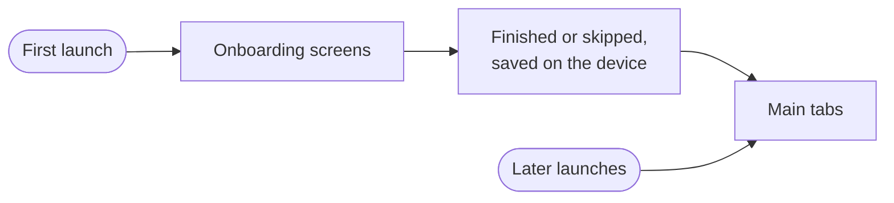

# App shell

The app shell is the base of the Gelpy app. It holds navigation, first-launch onboarding, the language and theme settings, and the layout for phones and browsers. Sign-in, in production since 2026-11-07, is built inside it, and later features, such as requests, will be too.

:::note Status

The app shell runs in production on the web, since app release 0.2.0 (2026-11-03). On Android, it is in the production Android build since 2026-11-08. That build is installed as an APK; the app is not on Google Play.

:::

The same app runs on Android and in the browser.

## Navigation

The app has three main tabs, in this order:

| Tab | Spanish label | Today |
|-----|---------------|-------|
| Home | Inicio | The starting screen. It shows a "coming soon" view. |
| Tasks | Tareas | It shows a "coming soon" view. |
| Profile | Perfil | Account (photo or a silhouette, name, email, a phone row, and Passkeys), the language and theme settings, Preferencias › Notificaciones on Android, and a footer with the app and API versions. |

On Android and on phones, the tabs stay at the bottom of the screen. On the web, tablets (768 to 1023 px) use an 88 px side rail, and desktops (1024 px and wider) use a 240 px sidebar. On the web, each tab has its own address, so links and the browser's back button work.

## Onboarding

- On first launch, the app shows a short set of onboarding screens before the tabs.
- People can skip onboarding at any time.
- Once onboarding is finished or skipped, the app remembers it on the device and goes straight to the tabs from then on.
- On Android, one screen asks for Android's notification permission. People can say "Not now", and onboarding does not ask again. The permission alone turns on no notification: "Novedades de Gelpy" turns on only with its switch in Profile. The web skips this step.

## Languages

- The app is available in Spanish and English. Spanish is the default.
- People change the language in Profile. All visible text changes at once, without restarting the app.
- The choice is saved on the device and kept the next time the app opens.
- Every text exists in both languages, and tests check that none is missing.
- On the web, the page language is updated too, so screen readers and translation tools read it correctly.

## Themes

- People choose between three options in Profile: **System**, **Light**, and **Dark**.
- **System** is the default and follows the device setting.
- The choice is saved on the device and kept across restarts.
- Colors, type, and spacing come from the Gelpy design system. Dark mode uses deep navy surfaces.
- Text meets WCAG AA contrast in light and dark. An automated accessibility test checks it.

## Screen sizes

The web app adapts to phones, tablets, and desktops. Tests check three width classes at 9 viewports.

## Local preferences

Language, theme, and onboarding progress are stored only on the device, as local preferences. They contain no personal data. Sign-in credentials will never be stored with them.

## Related pages

- [Architecture overview](./overview.md)
- [Data flow](./data-flow.md)
- [Push notifications](./push.md)
