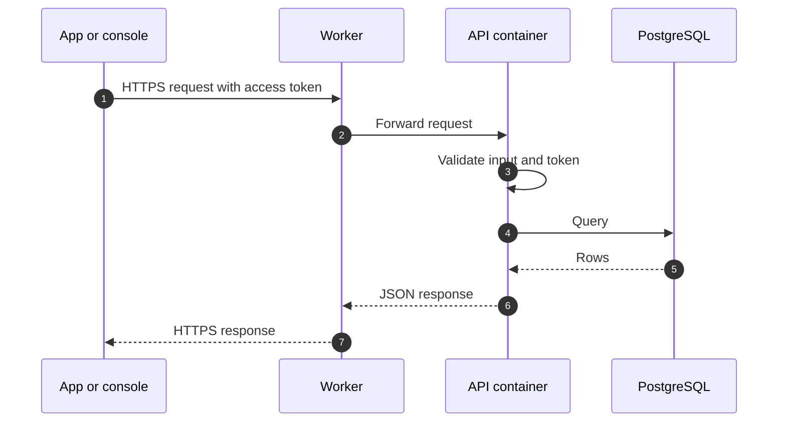

# Data flow

This page shows how data moves through the Phase 1 system that runs today.

## Request path

- All traffic uses HTTPS.
- The API validates request input with schemas (Zod) before it uses it.

## Sign-in

People register with email and password, confirmed by an email link, or with Google. A phone number is added later and verified by SMS. Sessions use refresh tokens that work once. See [Identity and sign-in](../security/identity.md) for the flows, their status, and how identity data is handled.

## Notifications

Push notifications are in production since 2026-11-08. On Android, people choose whether to get them. The app registers the device with the API, the API sends each notification through a push relay and a push service, and it records each delivery so the same notification is not sent twice. See [Push notifications](./push.md).

## Data at rest

- The database is the system of record.
- Personal data is limited to what the product needs:
  - Name, email, phone number, and the Google profile photo
  - Each Android installation's push token, with its notification preferences and delivery records
  - Passkey public keys
  - The record of accepting the legal texts, with the versions of the texts
- Test data never comes from production.

## Related pages

- [Architecture overview](./overview.md)
- [Push notifications](./push.md)
- [Security overview](../security/overview.md)
