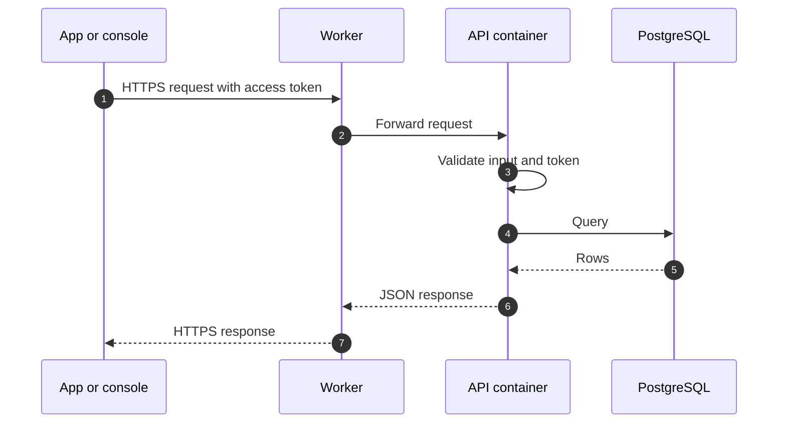

# Data flow

This page shows how data moves through the planned Phase 1 system. It describes the design, not a running service.

## Request path

- All traffic uses HTTPS.
- The API validates request input with schemas (Zod) before it uses it.

## Sign-in

People register with email and password, confirmed by an email link, or with Google. A phone number is added later and verified by SMS. Sessions use refresh tokens that work once. See [Identity and sign-in](../security/identity.md) for the flows, their status, and how identity data is handled.

## Notifications (planned)

On Android, people choose whether to get push notifications. The app registers the device with the API, the API sends each notification through a push service, and it records each delivery so the same notification is not sent twice.

## Data at rest

- The database is the system of record.
- Personal data is limited to what the product needs: name, email, and phone number.
- Test data never comes from production.

## Related pages

- [Architecture overview](./overview.md)
- [Security overview](../security/overview.md)
