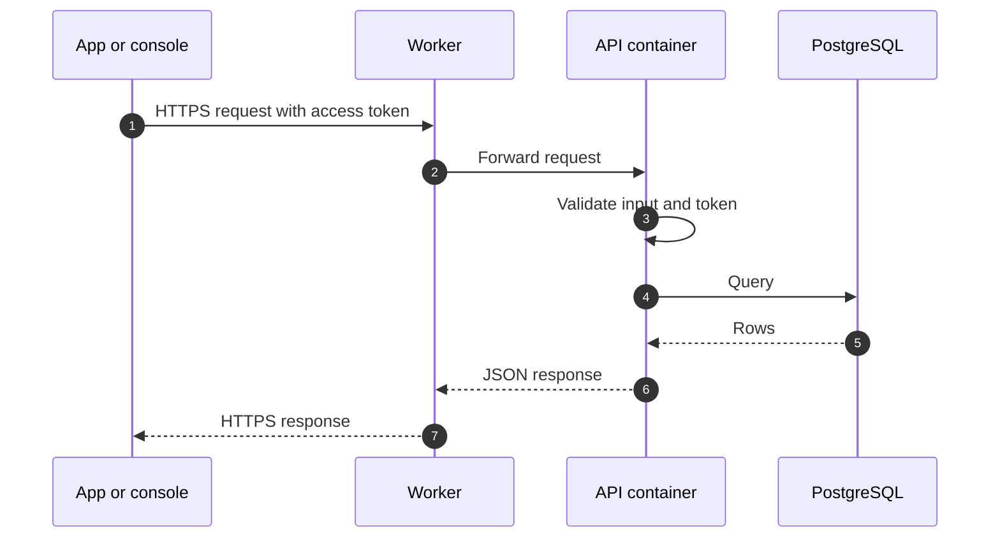
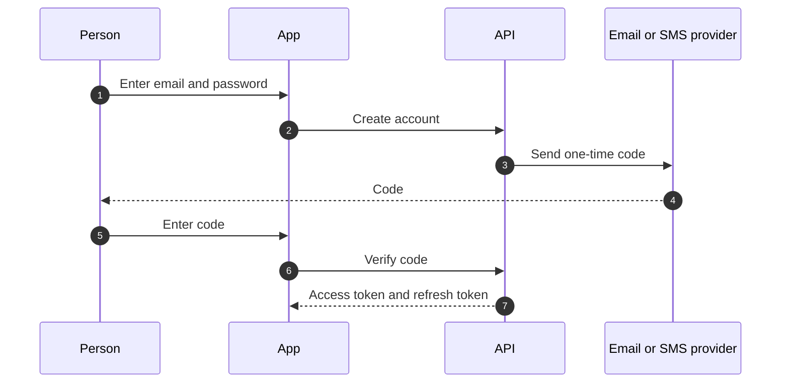

# Data flow

This page shows how data moves through the planned Phase 1 system. It describes the design, not a running service.

## Request path

- All traffic uses HTTPS.
- The API validates request input with schemas (Zod) before it uses it.

## Sign-in (planned)

People sign in with Google or with email and password. A one-time code (OTP) by email or SMS verifies the account. On Android, people can turn on biometric unlock, and on Android and web they can register a passkey that the server verifies.

- Passwords are stored only as salted hashes.
- One-time codes are stored only as hashes. They expire after 10 minutes, allow at most 5 attempts, and are never written to logs.
- Each refresh token works once: using it issues a new one. Signing out revokes it.
- Passkey challenges expire and cannot be reused.

## Notifications (planned)

On Android, people choose whether to get push notifications. The app registers the device with the API, the API sends each notification through a push service, and it records each delivery so the same notification is not sent twice.

## Data at rest

- The database is the system of record.
- Personal data is limited to what the product needs: name, email, and phone number.
- Test data never comes from production.

## Related pages

- [Architecture overview](./overview.md)
- [Security overview](../security/overview.md)
