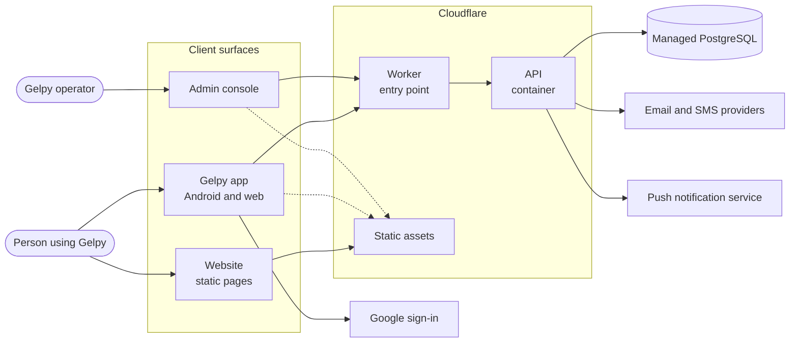
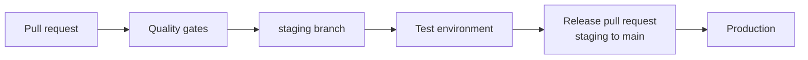

# Architecture overview

Gelpy connects general-services professionals with people who need help, with safety and trust. Phase 1 builds the application base: accounts, sign-in, app navigation, and notifications. Phase 2, the controlled marketplace pilot, opened on 2026-11-08; in production it stays off behind the pilot invitation gate.

:::note Status

The app on the web (since 2026-11-03), identity (since 2026-11-07), and push notifications and the legal pages (since 2026-11-08) are in production. A capability is documented as available only after it reaches production; the rest is marked as planned.

:::

## System context

## Components

| Component | Role | Technology |
|-----------|------|------------|
| App | The product people use, on Android and in the browser | Expo, React Native, TypeScript, Expo Router, TanStack Query |
| Website | Public pages in Spanish and English | Nuxt (static generation), TypeScript, Tailwind CSS |
| Admin console | Internal administration for Gelpy operators | Next.js, TypeScript, Tailwind CSS |
| API | Business logic, authentication, and data access | Node.js, Express, TypeScript, Zod, Prisma client |
| Database | System of record | Managed PostgreSQL with SQL migrations |
| Design system | Shared design tokens and assets | Design tokens, SVG assets |
| Engineering docs | This site | Docusaurus on Cloudflare Workers |

## Runtime platform

- The API runs as a container on Cloudflare Containers, behind a Cloudflare Worker that receives every request.
- The app, the website, and the admin console are served as static assets from Cloudflare.
- The database is managed PostgreSQL. The API container connects to it through the database provider's connection pooler.
- There is no self-managed server.

## Environments

There are two environments: **test** and **production**. Each one has its own Worker, database, secrets, OAuth clients, and passkey configuration. Test never holds production personal data.

## Build and release flow

- Work starts on a branch and merges into `staging` after the quality gates pass. `staging` deploys to the test environment.
- A release pull request promotes `staging` to `main`, which deploys to production. It needs explicit owner approval.
- While the API builds on Cloudflare Workers Builds (November 2026), production rebuilds the same source tree that was tested on `staging`.
- CI/CD runs on Cloudflare Workers Builds, and each production build creates a GitHub Release.
- Releases follow Semantic Versioning. Each release gets a Git tag and release notes from the changelog.

## Data model ownership

SQL migrations are the only source of the database schema. The API generates its database client from that schema and never changes the schema itself. Migrations run before the API deploys and follow the expand-and-contract pattern, so old and new API versions work during a release.

## Related pages

- [Data flow](./data-flow.md)
- [App shell](./app-shell.md)
- [Push notifications](./push.md)
- [Commercial website](./website.md)
- [Security overview](../security/overview.md)
