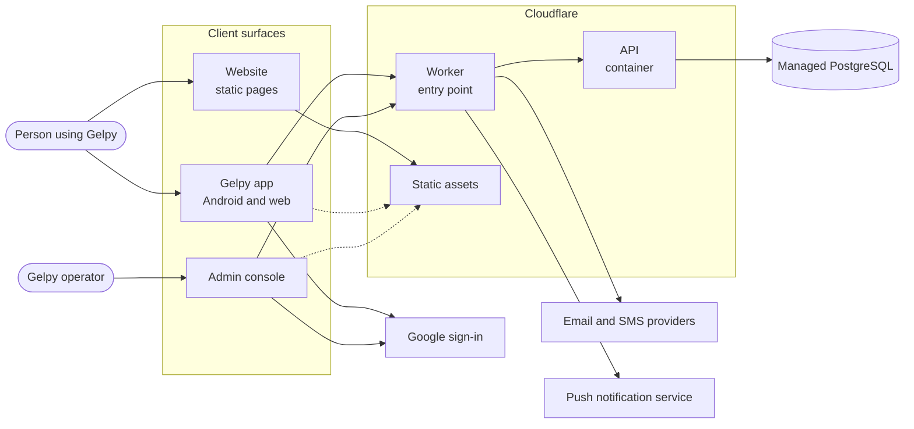
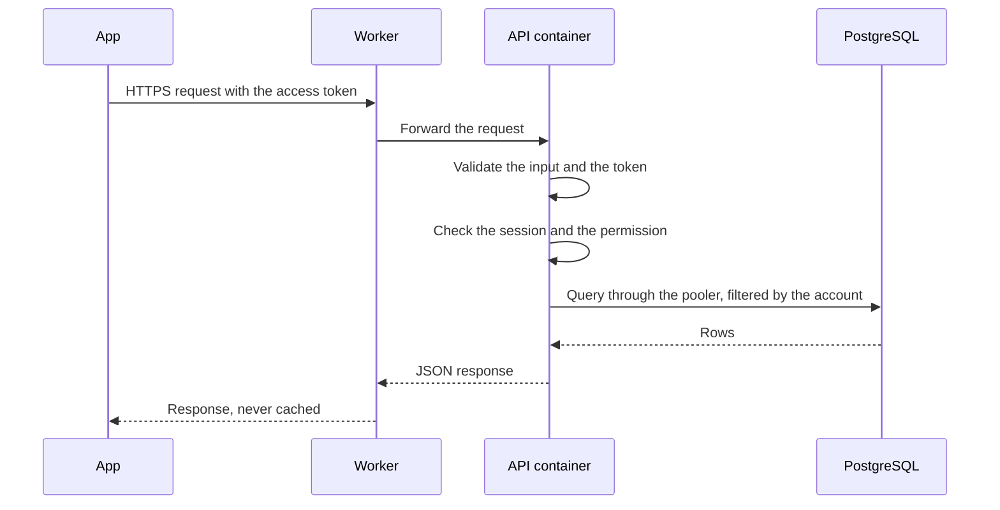
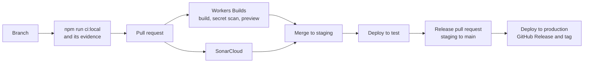

# Architecture overview

Gelpy connects general-services professionals with people who need help, with safety and trust. Phase 1 builds the application base: accounts, sign-in, app navigation, and notifications. Phase 2, the controlled marketplace pilot, opened on 2026-11-08; in production it stays off behind the pilot invitation gate.

:::note Status

These parts are in production:

- the app shell on the web, since 2026-11-03;
- accounts and sign-in, since 2026-11-07;
- the first production Android build, push notifications, the admin console, and the legal pages of the website, since 2026-11-08.

A capability is documented as available only after it reaches production; the rest is marked as planned. See [What is in production](../product/overview.md).

:::

## System context

Two kinds of people use Gelpy through three surfaces. Every surface talks to one API, and only the API reads and writes the database.

## Components

| Component | Role | Technology |
|-----------|------|------------|
| App | The product people use, on Android and in the browser | Expo, React Native, TypeScript, Expo Router, TanStack Query |
| Website | Public pages in Spanish and English | Nuxt (prerendered), Vue, TypeScript, Tailwind CSS |
| Admin console | Administration for the Gelpy team | Next.js (static export), React, TypeScript, Tailwind CSS |
| API | Business logic, authentication, and data access | Node.js, Express, TypeScript, Zod, Prisma client |
| Database | System of record | Managed PostgreSQL 17, with SQL migrations and a small Node migrator |
| Design system | Brand tokens and assets | A versioned package of design tokens and SVG assets |
| Engineering docs | This site | Docusaurus on Cloudflare Workers |

## Runtime platform

- **The Worker** receives every request. It starts the API container when needed, forwards the request, and relays the API's email, SMS, and push messages to their providers.
- **The API** runs as a container on Cloudflare Containers. It validates every input with a schema, checks the token and the session on protected routes, and checks the admin permission on console routes. It is the only component that reaches the database.
- **The database** is managed PostgreSQL. The API connects to it through the provider's connection pooler (ADR-0016). It has two roles: one owns the schema and is used only by migrations, and the runtime role reads and writes data but cannot change the schema.
- The app, the website, and the admin console are served as static assets from Cloudflare.
- There is no self-managed server.

## A request from end to end

A signed-in person opens a screen of the app that needs data.

## Environments

There are two environments: **test** and **production**.

| | Test | Production |
|---|---|---|
| Branch | `staging` | `main` |
| Android | The internal preview build | The production build |

Each environment has its own Workers, database, secrets, OAuth clients, and passkey configuration. Test never holds production personal data, and a test credential is never valid in production.

## Build and release flow

- Work starts on a branch and merges into `staging` after the local gate and the pull request checks pass. `staging` deploys to test.
- A release pull request promotes `staging` to `main`, which deploys to production. It needs the owner's explicit approval.
- While the builds run on Cloudflare Workers Builds, production rebuilds the same source tree that was tested on `staging`.
- **MVP mode, until 2026-11-30 (ADR-0018):** the tests run only in each repository's local gate, and its evidence goes on the pull request. Cloudflare Workers Builds builds, scans for secrets, publishes the preview, and deploys. The GitHub workflows stay as a manual failover.
- Releases follow Semantic Versioning. Each production deploy creates a GitHub Release and a tag, with notes from the changelog (ADR-0004).

The gates of each component are on the [Quality overview](../quality/overview.md).

## Data ownership

| Data | Owner | Rule |
|------|-------|------|
| The schema | The database repository | SQL migrations are the only source. The API generates its client from them and never changes the schema. Migrations run before the API deploys and follow expand and contract, so the old and the new API version both work during a release (ADR-0009) |
| Accounts, sessions, profiles | The API, in PostgreSQL | Each account has a UUID, and sensitive queries filter by it. Passwords are stored only as salted hashes; passkey private keys are never stored |
| Design tokens | The design system | No color, font family, or logo is hard-coded outside it (ADR-0010) |
| Website content | The website repository | Files in the repository, in Spanish and English |
| Analytics | Planned, behind consent | Third parties would get a pseudonymous analytics ID, never the account ID (ADR-0020) |

## Decisions

| ADR | What it decides |
|-----|-----------------|
| 0002 | One repository per deployable, plus one for governance |
| 0005 | Two environments: `staging` is test and `main` is production |
| 0006 | Cloudflare as the platform |
| 0009 | SQL migrations are the source of the schema |
| 0016 | The API connects through the provider's pooler |
| 0017 | Validate once, deploy on merge, no deploy secrets in pull requests |
| 0018 | CI/CD on Cloudflare Workers Builds, and the MVP mode |
| 0020 | Measurement by design, behind consent |

## Related pages

- [Data flow](./data-flow.md)
- [App shell](./app-shell.md)
- [Push notifications](./push.md)
- [Commercial website](./website.md)
- [Quality overview](../quality/overview.md)
- [Security overview](../security/overview.md)
