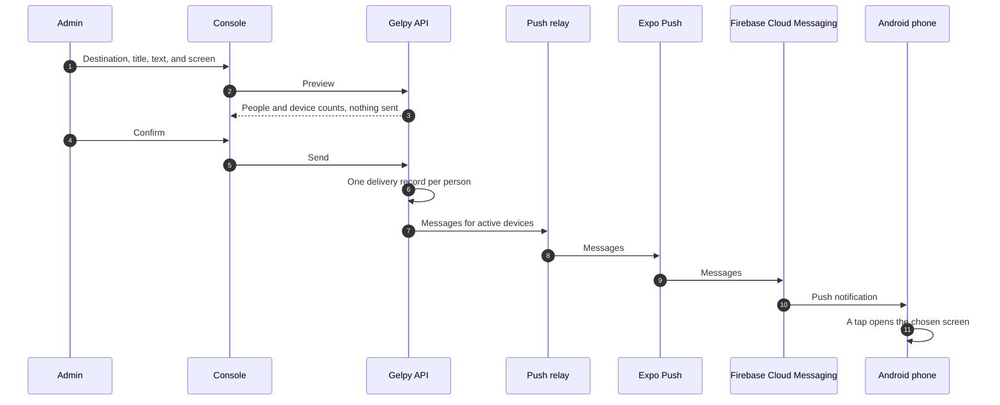

# Push notifications

This page describes how Gelpy sends push notifications: how people opt in, how devices register, how a send travels to the phone, and how admins send and follow notifications from the console. It describes flows, not screens.

:::note Status

Push notifications are in production since 2026-11-08: in the API, in the app in the production Android build, and in the admin console. The owner's end-to-end check in production passed on 2026-11-08. The production Android build is installed as an APK; the app is not on Google Play.

:::

| Capability | Status |
|------------|--------|
| The "Novedades de Gelpy" type on Android, opt-in | Production |
| Device registration and revocation | Production |
| Sending from the console, with preview and history | Production |
| Delivery receipts, processed on demand | Production |
| Push in the browser, and iOS | Planned, out of the current scope |
| Scheduled receipt processing | Planned |
| An identical send repeated within 10 minutes returns the stored send | Planned |
| Deleting the stored token when a device is revoked | Planned |
| Console roles per feature | Planned |
| A transactional type for the marketplace pilot | Planned |
| Deactivated accounts leave the audiences | Planned |

## Notification type and opt-in

There is one notification type: **Novedades de Gelpy** (Gelpy news). It is classed as promotional, so it is opt-in and off by default. A type with no stored preference counts as off.

- Push works on Android only. On the web the setting is hidden, and there is no browser push.
- People turn it on in Profile (Spanish labels: Perfil › Preferencias › Notificaciones › Novedades de Gelpy). Turning it on also needs Android's notification permission.
- The Android onboarding has a screen that asks for the notification permission, but only the Profile switch turns the type on.
- Tapping a notification opens the app screen that the sender chose from a list of allowed screens.
- A send from the console always arrives as a push, never as an email.

## Devices

Each installation of the app registers its own device:

- An installation registers after sign-in or a session restore, when the person turns the switch on and grants the permission. Without the permission, no device is registered.
- A person can register or revoke only their own device. Another user's device answers "not found".
- At sign-out, the app revokes this installation's device before it clears the session. A failed revocation never blocks sign-out.
- When a delivery receipt says the device is no longer registered, the device is deactivated.

Revoking a device deactivates it. Deleting the stored token when a device is revoked is planned.

## Send path

- The API container never holds the push service's access credential. A separate edge relay holds it and is the only component that talks to the push service. SMS uses the same pattern.
- A send reaches only people with an active device and the type turned on.
- Each send keeps one delivery record per person, with a deduplication key, so running a send again never sends a second message.

## Delivery receipts

Receipts are processed on demand, with no scheduled job. Delivery statuses move from sent to delivered or failed when the console reads the history or an admin presses "Actualizar estados" (update statuses). Until then, statuses can lag. Scheduled receipt processing is planned.

## Admin console

The console is in production since 2026-11-08. Only admins with a Google account of the `gelpy.app` organization can enter it. The menu follows the permissions the API returns: `console:access`, `push:read`, and `push:send`. In production every admin holds all three; console roles per feature are planned.

The console works in Spanish and English, in light and dark, on desktop and phone.

### Send

- A destination: one user found by email, all Gelpies, all Gelpers, or both.
- A title of up to 65 characters and a text of up to 240.
- The app screen to open when the notification is tapped.
- A preview, checked before any request.
- The API returns the people and device counts without sending ("N personas · M dispositivos"). The send posts only after confirmation, and the stored counts equal the preview.
- An email with no account answers "not found" and stores nothing.

### History

- Sends appear newest first.
- Each send has a detail view with delivery counts by status, the sender, and failure codes.
- "Actualizar estados" processes the pending receipts.
- The history shows the active-device totals for Gelpies, for Gelpers, and overall.

## Audit and privacy

- Each send stores who sent it, the audience, the content, and the counts, plus one audit event with the admin's ID and the send's ID.
- No log line or audit row holds an email. The email typed to find a recipient is never logged.
- No API answer holds a push token, and no log holds a push token or an access token.
- Admin answers that show emails go only to holders of `push:read`, and they are never cached.

## Related pages

- [Data flow](./data-flow.md)
- [App shell](./app-shell.md)
- [Identity and sign-in](../security/identity.md)
