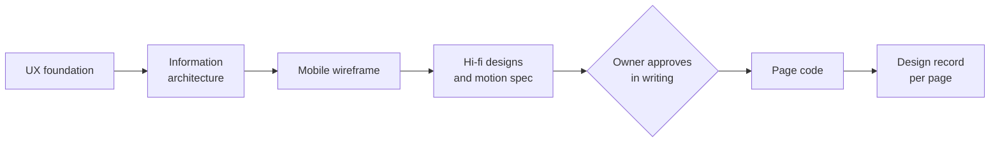
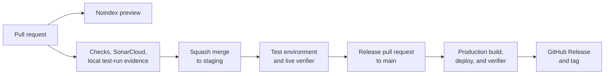

# Commercial website

This page describes the public website at `gelpy.app`: how it is built, which routes it serves, which checks every change passes, how its pages are designed, how it will be measured, and how it is deployed.

:::note Status

The website is in production since version 0.6.0 (2026-11-08); the production check found 20 pages and 0 problems. Production is served with noindex: indexing waits for the owner's approval, and there is no indexing during the pilot. The site has no login and makes no calls to the product API.

:::

## Stack

The stack is set by an architecture decision (ADR-0013):

- **Nuxt** (Vue 3, TypeScript) with static generation. Every route is prerendered to complete HTML that reads without JavaScript.
- **Cloudflare Workers static assets**, with no Worker script. The site serves a real localized 404 and adds trailing slashes automatically.
- **Styles only from the Gelpy design system**: its Tailwind preset, tokens, motion tokens, and the self-hosted Urbanist type.
- **Motion** is CSS first, with View Transitions between pages and GSAP only where needed. It animates only transform and opacity, and reduced motion turns it off.
- **No i18n runtime**. A route hook adds the English routes. Removing the runtime cut the initial JavaScript from 99.8 to 77.3 KB gzip per route.

## Languages

- Spanish (es-PE) lives at `/` and English under `/en/`. Each language is written natively, not translated word for word.
- The language and theme controls sit at the top right.
- Each page declares reciprocal canonical and hreflang links (es-PE, en, and x-default).

## Routes

| Page | Spanish | English | Notes |
|------|---------|---------|-------|
| Home | `/` | `/en/` | The hero plays the splash animation once |
| Gelpers | `/gelpers/` | `/en/gelpers/` | |
| Gelpies | `/gelpies/` | `/en/gelpies/` | |
| Companies | `/empresas/` | `/en/companies/` | |
| Help | `/ayuda/` | `/en/help/` | FAQPage data with exactly the 8 visible questions |
| About | `/nosotros/` | `/en/about/` | |
| Safety | `/seguridad/` | `/en/safety/` | Each safety claim cites a Done Work Item |
| Privacy | `/privacidad/` | `/en/privacy/` | Draft |
| Cookies | `/cookies/` | `/en/cookies/` | Draft |
| Terms | `/terminos/` | `/en/terms/` | Draft |
| Not found | localized 404 | localized 404 | A real 404 status |

Planned routes:

- The complaints book page (`/libro-de-reclamaciones/` and `/en/complaints-book/`): on test since 2026-11-10, production with the next web release.
- `/legal/versions.json`, the list of legal text versions.
- `/.well-known/assetlinks.json`, the Digital Asset Links file that passkeys on Android need.

## Shell

- A 64 px sticky header with four pages. "Abrir la app" (open the app) opens the app in a new tab.
- Below 768 px, the header turns into a hamburger menu.
- The home hero plays the splash animation once, for about 3.3 s.
- The footer has 9 page links and a "Tecnología" group that links the engineering portal, the wiki, and the console.
- The copyright line shows the site version.

## Legal pages

- The privacy, cookies, and terms pages are drafts since 2026-11-08. Each shows the notice "Borrador en revisión / Draft under review" and the version date 2026-11-08.
- The build refuses any bracketed placeholder, so no unfinished text can ship.
- Since 2026-11-08, signing up in the app requires accepting the terms and the privacy policy.
- Planned: a lawyer's approval that removes the draft notice, and a second privacy version with version labels and published text hashes.

## Quality gates

### Lab budgets

These are lab measurements that every change is held to, not promises about every visit:

| Budget | Limit |
|--------|-------|
| Lighthouse mobile performance | ≥ 90 |
| Lighthouse accessibility | 100 |
| Largest Contentful Paint (LCP) | ≤ 2.5 s |
| Cumulative Layout Shift (CLS) | ≤ 0.1 |
| Total Blocking Time (TBT) | ≤ 200 ms |
| Initial JavaScript per page | ≤ 100 KB gzip |
| Touch targets | ≥ 48 px |
| Primary call to action | Visible at 360 × 640 |
| Horizontal scroll | None from 320 to 1366 px |
| Contrast | WCAG AA, light and dark |
| Animation length | Nothing but the hero animates longer than 600 ms |

Recorded lab results, on the test environment on 2026-11-05 and 2026-11-06: median mobile LCP of 2.14 s on `/` and 2.13 s on `/en/`, CLS of 0, and TBT medians from 0 to 32 ms.

### Checks on every pull request

- Dependency audit, with 0 high or critical findings
- Lint, brand lint, and type check
- Tests with at least 90% coverage
- Build
- A site verifier: canonical and alternate links, `lang`, one `h1`, a `main` landmark, a skip link, JSON-LD, local links, the Open Graph image, the noindex policy, and a real 404
- A claims check: every public claim has evidence, and a denylist has 0 matches
- axe, with 0 violations
- Lighthouse CI
- The bundle-size check
- The motion-budget test
- The SonarCloud quality gate

## Content rules

- No invented metrics, testimonials, logos, or partner counts.
- The vision is never written in the present tense.
- No 24/7 support, guarantees, verification, or premium plans until they exist.
- No promises about search ranking.
- Marketplace features are never presented as available.

## Design flow

- Each page is designed in Claude Design before any code: the UX foundation, the information architecture, a mobile wireframe, and hi-fi designs at 360, 390, 768, and 1280 px, in light and dark, in Spanish and English, plus a motion spec.
- The owner approves the design in writing before the page code starts.
- Each page has a design record. Every visible change updates its design in the same pull request.
- Since 2026-11-09, a Product Designer designs every new screen with all its states.
- Visual work runs the brand checklist, and copy runs the public-claims audit.

## Measurement

Today, no analytics, tag manager, or session-recording provider loads on `gelpy.app`, and there is no consent banner. What exists today:

- The lab records above
- An internal visibility checklist
- The live verifier after every deploy

Planned, in this order:

1. A consent controller. Nothing loads before consent. Analytics and experience are separate purposes. Consent can be withdrawn from the footer. The banner works with the keyboard. Rejecting removes the providers. Advertising signals stay denied. Google tools load only through Tag Manager, and session recording masks content.
2. Google Analytics 4, Google Tag Manager, and Microsoft Clarity in production, after the lawyer's approval.

## Deploy

- The website builds on Cloudflare Workers Builds since 2026-11-06; the website was the pilot of that move.
- Every push to a pull request builds a noindex preview.
- Before merge, a pull request needs a comment with the local test-run evidence for its head commit, a green SonarCloud gate, a green cloud build, and a branch that is up to date.
- A squash merge to `staging` deploys the test environment, and the live verifier checks it.
- A release pull request from a release branch to `main` needs the owner's explicit approval.
- The `main` build runs a secret scan of the merged commits, the production build and deploy, and the live verifier, and then creates the GitHub Release and its tag.
- GitHub Actions workflows stay as a failover that runs only by hand.

## Related pages

- [Architecture overview](./overview.md)
- [Fingerprint unlock and passkeys](../security/biometrics-passkeys.md)
