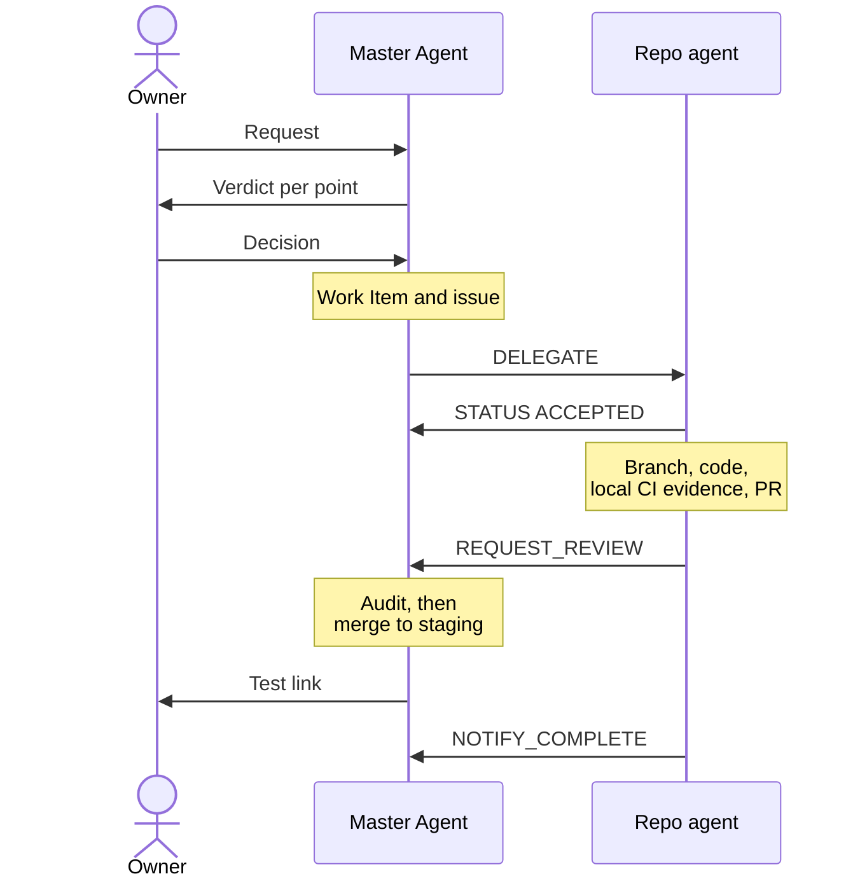

# The agent team

Each agent has one area. It owns that area and never works outside it.

| Agent | Owns | Never does |
|-------|------|------------|
| Master Agent | Specs, Work Items, governance, the cross-repo plan, delegation, status, audits and merges of PRs | Write product code |
| Agent Infra | Cloudflare platform, DNS, environments, the secret inventory (names only), observability, quality tooling (`infrastructure/`) | Edit product repos |
| Agent API | `gelpy-api`: Express, TypeScript, Prisma, Clean Architecture, Cloudflare Containers | Change the schema (that is Agent DB's job) |
| Agent DB | `gelpy-db`: SQL migrations, the only source of the schema (ADR-0009) | Touch production outside an approved release |
| Agent App | `gelpy-app`: Expo app for Android, iOS, and web | Code a screen without an approved design |
| Agent Web | `gelpy-web`: Nuxt commercial website, web motion, HyperFrames video | Publish copy that fails the public-claims rules |
| Agent Console | `gelpy-console`: Next.js admin console | Ship a screen without an approved design |
| Agent Design | `gelpy-design-system`: tokens, assets, `BRAND.md`; the only agent that changes brand assets | Let other repos hard-code brand values |
| Agent Docs | `Gelpy/gelpy`: this public site and its wiki mirror | Publish secrets, internal hosts, personal data, or open vulnerabilities |
| Business Coach | Business strategy for Peru (validation, economics, growth, financing); the `business/` memory | Authorize implementation, spending, publication, or production |
| Legal Peru | Peruvian legal research from official sources, and legal drafts | Act as a lawyer (drafts need a lawyer's approval) |
| Marketing | Positioning and growth experiments for both sides of the marketplace in Peru | Run campaigns or spend without the owner |
| Temporary specialists | One discipline and one question at a time (for example, finance) | Delegate further |
| Codex | Second executor on `codex/` branches, and reviewer of release PRs | Approve by silence: no answer is not an approval |

## How they run

- Each repo agent works in its own cloud session, in parallel. The Master coordinates them.
- A repo agent never edits another repo. It sends a `REQUEST_CHANGE` to the agent that owns it.
- **Transfers between sessions.** When an agent cannot push, it hands over its commits as a patch with a checksum manifest. The receiver checks every checksum and the resulting git tree before it pushes.
- The Master audits every PR before merge: secrets, scope, evidence, and design match.

## Message protocol

The skill `gelpy-orchestrate-agents` defines the protocol.

| Request | Use |
|---------|-----|
| `DELEGATE` | Assign a Work Item to an agent |
| `REQUEST_CHANGE` | Ask the owner of another repo for a change |
| `REQUEST_REVIEW` | Ask for a review of finished work |
| `REQUEST_INFO` | Ask for a missing fact |
| `NOTIFY_COMPLETE` | Report that work is complete |
| `NOTIFY_BLOCKED` | Report that work is blocked |

- Each request carries From, To, Work Item, Priority, Context, Dependencies, and Artifacts.
- Replies are `STATUS` messages: `ACCEPTED`, `COMPLETED`, `BLOCKED`, or `NEEDS_INFO`.
- **Disagreement.** A repo agent that disagrees with a `DELEGATE` answers `STATUS: NEEDS_INFO` with its verdict. The Master takes it to the owner, who decides.

## One Work Item, end to end

## Related pages

- [Gelpy Agentic Framework](./overview.md)
- [Skills](./skills.md)
- [Work Items and sprints](./work-items.md)
- [Owner rules and safety](./rules.md)
