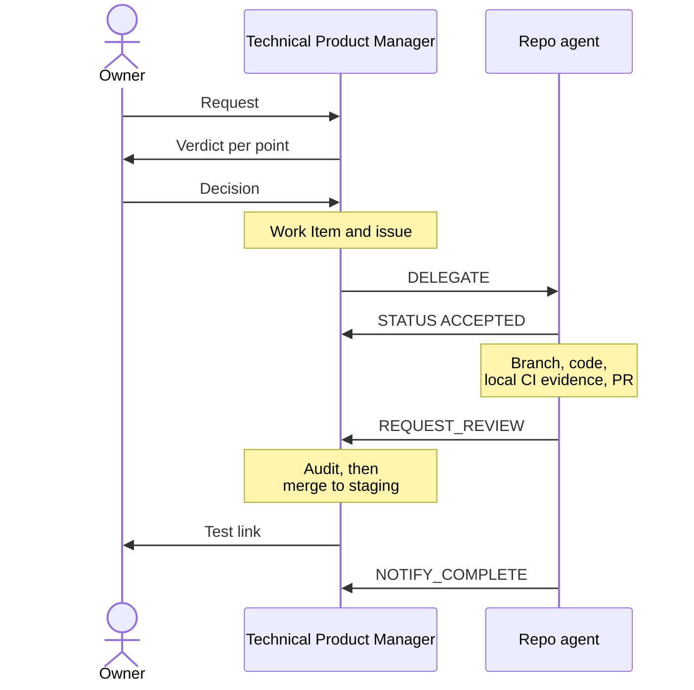

# The agent team

The agents work as a startup office. One owner coordinates two heads and is the only one who decides. Each agent has one office role and one area. It owns that area and never works outside it. Agent ids and profile names did not change with the office roles.

## Product and Engineering

Led by the **Technical Product Manager** (the Master). Three teams without a lead.

| Team | Office role | Agent | Owns | Never does |
|------|-------------|-------|------|------------|
| Head | Technical Product Manager | The Master | The backlog, specs, Work Items, proposed priorities, governance, the cross-repo plan, delegation, status, and delivery coordination, including audits and merges of PRs | Write product code, or set product direction (the owner does) |
| Platform | Platform Engineer (DevOps) | Agent Infra | Cloudflare platform, DNS, environments, the secret inventory (names only), observability, quality tooling (`infrastructure/`) | Edit product repos |
| Platform | Database Engineer | Agent DB | `gelpy-db`: SQL migrations, the only source of the schema (ADR-0009) | Touch production outside an approved release |
| Platform | Backend Developer | Agent API | `gelpy-api`: Express, TypeScript, Prisma, Clean Architecture, Cloudflare Containers | Change the schema (that is Agent DB's job) |
| Apps | Mobile Developer | Agent App | `gelpy-app`: Expo app for Android, iOS, and web | Code a new screen without an approved design |
| Apps | Frontend Developer (web) | Agent Web | `gelpy-web`: Nuxt commercial website, web motion, HyperFrames video | Publish copy that fails the public-claims rules |
| Apps | Frontend Developer (back office) | Agent Console | `gelpy-console`: Next.js admin console | Ship a new screen without an approved design |
| Design and Docs | Product Designer (UX/UI) | `gelpy-ux-ui` | The design of every new screen or flow in the design canvas, with all its states, before any code | Change tokens, approve a design, or write product code |
| Design and Docs | Design Systems Engineer | Agent Design | `gelpy-design-system`: tokens, assets, `BRAND.md`; the only agent that changes brand assets and tokens | Let other repos hard-code brand values |
| Design and Docs | Technical Writer | Agent Docs | `Gelpy/gelpy`: this public site and its wiki mirror | Publish secrets, internal hosts, personal data, or open vulnerabilities |
| External | Release Code Reviewer | Codex | Review of release PRs only | Approve by silence: no answer is not an approval |

## Business

Led by the **Strategy Manager** (the Business Coach). See [Strategy Manager](./business-coach.md).

| Office role | Agent | Owns | Never does |
|-------------|-------|------|------------|
| Strategy Manager | The Business Coach | Business strategy for Peru (validation, economics, growth, financing); the `business/` memory | Authorize implementation, spending, publication, or production |
| Legal Analyst | Legal Peru | Peruvian legal research from official sources, and legal drafts; a research role | Act as a lawyer (drafts need a lawyer's approval) |
| Growth Marketer | Marketing | Positioning and growth experiments for both sides of the marketplace in Peru | Run campaigns or spend without the owner |
| On-demand roles | Temporary | One discipline and one question at a time: Financial Analyst, Operations Coordinator, UX Researcher, or Partnerships Executive; at most three at a time | Delegate further |

That makes 13 agents, plus Codex and the on-demand roles.

## Product Designer

The Product Designer designs every new screen or flow in the design canvas before any code. Each design covers all its states, in light and dark, in Spanish and English:

- empty, loading, error, and success;
- resume;
- feature off and no permission;
- offline.

It changes no tokens (the Design Systems Engineer does), approves nothing (the owner does), and writes no product code. A small visual change stays with the repo agent, which updates the canvas in the same PR. The skill `gelpy-design-product-experience` defines its steps.

## How they run

- Each repo agent works in its own cloud session, in parallel. The Technical Product Manager coordinates them and delegates to each one directly.
- A specialist or repo agent takes work only from its head.
- Each session names its role. The Product Designer's sessions use the role `UX`.
- A repo agent never edits another repo. It sends a `REQUEST_CHANGE` to the agent that owns it, through its head.
- **Work between the areas goes head to head.** The Strategy Manager sends a `REQUEST_CHANGE` to the Technical Product Manager. The Technical Product Manager sends a `REQUEST_REVIEW` or `REQUEST_INFO` to the Strategy Manager instead of calling Legal or Marketing itself.
- **Transfers between sessions.** When an agent cannot push, it hands over its commits as a patch with a checksum manifest. The receiver checks every checksum and the resulting git tree before it pushes.
- The Technical Product Manager audits every PR before merge: secrets, scope, evidence, and design match.

## Message protocol

The skill `gelpy-orchestrate-agents` defines the protocol.

| Request | Use |
|---------|-----|
| `DELEGATE` | Assign a Work Item to an agent |
| `REQUEST_CHANGE` | Ask the owner of another repo for a change |
| `REQUEST_REVIEW` | Ask for a review of finished work |
| `REQUEST_INFO` | Ask for a missing fact |
| `NOTIFY_COMPLETE` | Report that work is complete |
| `NOTIFY_BLOCKED` | Report that work is blocked |

- Each request carries From, To, Work Item, Priority, Context, Dependencies, and Artifacts.
- Replies are `STATUS` messages: `ACCEPTED`, `COMPLETED`, `BLOCKED`, or `NEEDS_INFO`.
- **Disagreement.** A repo agent that disagrees with a `DELEGATE` answers `STATUS: NEEDS_INFO` with its verdict. The Technical Product Manager takes it to the owner, who decides.

## One Work Item, end to end

## Related pages

- [Gelpy Agentic Framework](./overview.md)
- [Skills](./skills.md)
- [Work Items and sprints](./work-items.md)
- [Owner rules and safety](./rules.md)
- [Strategy Manager](./business-coach.md)
