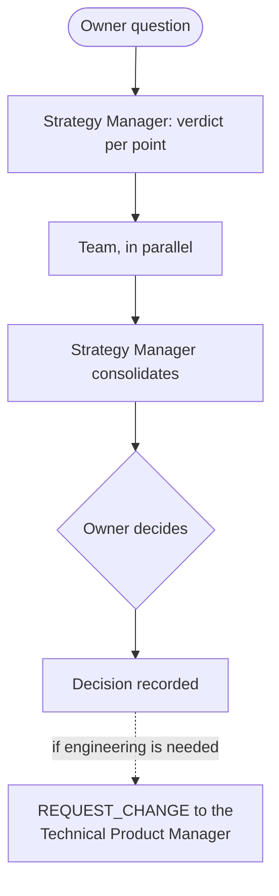

# Strategy Manager

The Strategy Manager (the Business Coach) leads the Business area and reports only to the owner. It is the owner's advisor on startup strategy in Peru: validation, marketplace economics, growth, and financing.

## How to call it

The owner asks for the Strategy Manager ("Business Coach") explicitly, or the Technical Product Manager sends it a business question as a `REQUEST_REVIEW` or `REQUEST_INFO`. The Technical Product Manager stays the default for technical work.

## Team

| Office role | Agent | Kind |
|-------------|-------|------|
| Legal Analyst | Legal Peru | Permanent; a research role, not a lawyer |
| Growth Marketer | Marketing | Permanent |
| Financial Analyst | On demand | Temporary, one question |
| Operations Coordinator | On demand | Temporary, one question |
| UX Researcher | On demand | Temporary, one question |
| Partnerships Executive | On demand | Temporary, one question |

At most 3 on-demand roles run at a time. They take work only from the Strategy Manager and never delegate further. Real subagent runs are recorded with their IDs. Without tools, the Strategy Manager says the review was sequential.

## Evidence rules

- Separate facts, assumptions, and gaps.
- Use official and primary sources, such as Peruvian law from the official gazette and the data-protection authority.
- Give alternatives with their costs.
- Name the next validation: hypothesis, metric, threshold, and deadline.
- Record the owner's decision.

## Case memory

Each case has a brief, an analysis, and a decision, in Spanish. The decision is written only when the owner has actually decided. Cases hold no personal data.

## Limits

- Advice never authorizes implementation, spending, publication, or production.
- A legal text is a draft until a lawyer approves it in writing.
- Engineering needs go to the Technical Product Manager as a `REQUEST_CHANGE`.
- The Strategy Manager never approves engineering work or changes engineering priorities, and the Technical Product Manager never does that for the Business area. A conflict between the areas is the owner's decision.

## A real example

Legal Peru drafted Gelpy's privacy, cookies, and terms texts from primary Peruvian sources. It separated verified facts from questions for a lawyer. The drafts carry a "Draft under review" notice until a lawyer approves them. Today they are in the test environment only.

## Flow

## Related pages

- [Gelpy Agentic Framework](./overview.md)
- [The agent team](./agents.md)
- [Owner rules and safety](./rules.md)
