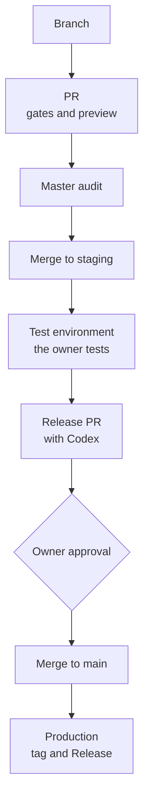

# Delivery: gates, environments, and releases

## Branches

These rules come from ADR-0005 and ADR-0008.

- `claude/NNN-MMM-slug` for Claude Code agents, and `codex/NNN-MMM-slug` for Codex.
- Deployable repos branch from `staging`. The architecture, docs, and design-system repos branch from `main`.
- `release/vX.Y.Z` and `hotfix/*`.
- One Work Item per PR, one PR in flight per repo, and squash merge.

## Pull request gates

These rules come from ADR-0011, ADR-0015, ADR-0017, and ADR-0018.

- The local CI runs every step: audit, tests, lint, build, and a dry-run deploy. Its evidence is posted as a PR comment for the head commit.
- The SonarCloud quality gate.
- gitleaks secret scanning.
- Coverage of 90% minimum, with a 95% target.
- A Cloudflare Workers Builds preview with `noindex`.
- No deploy secret in any PR build (ADR-0018, point 4).

**MVP mode.** Until 2026-11-30, the builds run on Cloudflare Workers Builds. The GitHub Actions workflows stay as a manual failover.

## Environments

| Environment | Source branch |
|-------------|---------------|
| Test | `staging` |
| Production | `main` |

Each environment has its own database and its own secrets.

## Release trains

- The order follows dependencies: db → api → console → app.
- Each repo opens a `staging` → `main` release PR.
- Codex reviews it. P0, P1, and security findings block; P2 and P3 findings become follow-up issues.
- The owner approves explicitly.
- Versions follow SemVer, with a Keep a Changelog section.
- The build creates the tag and the GitHub Release. The version manifest records the system version.
- Repos in one train share MAJOR.MINOR.

## Mobile

| EAS channel | Branch | Use |
|-------------|--------|-----|
| `production` | `main` | What is live on `main` (api.gelpy.app) |
| `preview` | `staging` | What is live on `staging` (test environment): the internal test app, which receives every staging update by itself |
| `development` | PR | Development client: opens a PR's code before its merge, on demand |

In Expo, a preview build is the internal QA app and a development build is the development client; the names are Expo's, not ours.

- Over-the-air updates use EAS Update with a fingerprint runtime, so a JS-only change reaches phones without a new build.
- A native build needs the owner's approval of its cost.
- **PR previews** are published only on demand by the Master. An Expo token never enters a PR build.

## From branch to production

## Related pages

- [Work Items and sprints](./work-items.md)
- [Owner rules and safety](./rules.md)
- [Architecture overview](../architecture/overview.md)
