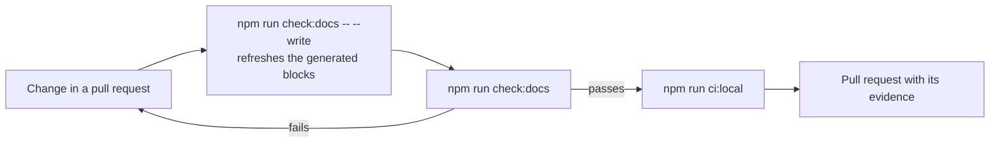

# Documentation standard

Every Gelpy repo documents itself the same way (ADR-0021). A new engineer, an auditor, or an investor opens any repo and understands in 15 minutes what it is, how to start it, how it is validated, and how it is protected.

:::note Status

Accepted on 2026-11-14. The repos adopt it in three waves:

1. The documents everyone reads, and the `check:docs` gate.
2. The generated references, the runbooks, and the fixes found while documenting.
3. The functional guide and its public version.

:::

## The file set

Each repo has these files, with the same level-2 sections in the same order. The templates live in the private architecture repo.

| File | Language | It answers |
|------|----------|------------|
| `README.md` | English and Spanish | What the repo is, how to start it, and how it is configured, validated, deployed, and protected, plus where each document is |
| `docs/architecture.md` | English and Spanish | How it is built and why: its components, key flows, data, external dependencies, and ADRs |
| `docs/quality.md` | English | Each step of the local gate, the tests by type, the coverage, and the pipelines |
| `SECURITY.md` | English | How to report a problem, the controls, the scanners, the inventory of secrets by name, and the personal data rules |
| `docs/runbook.md` | English | How to deploy, roll back, fail over, respond to an incident, and fix frequent problems |
| `CONTRIBUTING.md` | English | How a change gets in: the Work Item and the pull request |

## The README is the way in

The README has these sections, in this order: Status, Architecture, Quick start, Configuration, Scripts, Quality gates, Deploy, Security, Documentation map, and Related repos. A feature log does not belong there: it moves to `docs/features/` or stays in `CHANGELOG.md`.

## Rules for every document

- **Diagrams are Mermaid blocks inside the Markdown.** GitHub draws them, and a reviewer reads them in the pull request. The README has at least one diagram. The architecture document has at least a component view and one sequence diagram. No image file replaces a diagram that Mermaid can draw.
- **References are generated from the code when they can be:**
  - the API reference from its input schemas;
  - the table diagram and data dictionary from the database migrations;
  - the roles and permissions matrix of the console;
  - the token reference of the design system;
  - the navigation map of the app;
  - the content model, consent, and content security policy of the website.
- **Names, never values.** A document lists the name of a variable or a secret, what it is for, and where it lives. It never holds a value, personal data, or an open vulnerability. Vulnerabilities go to a private security advisory.
- **Bilingual for the main documents only.** The README, the architecture document, and the functional guide have a Spanish companion. The technical references stay in English only. Fewer companions means fewer that drift (ADR-0007, amended on 2026-11-14).

## The `check:docs` gate

Each repo runs `npm run check:docs` in its local gate once it adopts the standard. One reference checker is copied to every repo.

`check:docs` fails when:

- a file or a section of the standard is missing;
- a Spanish companion is missing, or has a different number of sections or diagrams;
- a Mermaid block names no known diagram type;
- a document holds a value that looks like a secret, or a path from one machine;
- a generated block differs from the code.

A repo may postpone a file only in its standard manifest, `docs/standard.json`, and only with the Work Item that will add it.

## Keeping documents current

- **Same pull request.** A pull request that changes a script, a variable, a step of the local gate, a route, a permission, or a table also updates the document that describes it. This is a step of `gelpy-update-docs`.
- **Document and fix.** A gap found in a validation while documenting it gets its own small Work Item. That way a document describes a complete validation, not an exception.
- **Done means usable.** The standard is done in a repo when a new agent, reading only the README, leaves its local gate green.

## Two readers

The private architecture repo holds the system view. It covers the context, the containers, the environments, the CI/CD flow, the testing strategy, the security overview, the first-day guide, the glossary, the runbooks, and the functional guide.

Functional documentation has two versions:

- **The internal guide**, complete and organized by flow, with the business rules, the states, and who can do what.
- **The public version on this site**, shorter. Only Agent Docs edits it. It follows the rule "planned until production" and passes `check:public`.

The repos keep what is internal; this site keeps what can be published. This site links to nothing internal. No repo document copies what this site says: it links to it.

## Related pages

- [Skills](./skills.md)
- [Delivery: gates, environments, and releases](./delivery.md)
- [Owner rules and safety](./rules.md)
- [Documentation rules](../contributing/documentation-rules.md)
