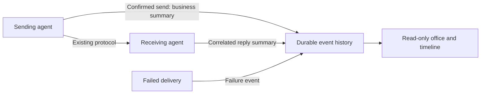

# Headquarters reporting

Headquarters is the planned internal office view for the business owners. It follows real agent sessions and their work through the [message protocol](./agents.md#message-protocol). It is a monitoring view: instructions, approvals, and decisions stay in the original chats.

:::note Status

As of 2026-11-18, the backend has acknowledged a real Codex protocol message and its response with HTTP 202. This confirms receipt, not durable replay after a restart or authenticated reading in the production console. The office view is coming soon: its production deployment and walkthrough remain pending. Real Claude verification is deferred separately; saved settings or local tests do not count as Claude acceptance.

:::

## The same messages, with a trace

Agents keep using `DELEGATE`, `REQUEST_CHANGE`, `REQUEST_REVIEW`, `REQUEST_INFO`, `NOTIFY_COMPLETE`, `NOTIFY_BLOCKED`, and the `STATUS` replies `ACCEPTED`, `COMPLETED`, `BLOCKED`, or `NEEDS_INFO`. Reporting records a business summary of each message; it does not send a second instruction or replace the message transport.

| Protocol message | What the owners should understand |
|---|---|
| `DELEGATE` | Who assigned the work, to whom, and its objective |
| `REQUEST_CHANGE` | Which team needs an adjustment from another team |
| `REQUEST_REVIEW` | Which delivery is ready for review |
| `REQUEST_INFO` | What information is missing to continue |
| `NOTIFY_COMPLETE` | What the agent reports it has delivered |
| `NOTIFY_BLOCKED` | What prevents the work from continuing |
| `STATUS` | Whether the recipient accepted, answered, finished its part, or needs help |

The sender reports a message after the transport confirms the send. A failed send is recorded as a delivery failure, never as a successful conversation. Each reply has its own event, linked to the original message and task. Retries reuse the event identifier so that one message produces one timeline entry. A reporting outage must not stop the original communication; the emitter retries later.

## Report business progress

The planned Headquarters has one office per area: Product and Engineering, and Business, with another office added when a new area is defined. The Technical Product Manager and Strategy Manager share a central workspace. Every subagent session has its own robot, with an appearance for its role; several sessions in the same role remain separate robots. A confirmed message represents a visit to the recipient; its reply represents the return conversation. The robot's panel brings together the objective, current activity, latest result, next step, and timeline. Sessions working on the same task remain distinct and can be viewed together.

A useful summary says, for example, “Preparing the reservation notices; waiting for the approved wording.” It explains the result or the missing decision in business language. It does not copy the full `Context`, `Dependencies`, or `Artifacts` fields. Presence, pause, resume, and session-close events complement the protocol; a heartbeat alone is not proof of progress.

The backend is one production service; its reporting contract supports these area offices. Events can describe work on `staging`; the work's branch and the place where owners view its events are different concepts. Codex receipt is verified. The production console reading is still pending, and live Claude verification is tracked separately rather than inferred from Codex.

## Publisher authentication

The emitter uses the runtime's secure configuration; credentials never go in the command, message file, or business summary. Authentication mode is explicit:

- **Direct mode**, the default, uses the configured `HQ_PUBLISH_KEY`. A missing or invalid key fails; the emitter does not silently switch modes.
- **Proxy mode** uses `HQ_AUTH_MODE=proxy` and `HQ_PRODUCER_ID`. The runtime's configured HTTP proxy supplies the Bearer credential. Claude Cloud does not need an `HQ_PUBLISH_KEY` environment value in this mode, and the emitter deliberately omits its own Authorization header.

Both modes send to the approved production destination. Proxy settings must be restricted to that destination and reporting operation. A missing or invalid injection is rejected by the service; the sanitized event remains queued. Configuration and local header tests do not prove a successful cloud report: each source needs its own real receipt and timeline check.

## Times and completion mean different things

| Display | Meaning |
|---|---|
| Elapsed time | Time since the assignment, including waits |
| Observed active time | Activity supported by session signals, excluding pauses and stale intervals |
| Waiting time | Time explicitly waiting for information, a review, or a decision |
| No update | The last signal is too old to claim current activity |

A `NOTIFY_COMPLETE` or `STATUS: COMPLETED` is the agent's report. It does not mark a Work Item `Done`. Acceptance criteria, evidence, and any human approval are still checked through [Work Items and sprints](./work-items.md).

## Keep the record limited

The reporting contract permits task and session identifiers, roles, dates, message relationships, and short business summaries. It excludes raw conversations, files, code, command output, credentials, and customer data. Access is restricted to authorized owners; the view does not grant permission to instruct an agent or approve a release.

Detailed events are planned to expire after 90 days. Daily result and time summaries are planned to expire after one year. These records support internal operational monitoring; the feature does not add advertising, third-party analytics, or session replay.
