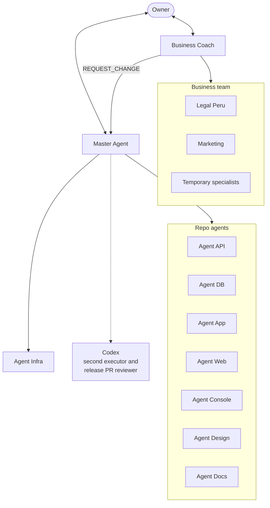

# Gelpy Agentic Framework

The Gelpy Agentic Framework is the working method that builds Gelpy. One human owner directs a team of specialized AI agents. The agents plan, build, review, release, and document the product, and advise on the business. The owner decides; the agents recommend, execute, and prove.

:::note Status

In use since 2026-10-31. Version 1.0 documented on 2026-11-08.

:::

## Principles

Each principle comes from a rule that the agents follow.

1. **The owner decides.** Agents give a verdict per point on every request, and the owner chooses (`gelpy-challenge-request`).
2. **Spec first.** No substantial change starts without a Work Item with SMART acceptance criteria and a GitHub issue (ADR-0003).
3. **Design first.** No screen or page is coded before the owner approves its design in writing.
4. **Evidence before Done.** Each criterion is checked and recorded as PASS, FAIL, or HUMAN PENDING before a Work Item is Done (`gelpy-verify-work-item`).
5. **Test before production.** Work reaches `staging` and the test environment first. Production releases need the owner's explicit approval (ADR-0005).
6. **Secrets never in code or chat.** Inventories hold names only, and agents never see values.
7. **One owner per repo.** Each repo has one specialized agent. Agents never edit another repo; they ask through the protocol.
8. **Bilingual memory.** English is canonical and Spanish is the companion. The owner works in Spanish (ADR-0007).

## System map

The Master Agent coordinates engineering. The Business Coach coordinates business advice and sends engineering needs to the Master as a `REQUEST_CHANGE`.

## Where it lives

The source of truth is the private `gelpy-architecture` repo. It holds:

- the `AGENTS.md` gate;
- the agent profiles under `.claude/agents/`;
- the skills under `codex/skills/`;
- the specs and Work Items under `specs/`;
- the ADRs under `adr/`;
- the governance scripts and `PROJECT_STATE.md`.

Each product repo has its own `AGENTS.md` gate, an agent profile, and a `codex/` router to the central skills. This site explains the method; it does not replace those files.

## In numbers (v1.0)

| Item | Count |
|------|-------|
| Agent profiles | 12, plus temporary specialists, plus Codex |
| Skills | 21 |
| ADRs | 18 |
| Specs | 11 |
| Work Items in Phase 1 | About 170 |
| Repos | 8 |

## Glossary

| Term | Meaning |
|------|---------|
| Work Item | The smallest tracked unit of work: one PR in one repo |
| AC | An acceptance criterion |
| Gate | A check that must pass before the next step |
| Release train | Coordinated `staging` → `main` releases across repos |
| OTA update | A JavaScript update that reaches installed apps without a store build |
| Handoff | The document that starts and records a long run of work |
| Verdict | The ✅/⚠️/❌ review of a request |

## Related pages

- [The agent team](./agents.md)
- [Skills](./skills.md)
- [Work Items and sprints](./work-items.md)
- [Delivery: gates, environments, and releases](./delivery.md)
- [Owner rules and safety](./rules.md)
- [Business Coach](./business-coach.md)
- [Origin and evolution](./evolution.md)
