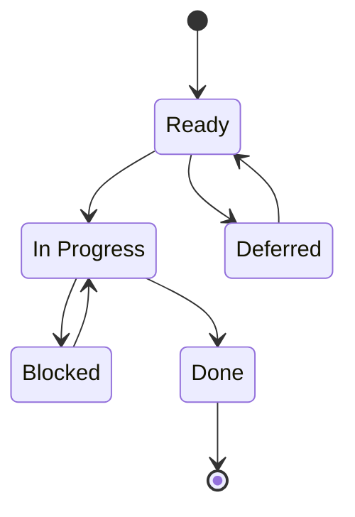

# Work Items and sprints

## From spec to tasks

Each spec folder has six files: `spec.md`, `plan.md`, and `tasks.md`, each with an `.es.md` companion.

| File | Holds |
|------|-------|
| `spec.md` | The summary, user scenarios, scope boundaries, and a compliance assessment (data classification, OWASP, Peru's Ley 29733, GDPR, logging) |
| `plan.md` | The approach, repo ownership, validation, release decision, and risks |
| `tasks.md` | The Work Items |

## Anatomy of a Work Item

A Work Item has these fields:

| Field | Content |
|-------|---------|
| Status | Ready, In Progress, Blocked, Deferred, or Done |
| GitHub Issue | The issue URL |
| Type | `user-story` or `task` |
| Target Repo | The one repo the work lands in |
| Sprint | The sprint it belongs to |
| Estimate | Points |
| Dependencies | Work Items that must finish first |
| Source | Where the request came from |
| Progress | Notes on the work so far |
| User Story | "As …, I want …, so that …" |
| SMART | Achievable, Relevant, Time-bound |
| Acceptance criteria | `AC-N`, each with Given/When/Then, a Measure, a Check, and Verified by |
| Compliance Assessment | Data and security notes |
| Release Decision | The version decision |

Each acceptance criterion has:

- **Given/When/Then**: the scenario;
- **Measure**: a number;
- **Check**: an exact command, or a human check;
- **Verified by**: Agent or Human.

Here is one full criterion from a fictional Work Item, "Show the app version on the Profile screen":

```text
AC-1
Given a signed-in person on the Profile screen,
When the screen opens,
Then it shows the installed app version.
Measure: 1 version string, equal to the version in package.json.
Check: npm test -- profile-version.test.tsx
Verified by: Agent
```

## The lint

The script `check-work-items` checks every `tasks.md`. It:

- rejects vague words, such as "works well" or "funciona bien";
- requires an exact command for every Agent check;
- requires the same IDs, status, sprint, issue, and number of criteria in English and Spanish;
- requires every issue URL when run with `--require-issues`.

## Statuses and issue sync



| Status | GitHub issue |
|--------|--------------|
| Ready | Open, no status label |
| In Progress | Open, `status:in-progress` |
| Blocked | Open, `status:blocked` |
| Deferred | Open, `status:deferred` (sprint: Backlog) |
| Done | Closed with an evidence comment |

The local `tasks.md` is the source of truth. The issue mirrors it.

## Hierarchy

Epic → one Feature per spec → Work Items, linked as native GitHub sub-issues. Issue bodies are generated in Spanish from `tasks.es.md`.

## Sprints

- A sprint lasts 1 week, Monday to Sunday (ADR-0003, amended 2026-11-07).
- Each sprint is a GitHub milestone with a due date, set by `sync-sprints` in all 8 repos.
- **Close rule.** At the end of a sprint, a Work Item still in progress moves to the next sprint when only its production check is left. Otherwise it stays until it closes.

## Progress

- Progress is weighted by points.
- Only Done counts; Deferred is excluded.
- `progress-report` prints one table, with a row per repo and a total row.

## Governance scripts

| Script | Purpose |
|--------|---------|
| `check-work-items` | The lint above |
| `publish-issues` | Create the Epic, Features, and Work Item issues, and write the URLs back |
| `link-sub-issues` | Link the sub-issue hierarchy |
| `sync-sprints` | Milestones, the sprint of each issue, status labels; dry run by default |
| `progress-report` | The percent table |
| `check-infrastructure` | Check that the platform inventories hold names only |

All are covered by tests with a 90% coverage gate (ADR-0015).

## Related pages

- [Gelpy Agentic Framework](./overview.md)
- [The agent team](./agents.md)
- [Delivery: gates, environments, and releases](./delivery.md)
