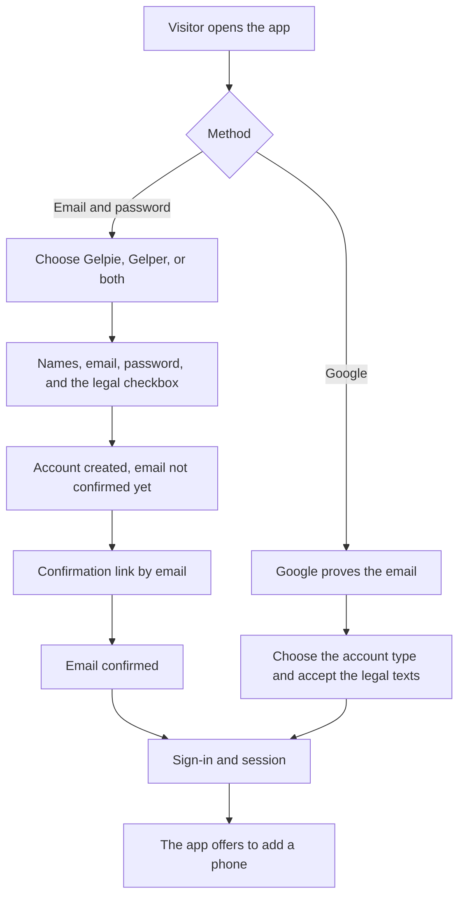

# Accounts and profile

A person creates a Gelpy account and signs in to the app, on Android and on the web. This page describes what the person does. The security side is in [Identity and sign-in](../security/identity.md).

:::note Status

In production on the web since 2026-11-07, and in the production Android build since 2026-11-08. Sign-up is open to everyone today. The planned changes are at the end of this page.

:::

## Who can do what

| Action | Visitor | Gelpie or Gelper |
|--------|---------|------------------|
| Create an account | Yes | — |
| Sign in with email and password, or with Google | — | Yes |
| Sign in with a passkey | — | Yes, on the web |
| Create, list, and revoke passkeys | — | Yes, on the web |
| Add and verify a phone | — | Yes |
| Turn on unlock with a fingerprint or the face | — | Yes, on Android |
| Sign out | — | Yes |

## Creating an account

- **Account type.** Every account says how the person uses Gelpy: Gelpie, Gelper, or both. The account does not exist without a type. The app cannot add the other type later yet.
- **Password.** It has 8 to 64 characters, with no composition rules.
- **Confirmation link.** An email-and-password account starts unconfirmed. The link in the email works once and lasts 24 hours, and no session starts before it is used. The "Revisa tu correo" screen can send the link again after a short wait.
- **Google.** Google proves the email, so a Google account starts confirmed.
- **Legal texts.** Sign-up needs the checkbox "Acepto los Términos y condiciones y leí la Política de privacidad de Gelpy.", unchecked by default. Without it, nothing is created. Each acceptance is recorded with the version of each text.
- **No account enumeration.** Signing up with an email that already has an account gets the same answer as a new one, and only the owner of that email gets a notice.

## Signing in

- With email and password, or with Google, on the web and on Android.
- With a passkey on the web: "Usar una passkey" on the sign-in screen.
- A wrong password and an unknown email get the same answer. After several failed attempts, the app asks the person to wait before trying again.
- On Android, the session survives closing the app. On the web, it lives only in the open page, so a reload asks to sign in again.
- "Cerrar sesión" in Perfil ends the session on the device and on the server.

## Phone

- After a sign-in without a verified phone, the app offers to add one. "Ahora no" skips it.
- The phone is added from Perfil. It must be a Peruvian mobile number, and it is verified with a code sent by SMS.
- The app shows the number masked.

## Perfil

Perfil shows the account: the photo from Google when there is one, the name, the email, and the account types. Its "Seguridad y acceso" card holds:

- **Teléfono:** add or verify the phone.
- **Passkeys:** where the browser supports them, create a passkey, see each one with its date, and revoke it after a confirmation.
- **Unlock with a fingerprint or the face**, on Android: off by default. When it is on, opening the app asks for the fingerprint or the face. Android checks it on the phone, and Gelpy never receives it.

## What the person sees when something fails

| Situation | What the person sees | What to do |
|-----------|----------------------|------------|
| Email not confirmed | A request to confirm the email, with a button to resend the link | Open the link in the email |
| Link used or expired | The link is refused | Ask for a new link |
| Wrong password or unknown email | "El correo o la contraseña no son correctos." | Try again |
| Too many attempts | "Demasiados intentos", with the time to wait | Wait for the countdown |
| A passkey fails | "No pudimos usar tu passkey" | Try again, or use another method |
| Phone already used by another account | "Este número ya está en otra cuenta" | Use another number |

## Planned

- Sign-up by invitation only, with invitations that the team sends from the console.
- A maintenance pause of the app's sign-in, with a "we are doing maintenance" screen.
- Account deactivation by the team, with a reason, which closes every session and keeps the data.
- Accepting a new major version of the terms or the privacy policy again.
- Linking Google from Perfil.
- Adding the other account type from Perfil.
- Passkeys on Android, and account deletion.

## Related pages

- [What Gelpy does today](./overview.md)
- [Identity and sign-in](../security/identity.md)
- [Fingerprint unlock and passkeys](../security/biometrics-passkeys.md)
- [App shell](../architecture/app-shell.md)
