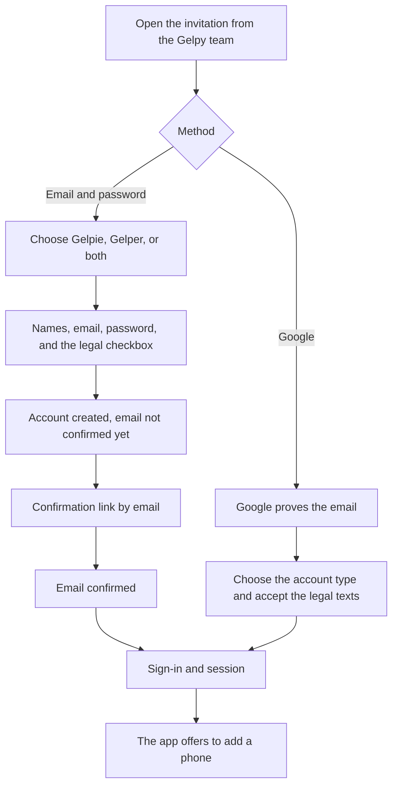

# Accounts and profile

A person creates a Gelpy account and signs in to the app, on Android and on the web. This page describes what the person does. The security side is in [Identity and sign-in](../security/identity.md).

:::note Status

In production on the web since 2026-11-07, and in the production Android build since 2026-11-08. Since 2026-11-15, sign-up is by invitation only, and the team can pause the app's sign-in and deactivate accounts. The app's new screens of that day are on the web, and reach Android with its next build. The planned changes are at the end of this page.

:::

## Who can do what

| Action | Gelpie or Gelper |
|--------|------------------|
| Create an account | With an invitation from the Gelpy team, on the web |
| Sign in with email and password, or with Google | Yes |
| Sign in with a passkey | Yes, on the web |
| Create, list, and revoke passkeys | Yes, on the web |
| Add and verify a phone | Yes |
| Link Google to the account | Yes, on the web |
| Turn on unlock with a fingerprint or the face | Yes, on Android |
| Sign out | Yes |

## Creating an account

- **By invitation.** Sign-up is closed: the app offers only sign-in, and every sign-up attempt gets the same sign-up-closed answer, whatever the email. The Gelpy team invites a person from the admin console. The invitation link works once, only for the invited email, and the screen shows the day it expires.
- **Account type.** Every account says how the person uses Gelpy: Gelpie, Gelper, or both. The account does not exist without a type. The app cannot add the other type later yet.
- **Password.** It has 8 to 64 characters, with no composition rules.
- **Confirmation link.** An email-and-password account starts unconfirmed. The link in the email works once and lasts 24 hours, and no session starts before it is used. The check-your-email screen can send the link again after a short wait.
- **Google.** Google proves the email, so a Google account starts confirmed.
- **Legal texts.** Sign-up needs the checkbox "Acepto los Términos y condiciones y leí la Política de privacidad de Gelpy.", unchecked by default. Without it, nothing is created. Each acceptance is recorded with the version of each text. When a legal text gets a new major version, the app on the web asks each account to accept it again, and shows only that screen and "Cerrar sesión" until the person accepts.
- **The app does not reveal whether an email has an account.** While sign-up is closed, every attempt gets the same answer. When sign-up is open, signing up with an email that already has an account gets the same answer as a new one, and only the owner of that email gets a notice.

## Signing in

- With email and password, or with Google, on the web and on Android.
- With a passkey on the web: "Usar una passkey" on the sign-in screen.
- A wrong password and an unknown email get the same answer. After several failed attempts, the app asks the person to wait before trying again.
- On Android, the session survives closing the app. On the web, it lives only in the open page, so a reload asks to sign in again.
- "Cerrar sesión" in Perfil ends the session on the device and on the server.
- **Maintenance pause.** The team can pause the app's sign-in for maintenance. The app on the web then shows "Estamos haciendo mantenimiento" with "Reintentar". A person who is already signed in keeps the session, and the app goes back to where it was when the pause ends.
- **Deactivation.** The team can deactivate an account with a reason. Every session of the account closes, the data is kept, and the person cannot sign in. The app on the web says "Tu cuenta está desactivada", with the support address. Deactivation is not a deletion.

## Phone

- After a sign-in without a verified phone, the app offers to add one. The person can skip it.
- The phone is added from Perfil. It must be a Peruvian mobile number, and it is verified with a code sent by SMS.
- The app shows the number masked.

## Perfil

Perfil shows the account: the photo from Google when there is one, the name, the email, and the account types. Its "Seguridad y acceso" card holds:

- **Teléfono:** add or verify the phone.
- **Passkeys:** where the browser supports them, create a passkey, see each one with its date, and revoke it after a confirmation.
- **Google**, on the web: link Google to the account, to sign in with it too.
- **Unlock with a fingerprint or the face**, on Android: off by default. When it is on, opening the app asks for the fingerprint or the face. Android checks it on the phone, and Gelpy never receives it.

## What the person sees when something fails

| Situation | What the person sees | What to do |
|-----------|----------------------|------------|
| Email not confirmed | A request to confirm the email, with a button to resend the link | Open the link in the email |
| Link used or expired | The link is refused | Ask for a new link |
| Wrong password or unknown email | A message that the email or the password is not correct | Try again |
| Too many attempts | A message that there were too many attempts, with the time to wait | Wait for the countdown |
| A passkey fails | A message that the passkey could not be used | Try again, or use another method |
| Sign-up closed | Only sign-in is offered. A form sent anyway says "El registro está cerrado por ahora" | Ask the Gelpy team for an invitation |
| Invitation used, revoked, or expired | The invitation is refused | Ask for a new invitation |
| Sign-in paused | "Estamos haciendo mantenimiento" with "Reintentar" | Try again in a few minutes |
| Account deactivated | "Tu cuenta está desactivada", with the support address | Write to the support address |

## Planned

- On Android, the screens of 2026-11-15: the maintenance screen, the deactivated account, accepting a new version of the legal texts, and linking Google, with the next Android build.
- Adding the other account type from Perfil.
- Password recovery and account deletion.
- Passkeys on Android: the app offers them, but they are pending verification on a phone.

## Related pages

- [What works in production](./overview.md)
- [Identity and sign-in](../security/identity.md)
- [Fingerprint unlock and passkeys](../security/biometrics-passkeys.md)
- [App shell](../architecture/app-shell.md)
