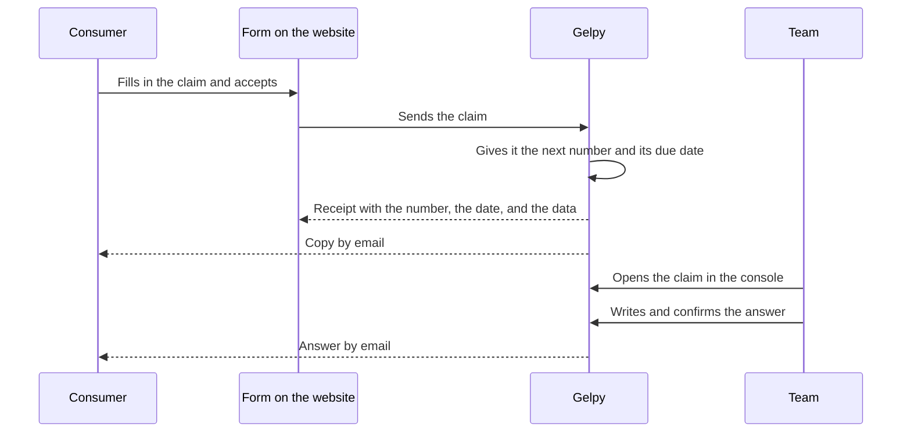

# Complaints book

Because it serves consumers online too, Gelpy has a virtual Libro de Reclamaciones, as Peruvian law asks. It is a form on the website that anyone can use, and a module in the admin console where the team answers.

:::note Status

In production since 2026-11-15: the form on the website, the receipt, the emails, and the module in the admin console. The app on the web links to it; the Android app gets the links with its next build.

:::

## Who can do what

| Action | Anyone | Team |
|--------|--------|------|
| File a claim (a reclamo or a queja), without an account | Yes | — |
| Get a receipt with a number, and a copy by email. If the copy cannot be sent, the receipt on screen says so and asks the person to print or save it | Yes | — |
| Read, answer, export, and print the claims, and resend an answer email that could not be sent | — | Yes, with the permission |

## The flow

## How it works

- The form is on the website, in Spanish and English, and needs no account. The page defines a reclamo and a queja.
- The form asks for the data that the regulation lists: the claimant's identity and contact details, what was contracted, the detail of the claim, and the request. For a minor, a parent or guardian's data are also required.
- Each claim gets a correlative number for its year. The receipt shows the number, the date, the due date of the answer, and the data sent. It can be printed or saved as PDF.
- If the copy by email fails, Gelpy retries it on its own, up to 3 times.
- Gelpy answers within 15 business days, by email. Filing a claim does not stop the consumer from going to Indecopi, the consumer protection authority.
- A filed claim cannot be deleted or changed: only its status and its answer change. Claims are kept for at least 2 years, as the regulation asks.
- In the console, the list shows each claim's number, date, type, status, and business days left, and marks the claims that are due soon or overdue. An answer needs a confirmation, and once sent it cannot be edited. If the answer email could not be sent, the claim says so, and a team member who answers claims can resend it.
- The app on the web links to the complaints book from screens that need no session, such as the welcome and the sign-in screens, and from Perfil. It opens the page in the browser.
- The complaints book does not depend on the marketplace: it works whether the marketplace is on or off.

## Personal data

- Only team members with the permission see a claim's personal data, in the console.
- Claim data never goes into the browser's address bar, its storage, or the logs.

## Related pages

- [What Gelpy does today](./overview.md)
- [Admin console](./console.md)
- [Commercial website](../architecture/website.md)
