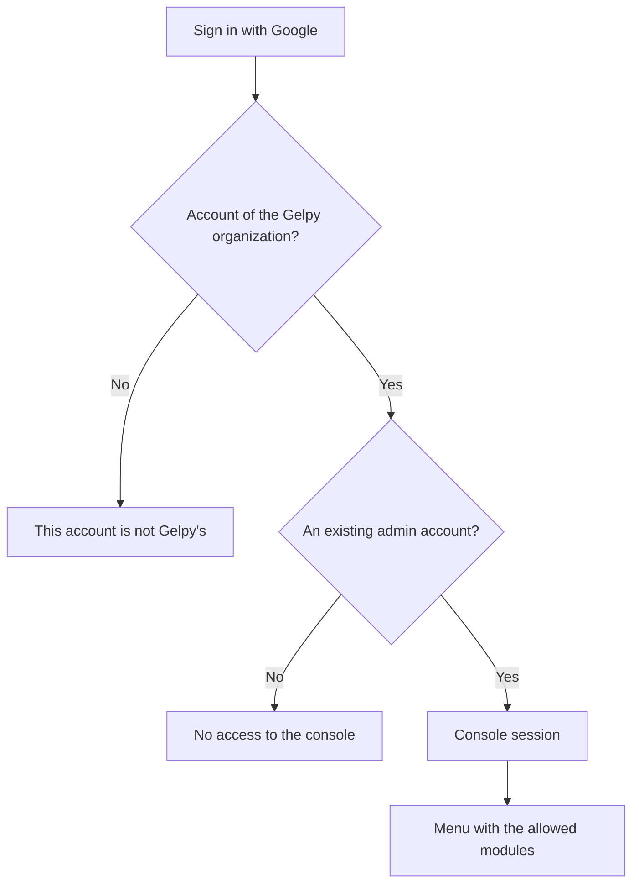

# Admin console

The admin console is where the Gelpy team runs the platform. It is a web app for the team only, not for Gelpies or Gelpers.

:::note Status

In production since 2026-11-07, with the Push module since 2026-11-08. The planned modules are at the end of this page.

:::

## Who enters

- Only Google accounts of the Gelpy company organization. The console has no email and password sign-in.
- An app account cannot use the console.
- An account outside the organization is refused, and so is an organization account that is not an admin. Console sign-in never creates accounts.
- The console keeps its session only in the open page, so a reload asks to sign in again.

## What it does today

| Module | What it does |
|--------|--------------|
| Push: Enviar | Writes a push, shows how many people and devices it reaches, and sends it after a confirmation. See [Notifications](./notifications.md) |
| Push: Historial | Lists each send with its sender, audience, and delivery counts, and refreshes the statuses on demand |

Each send records who sent it, and no log or audit record holds an email.

## Planned

- **Roles and permissions:** the Super admin builds roles from permissions and gives them to team members. Each person sees only the modules of their roles.
- **App accounts:** find an account by its exact email, and deactivate or activate it with a reason.
- **Sign-up invitations:** invite a person to sign up while sign-up is closed.
- **Platform settings:** open or close sign-up, pause the app's sign-in for maintenance, and turn the assisted search on or off.
- **The complaints book:** read, answer, export, and print each claim. See [Complaints book](./complaints-book.md).
- **Categories:** the trades and services of the marketplace.

## Related pages

- [What Gelpy does today](./overview.md)
- [Identity and sign-in](../security/identity.md)
- [Push notifications](../architecture/push.md)
