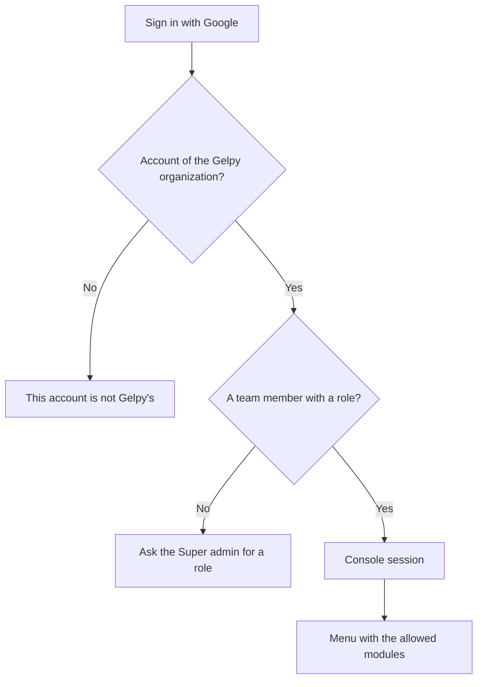

# Admin console

The admin console is where the Gelpy team runs the platform. It is a web app for the team only, not for Gelpies or Gelpers.

:::note Status

In production since 2026-11-07, with the Push module since 2026-11-08 and the other modules since 2026-11-15. The planned modules are at the end of this page.

:::

## Who enters

- Only Google accounts of the Gelpy company organization. The console has no email and password sign-in.
- An app account cannot use the console.
- An account outside the organization is refused. An organization account without a role sees a request to ask the Super admin for one. Console sign-in never creates accounts.
- The console keeps its session only in the open page, so a reload asks to sign in again.

## What it does today

| Module | What it does |
|--------|--------------|
| Push: Enviar | Writes a push, shows how many people and devices it reaches, and sends it after a confirmation. See [Notifications](./notifications.md) |
| Push: Historial | Lists each send with its sender, audience, and delivery counts, and refreshes the statuses on demand |
| Acceso | The Super admin decides who on the team enters the console, builds roles from permissions, and gives them to team members. Only the Super admin sees this module |
| Usuarios del app | Finds an app account by its exact email, and deactivates or activates it with a reason after a confirmation. See [Accounts and profile](./accounts.md) |
| Invitaciones de registro | Invites a person to create an app account while sign-up is closed, and resends or revokes an invitation |
| Configuración de la plataforma | Opens or closes sign-up, pauses the app's sign-in for maintenance, and turns the assisted search on or off. Only the Super admin changes these settings |
| Libro de Reclamaciones | Reads, answers, exports, and prints each claim, and resends an answer email that could not be sent. See [Complaints book](./complaints-book.md) |
| Categorías, Funciones, Idiomas de la app | The catalog that the marketplace pilot will use: the trades and services, the details of the work, and the languages |
| Proveedores | The register of the outside services that Gelpy pays for or uses |

Each person sees only the modules and the actions that their roles allow; a module without the permission says so. Each send and each change records who made it, and no log or audit record holds an email.

## Planned

- **Pilot invitations**, for the people invited to the marketplace pilot. See [Marketplace pilot](./marketplace-pilot.md).
- **Registering a claim that arrives by email** in the complaints book.

## Related pages

- [What Gelpy does today](./overview.md)
- [Identity and sign-in](../security/identity.md)
- [Push notifications](../architecture/push.md)
