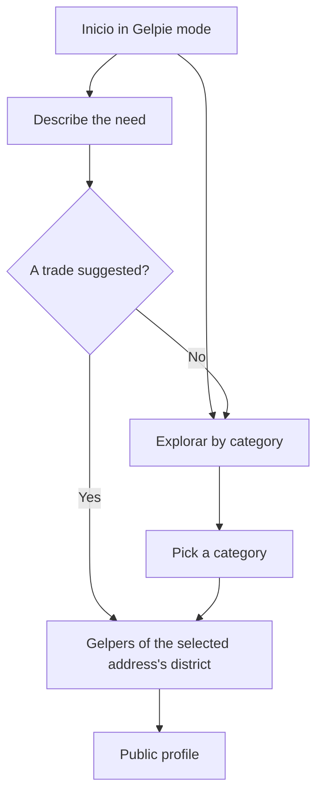

# Marketplace pilot (planned)

The marketplace is where a Gelpie finds the right Gelper near home. Gelpy opens it first as a controlled pilot, with invited people only (ADR-0019).

:::note Status

Planned. The marketplace runs in the test environment and is off in production. It opens only after the legal approvals of the pilot, and then only for invited people. Until then, the app shows a coming-soon screen in its place.

:::

## What it will do

| For | What |
|-----|------|
| Gelpers | Build a profile in three steps (their trades and services, a description, and the districts where they work), then add optional details such as a reference rate |
| Gelpers | See how clients find the profile: how many times it appeared and was opened, as counts only |
| Gelpies | Browse the open categories, see the Gelpers of the district of a saved address, and open a Gelper's public profile |
| Gelpies | Save the places where they need help, such as home or the office |
| Gelpies | Describe the need in a few words and get a suggested trade |
| The team | Open trades and categories, and turn the assisted search on or off, from the console |

Booking a Gelper comes later: on the profile, "Solicitar Gelp" shows "Próximamente".

## Finding a Gelper

## Rules that protect people

- **A complete profile.** A Gelper is listed only with a display name, at least one trade and service, a description, an active district, and a verified phone. A complete profile does not mean a verified person, and the profile never claims a background check.
- **What clients see.** The display name is the first name and the last initial. The public profile shows the trades, the services, the description, the districts, and, only when set, the optional details. It never shows a phone, an email, an address, or the full name.
- **The photo.** A Gelper can show the account's Google photo only by checking a box, and can uncheck it at any time. Gelpy keeps no copy.
- **No reviews yet.** Profiles read "Nuevo" until reviews exist. No stars, averages, or job counts are invented.
- **No payments.** Gelpy charges and processes no payment.
- **Addresses.** A Gelpie's addresses are never public. On Android, the Gelpie can confirm an address with the phone's location: the phone compares it with the address, and Gelpy only receives that they match and the date, never the location.
- **Assisted search.** The app sends only the text of the search. Gelpy removes emails and long numbers from it, and an AI service suggests a trade from the active catalog, with no data that identifies the person. The text is never stored. A notice under the box says so before anything is sent.
- **Statistics.** A Gelper sees counts only, never who viewed the profile.

## Related pages

- [What Gelpy does today](./overview.md)
- [Accounts and profile](./accounts.md)
- [Architecture overview](../architecture/overview.md)
