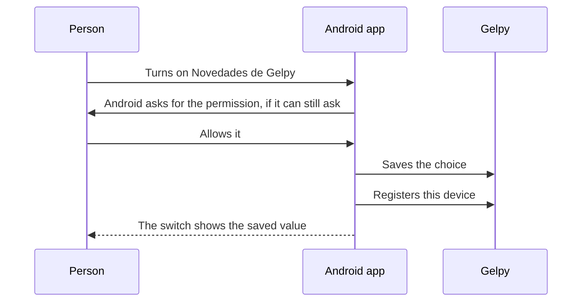

# Notifications

Gelpy tells people things in three ways: a push notification in the Android app, an account email, and an SMS code. The technical side of push is in [Push notifications](../architecture/push.md).

:::note Status

Push is in production since 2026-11-08: in the production Android build and in the admin console. The planned changes are at the end of this page.

:::

## Who can do what

| Action | Gelpie or Gelper | Team |
|--------|------------------|------|
| Turn "Novedades de Gelpy" on or off | Yes, on Android | — |
| Receive a push | With the type on, on an Android device signed in to Gelpy | — |
| Receive account emails | Yes | — |
| Preview and send a push from the console | — | Yes |
| Read the history and refresh the delivery statuses | — | Yes |

## Push in the app

- Today there is one type of push: "Novedades de Gelpy", news about Gelpy. It is promotional, so it is opt-in and starts off.
- Its switch is in Perfil, under Notificaciones. It reads "Te contamos las funciones nuevas de Gelpy. Es publicidad: la recibes solo si lo enciendes, y puedes apagarlo cuando quieras."
- Android asks for the notifications permission when it is needed: on the onboarding step of Android 13 or newer, and when the person turns the switch on.
- Push works in the Android app only. The web version of the app has no notifications row. Push in the browser and on iOS are out of scope.
- "Cerrar sesión" also stops push to that device.

## Sending from the console

- The team sends a push to one person, found by the exact email of the account, or to all Gelpies, all Gelpers, or both.
- Only people with the type on and an active device receive it. A person with two phones gets it on both.
- A send has a title, a short text, and the app screen that opens on tap.
- Before sending, the console shows how many people and devices it reaches. The push goes out only after the team member confirms.
- A console send is always a push, never an email.
- The history shows each send. Delivery statuses move from sent to delivered or failed when the history is read or when the team presses "Actualizar estados" (update statuses).

## Emails and SMS

- **Account emails**, never marketing: the confirmation link, and the notice to the owner of an email that already has an account. They follow the Gelpy brand, and a token in a link never reaches a server log.
- **SMS:** only the code that verifies a phone.

## What the person sees when something fails

| Situation | What the person sees | What to do |
|-----------|----------------------|------------|
| The Android permission is blocked | The switch is locked, with "Abrir ajustes" | Allow notifications in the phone's settings |
| The switch cannot save | The switch goes back, with a message to check the connection | Try again with a connection |
| Using the web app | No notifications row | Use the Android app |

## Planned

- Recording the consent to "Novedades de Gelpy" with the version of its text.
- A send repeated by mistake goes out only once.
- Notices about bookings, a second push type that is on by default and can be turned off, for the marketplace pilot.
- Emails for sign-up invitations and for the complaints book.

## Related pages

- [What Gelpy does today](./overview.md)
- [Push notifications](../architecture/push.md)
- [Admin console](./console.md)
