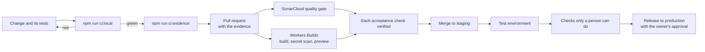

# Quality overview

Every change to Gelpy is tested and checked before it reaches people. This page shows the rules, the path a change follows, and the tests behind it.

:::note Status

These rules apply to every Gelpy repository today. Until 2026-11-30, the tests run in each repository's local gate, and the result is posted on the pull request (MVP mode, ADR-0018).

:::

## The rules

| Rule | Decision |
|------|----------|
| Every pull request with code brings its tests and its coverage report | ADR-0015 |
| Coverage is at least 90% on lines, branches, functions, and statements, with 95% as the target. A gap is closed with tests, never with an exclusion or a lower threshold | ADR-0015 |
| The gates of a pull request are lint, types, tests with coverage, the build, and the dependency audit. Visual surfaces also have accessibility and brand checks | ADR-0011 |
| The SonarCloud quality gate is required on every pull request | ADR-0011 |
| A change is validated once and deployed on merge. No pull request can read a deploy secret | ADR-0017 |
| Deploy logic lives in tested scripts, not in workflow files | ADR-0015 |
| Until 2026-11-30, the tests run in `npm run ci:local`, and `npm run ci:evidence` posts the result on the pull request | ADR-0018 |

## How a change is validated

- The local gate runs every step of the pull request checks on the agent's machine. A red step sends the change back.
- Each acceptance criterion of the Work Item is checked and recorded as passed, failed, or pending a person, before the Work Item is done.
- The release to production needs the owner's written approval. See [Delivery](../framework/delivery.md).

## The test pyramid

| Level | What it proves | Tools | Where |
|-------|----------------|-------|-------|
| Unit | Logic in isolation | Vitest, `node --test` | Every component |
| Component and HTTP | A screen or a route with its real collaborators, without the network | Vitest with jsdom or happy-dom, supertest | App, website, console, API |
| Database | Migrations, grants, and queries against a real PostgreSQL | `node:test`, Vitest | Database, API |
| Browser | Visual baselines, accessibility with axe, screen sizes, and full flows | Playwright | App, website, console |
| Performance | A performance score of at least 0.9 and an accessibility score of 1 | Lighthouse | Website |
| Rules as tests | Workflow policy, security headers, no trackers without consent, and no secret in the logs | The tools above | Every component |

Each component is tested on its own, against the contracts of the others.

## The local gate of each component

| Component | Lint and checks | Tests and coverage | Build and rehearsal |
|-----------|-----------------|--------------------|---------------------|
| API | ESLint, strict, with 0 warnings; types of the app and of the Worker | Vitest, 90% | Build |
| Database | SQL lint | `node:test` against a real PostgreSQL, 90% | Migrations are checked before they reach production |
| App | ESLint, types, brand lint | Vitest, 90% | Web and Android exports, Expo checks, and a deploy dry run for test and production |
| Website | ESLint, types, brand lint, media and motion checks | Vitest, 90% | Builds for test and production, site verification, bundle size, and a deploy dry run |
| Console | ESLint, types, brand lint | Vitest, 90% | Build, security headers, and a deploy dry run for test and production |
| Design system | Token validation | `node --test`, 90% | Build, unchanged output, and a package dry run |
| This site | Public-safety and brand checks | `node --test`, 90% | Build in English and Spanish, wiki build, and a deploy dry run |

The gates of the API, database, app, website, console, and this site also run the dependency audit.

## Where each scanner runs

| Scanner | Finds | Where |
|---------|-------|-------|
| gitleaks | Secrets in the code | Every pull request build on Workers Builds |
| `npm audit` | Known vulnerabilities in dependencies | The local gate |
| actionlint and zizmor | Mistakes and unsafe patterns in GitHub workflows | The local gate, when a workflow changes |
| SonarCloud | Bugs, code smells, and security hotspots | Every pull request |

Scanner versions are pinned by checksum.

## Coverage and evidence

- Coverage is reported in the evidence of each pull request: the head commit, the result of each step, the test count, and the coverage of lines, branches, and functions.
- SonarCloud judges the new code of each pull request. It does not hold the coverage.

## What a person verifies

Some acceptance criteria can only be checked by a person: a design the owner approves, a flow the owner tries on a phone, or a text the owner reads. An agent never marks them as passed. They stay pending until the person confirms in writing, and the Work Item records the date and the words.

## Related pages

- [Delivery: gates, environments, and releases](../framework/delivery.md)
- [Architecture overview](../architecture/overview.md)
- [Security overview](../security/overview.md)
