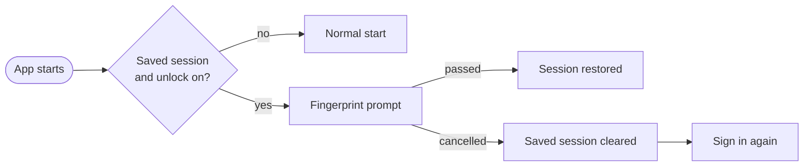
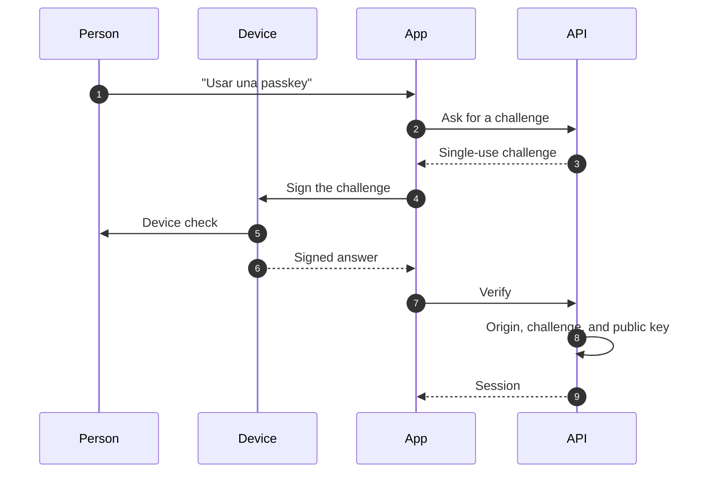

# Fingerprint unlock and passkeys

This page describes two ways to sign in to Gelpy without typing a password: fingerprint unlock on Android and passkeys. It describes flows, not screens, and leaves out implementation detail that would help an attacker.

:::note Status

Passkeys are available on the web since 2026-11-07. Fingerprint unlock is in the production Android build since 2026-11-08; that build is installed as an APK, and the app is not on Google Play. Passkeys on Android and the stronger session binding below are planned.

:::

| Capability | Status |
|------------|--------|
| Passkeys on the web | Available since 2026-11-07 |
| Fingerprint unlock on Android | In the production Android build since 2026-11-08 |
| Passkeys on Android | Planned: they need the Digital Asset Links file served on `gelpy.app` |
| Saved session bound to the fingerprint check | Planned: on test, production with the next app release |
| Guarded passkey counter | Planned: on test |
| iOS | Planned, deferred |

Google sign-in and email with password stay available as fallbacks for both.

## Fingerprint unlock (Android)

- Fingerprint unlock is opt-in and off by default.
- It protects the restore of the saved session when the app starts: the app asks for the fingerprint first.
- Only strong biometrics are accepted.
- Cancelling the prompt clears the saved session, and the person signs in again.
- Biometric data stays on the device. Gelpy never receives it.
- It is not offered on the web.

### Planned: a stronger binding

These changes run on test and reach production with the next app release, shipped as an over-the-air update:

- If the app cannot read the biometric preference, it treats it as unknown and opens no session until the check passes or the person signs in again. The app always ends in a defined state.
- The saved session is bound to the fingerprint check with an envelope key: a random key stored once in the device's secure storage, readable only after a successful biometric check. The session is stored encrypted with that key.
- The key stays in memory only while the app is unlocked. There is one prompt per launch.
- A failed or cancelled prompt leaves no session.
- Enrolling a new fingerprint makes the saved session unreadable, so the person signs in again.
- Sessions saved the old way move to the new storage at their next unlock.

## Passkeys

- Passkeys follow the WebAuthn standard. The server registers, verifies, and revokes them.
- Each environment has its own relying party. The production relying party is `gelpy.app`, and a test relying party is never valid in production.
- People sign in with "Usar una passkey" (use a passkey) on the sign-in screen.
- A Passkeys section in Profile (Spanish labels: Perfil › Cuenta) lets people create, list, and revoke their passkeys.
- Each challenge expires and works once. Only the environment's configured origins are accepted.
- The device keeps the private key. The database stores only the public key.
- A revoked passkey fails, and Google sign-in still works.

### Planned: a guarded counter

On test, the passkey's signature counter rises in one guarded step before any session exists, and only while the passkey is active. A cloned, replayed, or just-revoked passkey then cannot open a session. A failed attempt's audit record holds only the reason.

### Passkeys on Android

Passkeys on Android are planned. They need the Digital Asset Links file served on `gelpy.app`, which links the app to the site; the production Android build alone does not enable them.

## What is never stored

| Never stored by Gelpy | Why |
|-----------------------|-----|
| Passkey private keys | They stay on the device; the database has only public keys |
| Biometric data | It stays on the device; Gelpy never receives it |
| Passwords in clear | Only argon2id hashes are stored |

- Challenges are single-use records that expire.
- Logs never hold passwords, one-time codes, tokens, or personal data.

## Related pages

- [Identity and sign-in](./identity.md)
- [Security overview](./overview.md)
- [App shell](../architecture/app-shell.md)
