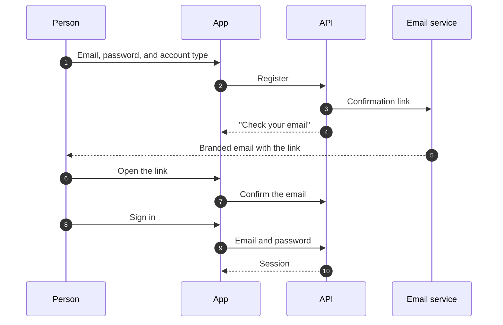

# Identity and sign-in

This page describes how people create an account and sign in to Gelpy, how admins enter the console, and how identity data is protected. It describes flows, not screens.

:::note Status

Identity is in production since 2026-11-07 on the web: in the web version of the app and in the admin console. The Android app is still in preview, so identity on Android runs only in the Android preview build until the first production Android build. Each section below says where each part works today.

:::

| Capability | Status |
|------------|--------|
| Email and password, with an email confirmation link | Production |
| Google sign-in on the web | Production |
| Google sign-in on Android | Android preview build; production with the first production Android build |
| Phone verification by SMS | Production |
| Fingerprint unlock on Android | Android preview build; production with the first production Android build |
| Passkeys | Production on the web; Android preview build |
| Admin console with Google accounts of `gelpy.app` only | Production |

## Account types

When people register, by any method, they choose how they use Gelpy:

- **Gelpie**: someone who needs help.
- **Gelper**: a professional who offers services.
- **Both**.

The account is not created until a type is chosen, including on a first Google sign-in. People can add the other type later from Profile.

Accounts also carry an internal admin flag. It is off by default, and no public part of the API can turn it on.

## Email and password

- Passwords must be 8 to 64 characters, with no composition rules, following NIST SP 800-63B.
- Passwords are stored only as argon2id hashes and never appear in responses or logs.
- The account starts unconfirmed. No session is issued until the email is confirmed.
- The confirmation link works once and lasts 24 hours. Only a hash of its token is stored, and the token travels in the part of the link that browsers do not send to servers.
- Resending the link and failed sign-ins are rate limited per account.
- Confirmation emails and notices use the Gelpy brand.

### No account enumeration

Nothing reveals whether an email already has an account:

- A failed sign-in with an unknown email looks the same as a wrong password: same answer and same timing.
- Registering with an email that already has an account gets the same "check your email" answer as a new one. Only the owner of that email gets a notice, which greets them by the name already on their account.

## Google

- Google proves the email, so a Google account starts with the email confirmed.
- The API checks every Google token: who issued it, which app it was issued for, that it has not expired, and that the email is verified. A token issued for any other app is rejected.
- On the web, the app gets the Google token directly in the browser.
- On Android, the app uses the system's Credential Manager. It runs in the Android preview build and reaches production with the first production Android build.
- No Google client secret is used or stored.

If someone registered with an email and password but never confirmed it, and the real owner of that email later signs in with Google, the API removes the unconfirmed password and ends its sessions first. This blocks pre-account takeover.

## Phone

- After signing in, the app offers once per account and device to add a phone number. People can skip it, and add it later from Profile.
- The phone is verified with a 6-digit code sent by SMS through Twilio Verify.
- In Phase 1, only Peruvian numbers (+51) are accepted.
- Codes expire after 10 minutes and allow a limited number of attempts. Sends are rate limited per account.
- The app shows the number masked, for example "+51 9•• ••• •12". The full number never appears in logs.

## Sessions

- A sign-in issues an access token and a refresh token.
- Each refresh token works once: using it issues a new one, and reusing an old one fails.
- Signing out ends the session, and its refresh token stops working.
- Tokens are never stored with the app's local preferences.

## Fingerprint unlock (Android)

- People can turn on fingerprint unlock on Android. Then the app asks for it before it restores a saved session.
- Only strong biometrics are accepted.
- Cancelling the prompt clears the saved session, so the person signs in again.
- It runs in the Android preview build, checked on a physical phone, and reaches production with the first production Android build.

## Passkeys

- People can create, use, and revoke passkeys. The server registers, verifies, and revokes them.
- Each challenge expires and works once, and only the environment's own origins are accepted.
- No private key ever reaches Gelpy: the device keeps it.
- Passkeys work in production on the web. On Android they run in the Android preview build and reach production with the first production Android build.

## Admin console

The admin console is for Gelpy operators only. It signs in only with Google accounts of the `gelpy.app` organization:

- Google itself refuses accounts outside the organization.
- The API accepts a console sign-in only when the token was issued for the console, the account belongs to `gelpy.app`, its email is verified, and the account already exists as an admin. Console sign-in never creates accounts.
- Console sessions are separate from app sessions and last less. Admin actions accept only console sessions, so an admin's app session cannot perform them.
- Everyone else sees a no-access page, and no session is kept.

Admin roles per console module come in Phase 2.

## Data handling

| Data | Where it lives | Rules |
|------|----------------|-------|
| Email, name, phone | Database | Collected only when needed; the phone is shown masked |
| Password | Database, as an argon2id hash | Never stored, returned, or logged in clear |
| Confirmation links | Database, as hashes | Single use, 24 hours |
| SMS codes | The SMS provider | Never stored or logged by Gelpy |
| Sessions | Database, as hashes | Refresh tokens rotate; sign-out revokes them |
| Passkeys | Public key in the database; private key on the device | Challenges single use |

- Logs never record passwords, codes, tokens, or personal data.
- Security events, such as a removed unconfirmed password, are audited without personal data.
- Test and production have separate accounts, keys, and settings.

## Related pages

- [Security overview](./overview.md)
- [Data flow](../architecture/data-flow.md)
- [App shell](../architecture/app-shell.md)
