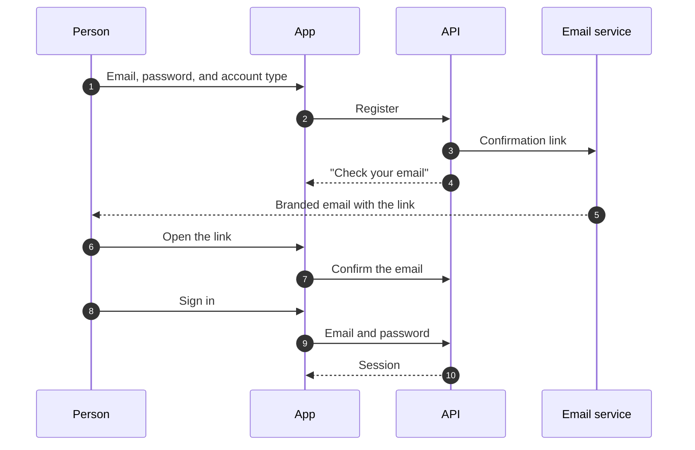

# Identity and sign-in

This page describes how people create an account and sign in to Gelpy, how admins enter the console, and how identity data is protected. It describes flows, not screens.

:::note Status

Identity is in production since 2026-11-07 on the web: in the web version of the app and in the admin console. The first production Android build shipped on 2026-11-08. It is installed as an APK; the app is not on Google Play. Since 2026-11-15, sign-up is by invitation only, and the console has roles and permissions. The app's new screens of that day are on the web; Android gets them with its next build. Each section below says where each part works today.

:::

| Capability | Status |
|------------|--------|
| Email and password, with an email confirmation link | Production |
| Google sign-in on the web | Production |
| Google sign-in on Android | In the production Android build since 2026-11-08 |
| Phone verification by SMS | Production |
| Fingerprint unlock on Android | In the production Android build since 2026-11-08 |
| Passkeys | Available on the web. On Android, the app offers them and `gelpy.app` serves the Digital Asset Links file since 2026-11-15, but they are pending verification on a phone |
| Required acceptance of the terms and the privacy policy at sign-up | Production since 2026-11-08 |
| Sign-up by invitation only | Production since 2026-11-15 |
| Accepting a new major version of the legal texts, the maintenance pause, account deactivation, and linking Google while signed in | Production since 2026-11-15; the app's screens are on the web, and Android gets them with its next build |
| Admin console with Google accounts of `gelpy.app` only | Production |
| Console roles and permissions | Production since 2026-11-15 |

## Account types

When people register, by any method, they choose how they use Gelpy:

- **Gelpie**: someone who needs help.
- **Gelper**: a professional who offers services.
- **Both**.

The account is not created until a type is chosen, including on a first Google sign-in. The app cannot add the other type to an existing account yet.

Since 2026-11-08, signing up also requires checking a box that accepts the terms and the privacy policy. The account keeps a record of that acceptance, with the versions of the texts. When a legal text gets a new major version, the app on the web asks each account to accept it again before it goes on.

Accounts also carry an internal admin flag. It is off by default, and no public part of the API can turn it on.

## Sign-up by invitation

Since 2026-11-15, sign-up is closed. Only an invitation from the Gelpy team lets a person create an account:

- The team sends the invitation from the admin console.
- The invitation link works once, only for the invited email, and expires on the day it shows.
- Only a hash of the invitation token is stored.
- While sign-up is closed, the app offers only sign-in, and every other sign-up attempt gets the same sign-up-closed answer.

## Email and password

- Passwords must be 8 to 64 characters, with no composition rules, following NIST SP 800-63B.
- Passwords are stored only as argon2id hashes and never appear in responses or logs.
- The account starts unconfirmed. No session is issued until the email is confirmed.
- The confirmation link works once and lasts 24 hours. Only a hash of its token is stored, and the token travels in the part of the link that browsers do not send to servers.
- Resending the link and failed sign-ins are rate limited per account.
- Confirmation emails and notices use the Gelpy brand.

### No account enumeration

Nothing reveals whether an email already has an account:

- A failed sign-in with an unknown email looks the same as a wrong password: same answer and same timing.
- While sign-up is closed, every sign-up attempt gets the same sign-up-closed answer, whatever the email, before any lookup.
- When sign-up is open, registering with an email that already has an account gets the same "check your email" answer as a new one. Only the owner of that email gets a notice, which greets them by the name already on their account.

## Google

- Google proves the email, so a Google account starts with the email confirmed.
- The API checks every Google token: who issued it, which app it was issued for, that it has not expired, and that the email is verified. A token issued for any other app is rejected.
- On the web, the app gets the Google token directly in the browser.
- On Android, the app uses the system's Credential Manager. It is in the production Android build since 2026-11-08.
- No Google client secret is used or stored.

On the web, a signed-in person can also link Google to the account from Perfil, under "Seguridad y acceso". It needs a recent Google sign-in and a confirmed email.

If someone registered with an email and password but never confirmed it, and the real owner of that email later signs in with Google, the API removes the unconfirmed password and ends its sessions first. This blocks pre-account takeover.

## Phone

- After signing in, the app offers once per account and device to add a phone number. People can skip it, and add it later from Profile.
- The phone is verified with a 6-digit code sent by SMS through Twilio Verify.
- In Phase 1, only Peruvian numbers (+51) are accepted.
- Codes expire after 10 minutes and allow a limited number of attempts. Sends are rate limited per account.
- The app shows the number masked, for example "+51 9•• ••• •12". The full number never appears in logs.

## Sessions

- A sign-in issues an access token and a refresh token.
- Each refresh token works once: using it issues a new one, and reusing an old one fails.
- Signing out ends the session, and its refresh token stops working.
- Tokens are never stored with the app's local preferences.
- The team can pause the app's sign-in for maintenance. The pause applies to the app only, never to the console. It also stops sign-up and invitations, and it closes no session.
- The team can deactivate an account with a reason. All its sessions close at once, and it cannot sign in. Deactivation keeps the data; it is not a deletion. Nobody can deactivate their own account, the Super admin, or a console member.

## Fingerprint unlock (Android)

- People can turn on fingerprint unlock on Android. Then the app asks for it before it restores a saved session.
- Only strong biometrics are accepted.
- Cancelling the prompt clears the saved session, so the person signs in again.
- It is in the production Android build since 2026-11-08.
- See [Fingerprint unlock and passkeys](./biometrics-passkeys.md) for the flow and the planned changes.

## Passkeys

- People can create, use, and revoke passkeys. The server registers, verifies, and revokes them.
- Each challenge expires and works once, and only the environment's own origins are accepted.
- No private key ever reaches Gelpy: the device keeps it.
- Passkeys are available on the web. On Android, the app offers them and `gelpy.app` serves the Digital Asset Links file since 2026-11-15, but they are pending verification on a phone.
- See [Fingerprint unlock and passkeys](./biometrics-passkeys.md) for the flow and what is never stored.

## Admin console

The admin console is for Gelpy operators only. It signs in only with Google accounts of the `gelpy.app` organization:

- Google itself refuses accounts outside the organization.
- The API accepts a console sign-in only when the token was issued for the console, the account belongs to `gelpy.app`, its email is verified, and the account is active and holds a role, or is the Super admin.
- The first sign-in of an organization account records it as a team member with no role. No session starts, and the console asks the person to request a role from the Super admin. Console sign-in never creates an app account.
- Console sessions are separate from app sessions and last less. Admin actions accept only console sessions, so an admin's app session cannot perform them.
- Everyone else sees a no-access page, and no session is kept.

Since 2026-11-15, the Super admin builds roles from permissions in the Acceso module and gives them to team members. Each member sees only the modules and actions of their roles. Exporting is always its own permission. Every change records who made it, with no name, email, or IP address.

## Data handling

| Data | Where it lives | Rules |
|------|----------------|-------|
| Email, name, phone | Database | Collected only when needed; the phone is shown masked |
| Password | Database, as an argon2id hash | Never stored, returned, or logged in clear |
| Confirmation links | Database, as hashes | Single use, 24 hours |
| Sign-up invitations | Database; the token as a hash | Single use, only for the invited email |
| SMS codes | The SMS provider | Never stored or logged by Gelpy |
| Sessions | Database, as hashes | Refresh tokens rotate; sign-out revokes them |
| Passkeys | Public key in the database; private key on the device | Challenges single use |

- Logs never record passwords, codes, tokens, or personal data.
- Security events, such as a removed unconfirmed password, are audited without personal data.
- Test and production have separate accounts, keys, and settings.

## Related pages

- [Security overview](./overview.md)
- [Fingerprint unlock and passkeys](./biometrics-passkeys.md)
- [Data flow](../architecture/data-flow.md)
- [App shell](../architecture/app-shell.md)
