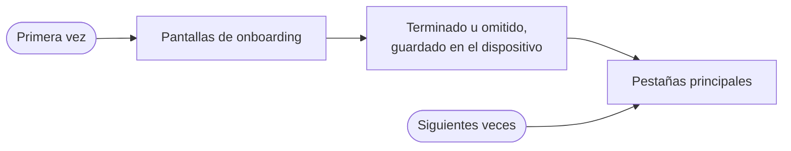

# Base de la app

La base de la app (el app shell) es el punto de partida de la app de Gelpy. Reúne la navegación, el onboarding de la primera vez, los ajustes de idioma y de tema, y el diseño para teléfonos y navegadores. El inicio de sesión, en producción desde el 2026-11-07, se construye dentro de ella, y lo mismo harán las funciones que vienen después, como las solicitudes.

:::note Estado

La base de la app corre en producción en la web desde la versión 0.2.0 de la app (2026-11-03). En Android está en el build de producción de Android desde el 2026-11-08. Ese build se instala como APK; la app no está en Google Play.

:::

La misma app corre en Android y en el navegador.

## Navegación

La app tiene tres pestañas principales, en este orden:

| Pestaña | Hoy |
|---------|-----|
| Inicio | La pantalla de partida. Muestra una vista de "próximamente". |
| Tareas | Muestra una vista de "próximamente". |
| Perfil | Cuenta (foto o silueta, nombre, correo, una fila de teléfono y Passkeys), los ajustes de idioma y de tema, Preferencias › Notificaciones en Android, y un pie con las versiones de la app y de la API. |

En Android y en los teléfonos, las pestañas quedan en la parte inferior de la pantalla. En la web, las tablets (de 768 a 1023 px) usan un riel lateral de 88 px, y las computadoras (desde 1024 px) una barra lateral de 240 px. En la web, cada pestaña tiene su propia dirección, así que los enlaces y el botón Atrás del navegador funcionan.

## Onboarding

- La primera vez, la app muestra unas pocas pantallas de onboarding antes de las pestañas.
- Se puede omitir el onboarding en cualquier momento.
- Cuando se termina u omite, la app lo recuerda en el dispositivo y desde entonces va directo a las pestañas.
- En Android, una pantalla pide el permiso de notificaciones de Android. Se puede responder "Ahora no", y el onboarding no vuelve a preguntar. El permiso por sí solo no activa ninguna notificación: "Novedades de Gelpy" se activa solo con su interruptor en Perfil. En la web este paso no aparece.

## Idiomas

- La app está en español y en inglés. El español es el idioma por defecto.
- El idioma se cambia en Perfil. Todo el texto visible cambia al instante, sin reiniciar la app.
- La elección se guarda en el dispositivo y se mantiene la próxima vez que se abre la app.
- Cada texto existe en los dos idiomas, y las pruebas verifican que no falte ninguno.
- En la web también se actualiza el idioma de la página, para que los lectores de pantalla y los traductores lo lean bien.

## Temas

- En Perfil se elige entre tres opciones: **Sistema**, **Claro** y **Oscuro**.
- **Sistema** es la opción por defecto y sigue el ajuste del dispositivo.
- La elección se guarda en el dispositivo y se mantiene al reiniciar.
- Los colores, la tipografía y los espacios vienen del sistema de diseño de Gelpy. El modo oscuro usa superficies azul marino.
- El texto cumple el contraste WCAG AA en claro y en oscuro. Una prueba automática de accesibilidad lo verifica.

## Tamaños de pantalla

La app web se adapta a teléfonos, tablets y computadoras. Las pruebas revisan tres clases de ancho en 9 viewports.

## Preferencias locales

El idioma, el tema y el avance del onboarding se guardan solo en el dispositivo, como preferencias locales. No contienen datos personales. Las credenciales de inicio de sesión nunca se guardarán con ellas.

## Páginas relacionadas

- [Visión general de la arquitectura](./overview.md)
- [Flujo de datos](./data-flow.md)
- [Notificaciones push](./push.md)
