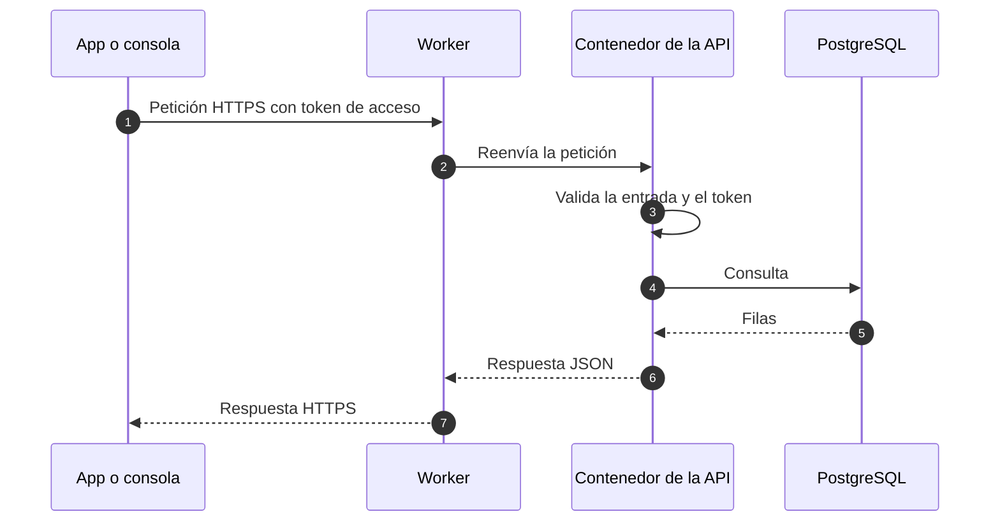
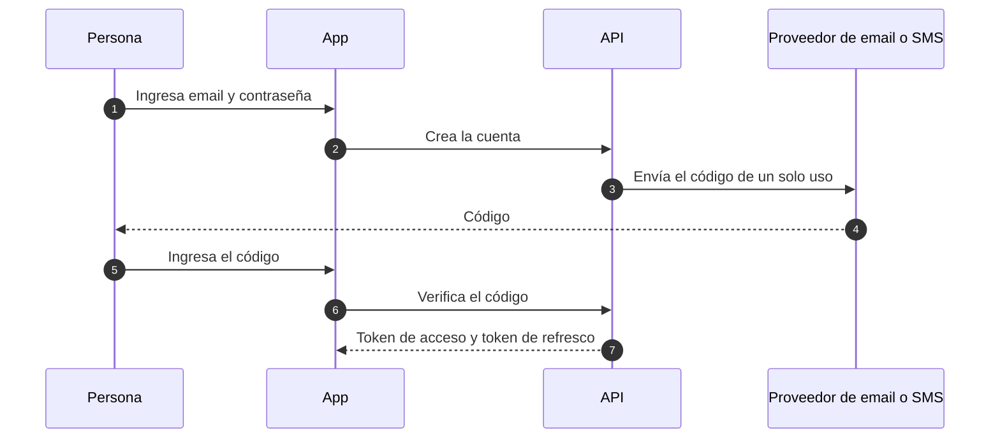

# Flujo de datos

Esta página muestra cómo se mueven los datos en el sistema previsto para la Fase 1. Describe el diseño, no un servicio en funcionamiento.

## Recorrido de una petición

- Todo el tráfico usa HTTPS.
- La API valida la entrada de cada petición con esquemas (Zod) antes de usarla.

## Inicio de sesión (previsto)

Las personas inician sesión con Google o con email y contraseña. Un código de un solo uso (OTP) enviado por email o SMS verifica la cuenta. En Android se puede activar el desbloqueo biométrico, y en Android y web se puede registrar una passkey que el servidor verifica.

- Las contraseñas se guardan solo como hashes con sal.
- Los códigos de un solo uso se guardan solo como hashes. Vencen a los 10 minutos, admiten como máximo 5 intentos y nunca se escriben en los logs.
- Cada token de refresco sirve una sola vez: al usarlo se emite uno nuevo. Cerrar sesión lo revoca.
- Los desafíos de passkey vencen y no se pueden reutilizar.

## Notificaciones (previsto)

En Android, cada persona decide si recibe notificaciones push. La app registra el dispositivo en la API, la API envía cada notificación por un servicio push y registra cada entrega para no enviar la misma notificación dos veces.

## Datos en reposo

- La base de datos es la fuente de verdad.
- Los datos personales se limitan a lo que el producto necesita: nombre, email y teléfono.
- Los datos de test nunca vienen de producción.

## Páginas relacionadas

- [Visión general de la arquitectura](./overview.md)
- [Visión general de seguridad](../security/overview.md)
