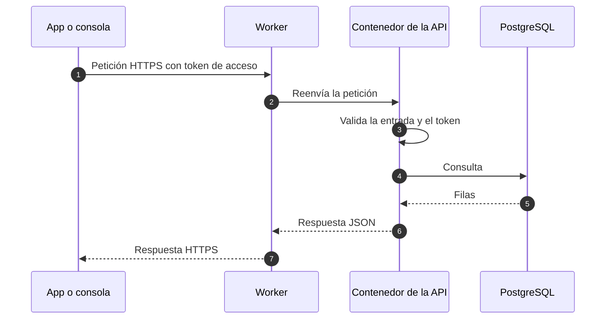

# Flujo de datos

Esta página muestra cómo se mueven los datos en el sistema previsto para la Fase 1. Describe el diseño, no un servicio en funcionamiento.

## Recorrido de una petición

- Todo el tráfico usa HTTPS.
- La API valida la entrada de cada petición con esquemas (Zod) antes de usarla.

## Inicio de sesión

Las personas se registran con correo y contraseña, confirmados con un link por correo, o con Google. El teléfono se agrega después y se verifica por SMS. Las sesiones usan tokens de refresco de un solo uso. Consulta [Identidad e inicio de sesión](../security/identity.md) para ver los flujos, su estado y cómo se manejan los datos de identidad.

## Notificaciones (previsto)

En Android, cada persona decide si recibe notificaciones push. La app registra el dispositivo en la API, la API envía cada notificación por un servicio push y registra cada entrega para no enviar la misma notificación dos veces.

## Datos en reposo

- La base de datos es la fuente de verdad.
- Los datos personales se limitan a lo que el producto necesita: nombre, email y teléfono.
- Los datos de test nunca vienen de producción.

## Páginas relacionadas

- [Visión general de la arquitectura](./overview.md)
- [Visión general de seguridad](../security/overview.md)
