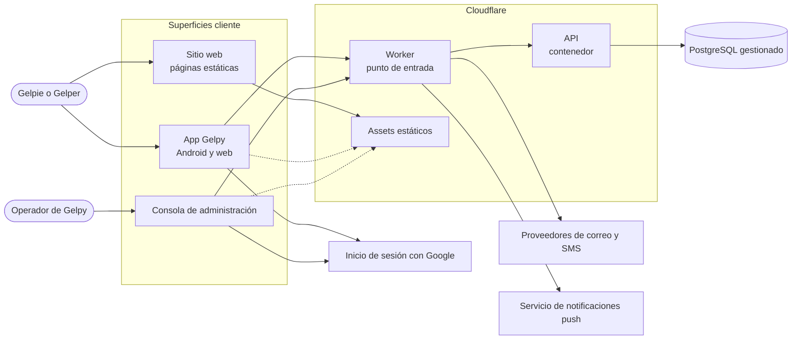
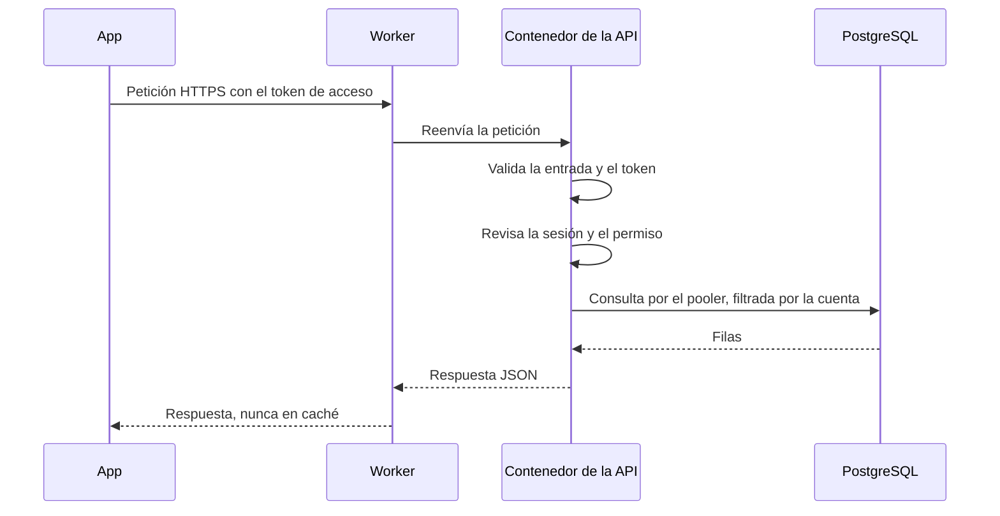
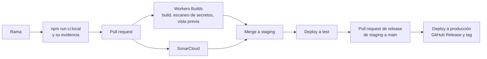

# Visión general de la arquitectura

Gelpy se está construyendo para conectar a profesionales de servicios generales con personas que necesitan ayuda, con seguridad y confianza. La Fase 1 construye la base de la aplicación: cuentas, inicio de sesión, navegación y notificaciones. El trabajo de la Fase 2, el piloto controlado del marketplace, empezó el 2026-11-08; en producción queda apagada detrás de la puerta de invitación del piloto.

:::note Estado

Gelpy está en prelanzamiento y no tiene clientes. «En producción» significa desplegado en el entorno de producción, donde el equipo lo prueba antes del lanzamiento. Estas partes están en producción:

- la base de la app en la web, desde el 2026-11-03;
- las cuentas y el inicio de sesión, desde el 2026-11-07;
- el primer build de producción para Android, las notificaciones push, la consola de administración y las páginas legales del sitio web, desde el 2026-11-08;
- el Libro de Reclamaciones, el registro por invitación y los módulos nuevos de la consola de administración, desde el 2026-11-15. Los cambios de la app de ese día están en la web, y llegan a Android con su próximo build.

Una capacidad se documenta como disponible solo cuando llega a producción; lo demás figura como previsto. Ver [Qué está en producción](../product/overview.md).

:::

## Contexto del sistema

Dos tipos de personas usarán Gelpy a través de tres superficies. Cada superficie habla con una sola API, y solo la API lee y escribe en la base de datos.

## Componentes

| Componente | Función | Tecnología |
|------------|---------|------------|
| App | El producto para Gelpies y Gelpers, en Android y en el navegador | Expo, React Native, TypeScript, Expo Router, TanStack Query |
| Sitio web | Páginas públicas en español e inglés | Nuxt (prerenderizado), Vue, TypeScript, Tailwind CSS |
| Consola de administración | Administración para el equipo de Gelpy | Next.js (exportación estática), React, TypeScript, Tailwind CSS |
| API | Lógica de negocio, autenticación y acceso a datos | Node.js, Express, TypeScript, Zod, cliente de Prisma |
| Base de datos | Fuente de verdad de los datos | PostgreSQL 17 gestionado, con migraciones SQL y un migrador pequeño en Node |
| Sistema de diseño | Tokens y assets de marca | Un paquete versionado de tokens de diseño y assets SVG |
| Docs de ingeniería | Este sitio | Docusaurus en Cloudflare Workers |

## Plataforma de ejecución

- **El Worker** recibe cada petición. Inicia el contenedor de la API cuando hace falta, reenvía la petición y lleva los correos, SMS y notificaciones push de la API a sus proveedores.
- **La API** corre como contenedor en Cloudflare Containers. Valida cada entrada con un esquema, revisa el token y la sesión en las rutas protegidas y revisa el permiso de administrador en las rutas de la consola. Es el único componente que llega a la base de datos.
- **La base de datos** es PostgreSQL gestionado. La API se conecta a ella a través del pooler de conexiones del proveedor (ADR-0016). Tiene dos roles: uno es dueño del esquema y solo lo usan las migraciones, y el rol de ejecución lee y escribe datos pero no puede cambiar el esquema.
- La app, el sitio web y la consola de administración se sirven como assets estáticos desde Cloudflare.
- No hay servidores administrados por el equipo.

## Una petición de punta a punta

Una persona con sesión iniciada abre una pantalla de la app que necesita datos.

## Entornos

Hay dos entornos: **test** y **producción**.

| | Test | Producción |
|---|---|---|
| Rama | `staging` | `main` |
| Android | El build interno de preview | El build de producción |

Cada entorno tiene sus propios Workers, base de datos, secretos, clientes OAuth y configuración de passkeys. Test nunca guarda datos personales de producción, y una credencial de test nunca es válida en producción.

## Flujo de build y release

- El trabajo empieza en una rama y se fusiona en `staging` cuando pasan el gate local y las revisiones del pull request. `staging` se despliega en test.
- Un pull request de release promueve `staging` a `main`, que se despliega en producción. Requiere la aprobación explícita del dueño.
- Mientras los builds corren en Cloudflare Workers Builds, producción vuelve a construir el mismo árbol de código que se probó en `staging`.
- **Modo MVP, hasta el 2026-11-30 (ADR-0018):** las pruebas corren solo en el gate local de cada repositorio, y su evidencia va en el pull request. Cloudflare Workers Builds construye, escanea secretos, publica la vista previa y despliega. Los workflows de GitHub quedan como respaldo manual.
- Los releases siguen Semantic Versioning. Cada deploy de producción crea un GitHub Release y un tag, con notas tomadas del changelog (ADR-0004).

Los gates de cada componente están en la [Visión general de la calidad](../quality/overview.md).

## Dueño de los datos

| Datos | Dueño | Regla |
|-------|-------|-------|
| El esquema | El repositorio de la base de datos | Las migraciones SQL son la única fuente. La API genera su cliente a partir de ellas y nunca cambia el esquema. Las migraciones corren antes del deploy de la API y siguen expand and contract, para que la versión anterior y la nueva de la API funcionen durante un release (ADR-0009) |
| Cuentas, sesiones, perfiles | La API, en PostgreSQL | Cada cuenta tiene un UUID, y las consultas sensibles filtran por él. Las contraseñas se guardan solo como hashes con sal; las llaves privadas de las passkeys nunca se guardan |
| Tokens de diseño | El sistema de diseño | Ningún color, familia tipográfica ni logo se escribe fijo fuera de él (ADR-0010) |
| Contenido del sitio web | El repositorio del sitio web | Archivos en el repositorio, en español e inglés |
| Analítica | El sitio web, detrás del consentimiento; la app, prevista | El sitio web carga Google Analytics y Microsoft Clarity solo después de que la persona lo permite. En la app, los terceros recibirían un ID de analítica seudónimo, nunca el ID de la cuenta (ADR-0020) |

## Decisiones

| ADR | Qué decide |
|-----|------------|
| 0002 | Un repositorio por cada desplegable, más uno de gobierno |
| 0005 | Dos entornos: `staging` es test y `main` es producción |
| 0006 | Cloudflare como plataforma |
| 0009 | Las migraciones SQL son la fuente del esquema |
| 0016 | La API se conecta a través del pooler del proveedor |
| 0017 | Validar una vez, desplegar al fusionar, sin secretos de deploy en los pull requests |
| 0018 | CI/CD en Cloudflare Workers Builds, y el modo MVP |
| 0020 | Medición desde el diseño, detrás del consentimiento |

## Páginas relacionadas

- [Flujo de datos](./data-flow.md)
- [Base de la app](./app-shell.md)
- [Notificaciones push](./push.md)
- [Sitio web comercial](./website.md)
- [Visión general de la calidad](../quality/overview.md)
- [Visión general de seguridad](../security/overview.md)
