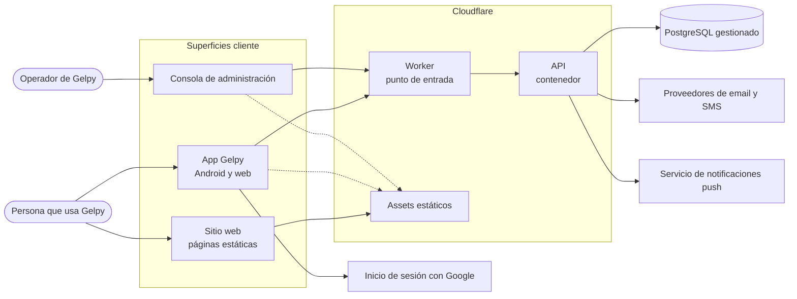
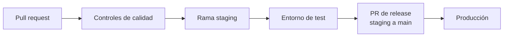

# Visión general de la arquitectura

Gelpy conecta a profesionales de servicios generales con personas que necesitan ayuda, con seguridad y confianza. La Fase 1 construye la base de la aplicación: cuentas, inicio de sesión, navegación y notificaciones. Las funciones de marketplace llegan en la Fase 2.

:::note Estado

La Fase 1 está en desarrollo. Esta página describe el diseño previsto. Una capacidad se documenta como disponible solo cuando llega a producción.

:::

## Contexto del sistema

## Componentes

| Componente | Función | Tecnología |
|------------|---------|------------|
| App | El producto que usan las personas, en Android y en el navegador | Expo, React Native, TypeScript, Expo Router, TanStack Query |
| Sitio web | Páginas públicas en español e inglés | Nuxt (generación estática), TypeScript, Tailwind CSS |
| Consola de administración | Administración interna para los operadores de Gelpy | Next.js, TypeScript, Tailwind CSS |
| API | Lógica de negocio, autenticación y acceso a datos | Node.js, Express, TypeScript, Zod, cliente de Prisma |
| Base de datos | Fuente de verdad de los datos | PostgreSQL gestionado con migraciones SQL |
| Sistema de diseño | Tokens de diseño y assets compartidos | Tokens de diseño, assets SVG |
| Docs de ingeniería | Este sitio | Docusaurus en GitHub Pages |

## Plataforma de ejecución

- La API corre como contenedor en Cloudflare Containers, detrás de un Cloudflare Worker que recibe cada petición.
- La app, el sitio web y la consola de administración se sirven como assets estáticos desde Cloudflare.
- La base de datos es PostgreSQL gestionado, al que se accede a través de Cloudflare Hyperdrive.
- No hay servidores administrados por el equipo.

## Entornos

Hay dos entornos: **test** y **producción**. Cada uno tiene su propio Worker, base de datos, secretos, clientes OAuth y configuración de passkeys. Test nunca guarda datos personales de producción.

## Flujo de build y release

- El trabajo empieza en una rama y se fusiona en `staging` cuando pasan los controles de calidad. `staging` se despliega en el entorno de test.
- Un PR de release promueve `staging` a `main`, que se despliega en producción. Requiere la aprobación explícita del dueño.
- Producción corre la misma imagen de la API que se probó en `staging`. La imagen no se vuelve a construir.
- Los releases siguen Semantic Versioning. Cada release tiene un tag de Git y notas tomadas del changelog.

## Dueño del modelo de datos

Las migraciones SQL son la única fuente del esquema de la base de datos. La API genera su cliente de base de datos a partir de ese esquema y nunca lo modifica. Las migraciones corren antes del deploy de la API y siguen el patrón expand and contract, para que la versión anterior y la nueva de la API funcionen durante un release.

## Páginas relacionadas

- [Flujo de datos](./data-flow.md)
- [Visión general de seguridad](../security/overview.md)
