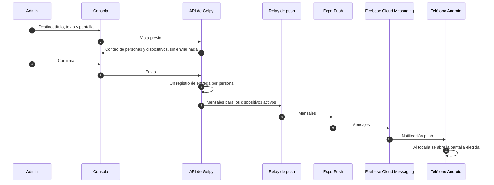

# Notificaciones push

Esta página describe cómo Gelpy envía notificaciones push: cómo se activan, cómo se registran los dispositivos, qué recorrido hace un envío hasta el teléfono y cómo los admins envían y siguen las notificaciones desde la consola. Describe flujos, no pantallas.

:::note Estado

Las notificaciones push están en producción desde el 2026-11-08: en la API, en la app del build de producción de Android y en la consola de admins. La prueba de punta a punta del dueño en producción pasó el 2026-11-08. El build de producción de Android se instala como APK; la app no está en Google Play.

:::

| Capacidad | Estado |
|-----------|--------|
| El tipo "Novedades de Gelpy" en Android, con activación voluntaria | Producción |
| Registro y revocación de dispositivos | Producción |
| Envío desde la consola, con vista previa e historial | Producción |
| Confirmaciones de entrega, procesadas a pedido | Producción |
| Push en el navegador, e iOS | Previsto, fuera del alcance actual |
| Procesamiento programado de las confirmaciones | Previsto |
| Un envío idéntico repetido dentro de 10 minutos devuelve el envío guardado | Previsto |
| Borrar el token guardado al revocar un dispositivo | Previsto |
| Roles de la consola por función | Previsto |
| Un tipo transaccional para el piloto del marketplace | Previsto |
| Las cuentas desactivadas salen de las audiencias | Previsto |

## Tipo de notificación y activación

Hay un solo tipo de notificación: **Novedades de Gelpy**. Está clasificado como promocional, así que se activa por decisión propia y viene apagado. Un tipo sin preferencia guardada cuenta como apagado.

- Las notificaciones push funcionan solo en Android. En la web el ajuste no aparece, y no hay push en el navegador.
- Se activan en Perfil › Preferencias › Notificaciones › Novedades de Gelpy. Activarlo también requiere el permiso de notificaciones de Android.
- El onboarding de Android tiene una pantalla que pide el permiso de notificaciones, pero solo el interruptor de Perfil activa el tipo.
- Al tocar una notificación se abre la pantalla de la app que eligió quien la envió, de una lista de pantallas permitidas.
- Un envío desde la consola siempre llega como push, nunca como correo.

## Dispositivos

Cada instalación de la app registra su propio dispositivo:

- Una instalación se registra después de iniciar sesión o de restaurar la sesión, cuando la persona activa el interruptor y concede el permiso. Sin el permiso no se registra ningún dispositivo.
- Cada persona solo puede registrar o revocar su propio dispositivo. El dispositivo de otro usuario responde "no encontrado".
- Al cerrar sesión, la app revoca el dispositivo de esta instalación antes de borrar la sesión. Si la revocación falla, el cierre de sesión sigue igual.
- Cuando una confirmación de entrega dice que el dispositivo ya no está registrado, el dispositivo se desactiva.

Revocar un dispositivo lo desactiva. Borrar el token guardado al revocarlo está previsto.

## Recorrido de un envío

- El contenedor de la API nunca guarda la credencial de acceso del servicio push. Un relay separado en el borde la guarda y es el único componente que habla con el servicio push. Los SMS siguen el mismo patrón.
- Un envío llega solo a las personas con un dispositivo activo y el tipo activado.
- Cada envío guarda un registro de entrega por persona, con una clave de deduplicación, así que repetir un envío nunca manda un segundo mensaje.

## Confirmaciones de entrega

Las confirmaciones se procesan a pedido, sin ninguna tarea programada. Los estados de entrega pasan de enviado a entregado o fallido cuando la consola lee el historial o un admin pulsa "Actualizar estados". Hasta entonces, los estados pueden ir con retraso. El procesamiento programado está previsto.

## Consola de admins

La consola está en producción desde el 2026-11-08. Solo entran los admins con una cuenta Google de la organización `gelpy.app`. El menú sigue los permisos que devuelve la API: `console:access`, `push:read` y `push:send`. En producción cada admin tiene los tres; los roles de la consola por función están previstos.

La consola funciona en español y en inglés, en claro y en oscuro, en computadora y en teléfono.

### Enviar

- Un destino: un usuario buscado por correo, todos los Gelpies, todos los Gelpers o ambos.
- Un título de hasta 65 caracteres y un texto de hasta 240.
- La pantalla de la app que se abre al tocar la notificación.
- Una vista previa, revisada antes de cualquier petición.
- La API devuelve el conteo de personas y dispositivos sin enviar nada ("N personas · M dispositivos"). El envío sale solo después de confirmar, y los conteos guardados son iguales a los de la vista previa.
- Un correo sin cuenta responde "no encontrado" y no guarda nada.

### Historial

- Los envíos aparecen del más reciente al más antiguo.
- Cada envío tiene un detalle con los conteos de entrega por estado, quién lo envió y los códigos de falla.
- "Actualizar estados" procesa las confirmaciones pendientes.
- El historial muestra el total de dispositivos activos de Gelpies, de Gelpers y en general.

## Auditoría y privacidad

- Cada envío guarda quién lo hizo, la audiencia, el contenido y los conteos, y un evento de auditoría con el ID del admin y el ID del envío.
- Ninguna línea de log ni fila de auditoría guarda un correo. El correo que se escribe para buscar a un destinatario nunca se registra.
- Ninguna respuesta de la API incluye un token push, y ningún log guarda un token push ni un token de acceso.
- Las respuestas de admin que muestran correos solo llegan a quienes tienen `push:read`, y nunca se guardan en caché.

## Páginas relacionadas

- [Flujo de datos](./data-flow.md)
- [Base de la app](./app-shell.md)
- [Identidad e inicio de sesión](../security/identity.md)
