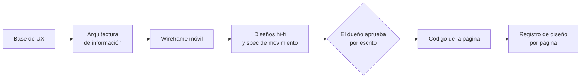
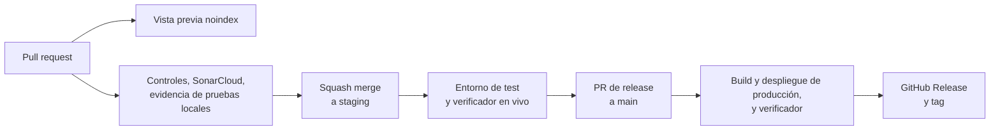

# Sitio web comercial

Esta página describe el sitio web público en `gelpy.app`: cómo está construido, qué rutas sirve, qué controles pasa cada cambio, cómo se diseñan sus páginas, cómo se va a medir y cómo se despliega.

:::note Estado

El sitio web está en producción desde la versión 0.6.0 (2026-11-08); la verificación en producción encontró 20 páginas y 0 problemas. Producción se sirve con noindex: la indexación espera la aprobación del dueño, y no hay indexación durante el piloto. El sitio no tiene inicio de sesión y no llama a la API del producto.

:::

## Stack

El stack lo fija una decisión de arquitectura (ADR-0013):

- **Nuxt** (Vue 3, TypeScript) con generación estática. Cada ruta se pre-renderiza como HTML completo que se lee sin JavaScript.
- **Assets estáticos de Cloudflare Workers**, sin script de Worker. El sitio sirve un 404 real y localizado, y agrega la barra final de las rutas automáticamente.
- **Estilos solo del sistema de diseño de Gelpy**: su preset de Tailwind, los tokens, los tokens de movimiento y la tipografía Urbanist alojada en el propio sitio.
- **Movimiento** primero con CSS, View Transitions entre páginas y GSAP solo donde hace falta. Solo anima transform y opacity, y la preferencia de movimiento reducido lo apaga.
- **Sin runtime de i18n**. Un hook de rutas agrega las rutas en inglés. Quitar el runtime bajó el JavaScript inicial de 99.8 a 77.3 KB gzip por ruta.

## Idiomas

- El español (es-PE) está en `/` y el inglés bajo `/en/`. Cada idioma se escribe de forma nativa, no como traducción literal.
- Los controles de idioma y de tema están arriba a la derecha.
- Cada página declara enlaces canonical y hreflang recíprocos (es-PE, en y x-default).

## Rutas

| Página | Español | Inglés | Notas |
|--------|---------|--------|-------|
| Inicio | `/` | `/en/` | El hero reproduce la animación de bienvenida una vez |
| Gelpers | `/gelpers/` | `/en/gelpers/` | |
| Gelpies | `/gelpies/` | `/en/gelpies/` | |
| Empresas | `/empresas/` | `/en/companies/` | |
| Ayuda | `/ayuda/` | `/en/help/` | Datos FAQPage con exactamente las 8 preguntas visibles |
| Nosotros | `/nosotros/` | `/en/about/` | |
| Seguridad | `/seguridad/` | `/en/safety/` | Cada afirmación de seguridad cita un Work Item en Done |
| Privacidad | `/privacidad/` | `/en/privacy/` | Borrador |
| Cookies | `/cookies/` | `/en/cookies/` | Borrador |
| Términos | `/terminos/` | `/en/terms/` | Borrador |
| No encontrada | 404 localizado | 404 localizado | Un estado 404 real |

Rutas previstas:

- La página del Libro de Reclamaciones (`/libro-de-reclamaciones/` y `/en/complaints-book/`): en test desde el 2026-11-10, a producción con el próximo release del sitio.
- `/legal/versions.json`, la lista de versiones de los textos legales.
- `/.well-known/assetlinks.json`, el archivo Digital Asset Links que necesitan las passkeys en Android.

## Estructura de la página

- Un encabezado fijo de 64 px con cuatro páginas. "Abrir la app" abre la app en una pestaña nueva.
- Por debajo de 768 px, el encabezado pasa a un menú hamburguesa.
- El hero de inicio reproduce la animación de bienvenida una sola vez, durante unos 3.3 s.
- El pie de página tiene 9 enlaces a páginas y un grupo "Tecnología" con enlaces al portal de ingeniería, la wiki y la consola.
- La línea de copyright muestra la versión del sitio.

## Páginas legales

- Las páginas de privacidad, cookies y términos son borradores desde el 2026-11-08. Cada una muestra el aviso "Borrador en revisión / Draft under review" y la fecha de versión 2026-11-08.
- El build rechaza cualquier marcador entre corchetes, así que ningún texto sin terminar puede salir publicado.
- Desde el 2026-11-08, registrarse en la app requiere aceptar los términos y la política de privacidad.
- Previsto: la aprobación de un abogado, que quita el aviso de borrador, y una segunda versión de privacidad con etiquetas de versión y hashes publicados de cada texto.

## Controles de calidad

### Presupuestos de laboratorio

Son mediciones de laboratorio que cada cambio debe cumplir, no promesas sobre cada visita:

| Presupuesto | Límite |
|-------------|--------|
| Rendimiento móvil en Lighthouse | ≥ 90 |
| Accesibilidad en Lighthouse | 100 |
| Largest Contentful Paint (LCP) | ≤ 2.5 s |
| Cumulative Layout Shift (CLS) | ≤ 0.1 |
| Total Blocking Time (TBT) | ≤ 200 ms |
| JavaScript inicial por página | ≤ 100 KB gzip |
| Áreas táctiles | ≥ 48 px |
| Llamada a la acción principal | Visible en 360 × 640 |
| Desplazamiento horizontal | Ninguno entre 320 y 1366 px |
| Contraste | WCAG AA, en claro y en oscuro |
| Duración de las animaciones | Nada salvo el hero anima más de 600 ms |

Resultados de laboratorio registrados, en el entorno de test el 2026-11-05 y el 2026-11-06: LCP móvil mediano de 2.14 s en `/` y de 2.13 s en `/en/`, CLS de 0 y medianas de TBT entre 0 y 32 ms.

### Controles en cada pull request

- Auditoría de dependencias, con 0 hallazgos altos o críticos
- Lint, lint de marca y chequeo de tipos
- Pruebas con al menos 90% de cobertura
- Build
- Un verificador del sitio: enlaces canonical y alternos, `lang`, un solo `h1`, un landmark `main`, un enlace para saltar al contenido, JSON-LD, enlaces locales, la imagen Open Graph, la política de noindex y un 404 real
- Un control de afirmaciones: cada afirmación pública tiene evidencia, y una lista de términos prohibidos tiene 0 coincidencias
- axe, con 0 violaciones
- Lighthouse CI
- El control del tamaño del bundle
- La prueba del presupuesto de movimiento
- El quality gate de SonarCloud

## Reglas de contenido

- Sin métricas, testimonios, logos ni cantidades de socios inventados.
- La visión nunca se escribe en presente.
- Sin soporte 24/7, garantías, verificación ni planes premium hasta que existan.
- Sin promesas de posicionamiento en buscadores.
- Las funciones del marketplace nunca se presentan como disponibles.

## Flujo de diseño

- Cada página se diseña en Claude Design antes de escribir código: la base de UX, la arquitectura de información, un wireframe móvil y diseños hi-fi en 360, 390, 768 y 1280 px, en claro y en oscuro, en español y en inglés, más una spec de movimiento.
- El dueño aprueba el diseño por escrito antes de empezar el código de la página.
- Cada página tiene un registro de diseño. Cada cambio visible actualiza su diseño en el mismo pull request.
- Desde el 2026-11-09, un Product Designer diseña cada pantalla nueva con todos sus estados.
- El trabajo visual pasa el checklist de marca, y los textos pasan la auditoría de afirmaciones públicas.

## Medición

Hoy no carga en `gelpy.app` ningún proveedor de analítica, gestor de etiquetas ni grabación de sesiones, y no hay banner de consentimiento. Lo que existe hoy:

- Los registros de laboratorio de arriba
- Un checklist interno de visibilidad
- El verificador en vivo después de cada despliegue

Previsto, en este orden:

1. Un controlador de consentimiento. Nada carga antes del consentimiento. La analítica y la experiencia son finalidades separadas. El consentimiento se puede retirar desde el pie de página. El banner funciona con el teclado. Rechazar quita los proveedores. Las señales de publicidad quedan denegadas. Las herramientas de Google cargan solo a través de Tag Manager, y la grabación de sesiones oculta el contenido.
2. Google Analytics 4, Google Tag Manager y Microsoft Clarity en producción, después de la aprobación del abogado.

## Despliegue

- El sitio web se construye en Cloudflare Workers Builds desde el 2026-11-06; el sitio web fue el piloto de ese cambio.
- Cada push a un pull request construye una vista previa con noindex.
- Antes del merge, un pull request necesita un comentario con la evidencia de las pruebas locales para su último commit, el gate de SonarCloud en verde, el build en la nube en verde y la rama al día.
- Un squash merge a `staging` despliega el entorno de test, y el verificador en vivo lo revisa.
- Un PR de release desde una rama de release a `main` necesita la aprobación explícita del dueño.
- El build de `main` corre un escaneo de secretos de los commits fusionados, el build y el despliegue de producción y el verificador en vivo, y luego crea el GitHub Release y su tag.
- Los workflows de GitHub Actions quedan como respaldo que solo se ejecuta a mano.

## Páginas relacionadas

- [Visión general de la arquitectura](./overview.md)
- [Desbloqueo con huella y passkeys](../security/biometrics-passkeys.md)
