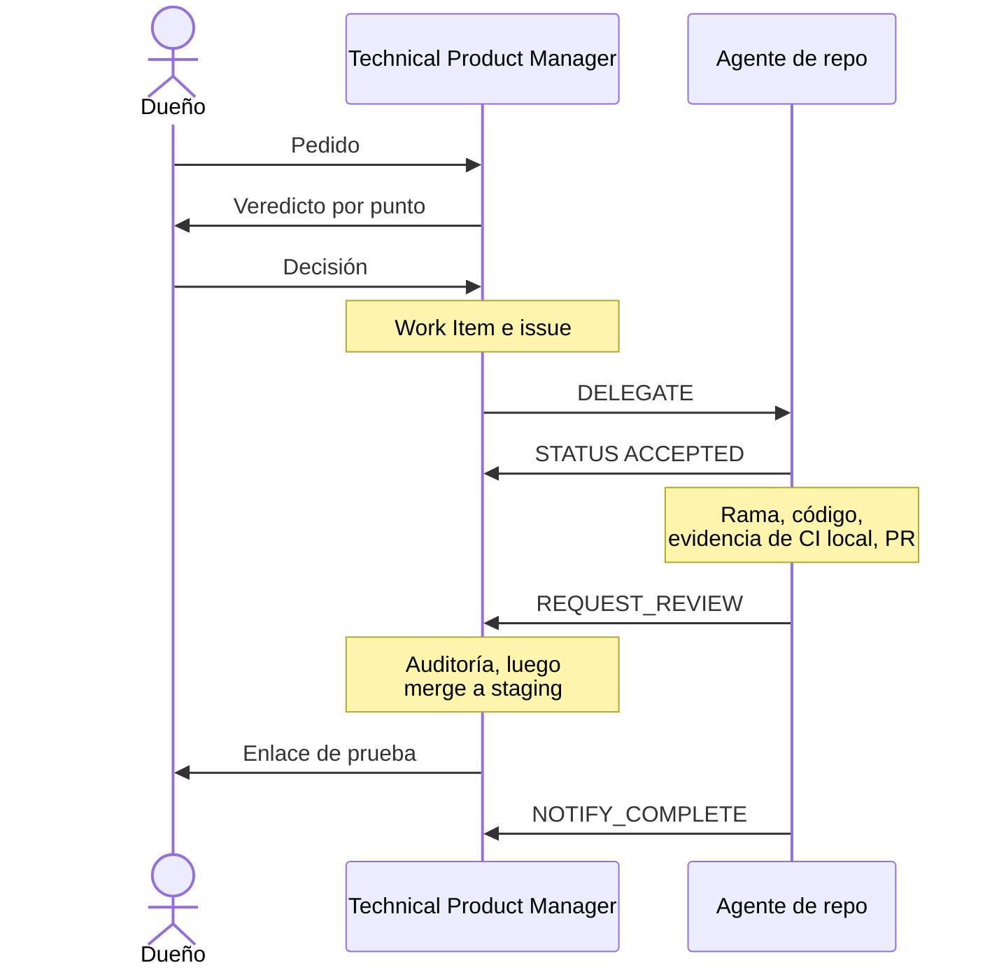

# El equipo de agentes

Los agentes trabajan como una oficina de startup. Un dueño coordina a dos jefes y es el único que decide. Cada agente tiene un cargo de oficina y un área. Es dueño de esa área y nunca trabaja fuera de ella. Los ids de los agentes y los nombres de sus perfiles no cambiaron con los cargos.

## Producto e Ingeniería

A cargo del **Technical Product Manager** (el Master). Tres equipos sin jefe.

| Equipo | Cargo | Agente | Es dueño de | Nunca hace |
|--------|-------|--------|-------------|------------|
| Jefe | Technical Product Manager | El Master | El backlog, las specs, los Work Items, las prioridades propuestas, el gobierno, el plan entre repos, la delegación, el estado y la coordinación de la entrega, incluidas las auditorías y los merges de PRs | Escribir código de producto, ni fijar la dirección del producto (lo hace el dueño) |
| Plataforma | Ingeniero de Plataforma (DevOps) | Agent Infra | Plataforma Cloudflare, DNS, entornos, el inventario de secretos (solo nombres), observabilidad, herramientas de calidad (`infrastructure/`) | Editar repos de producto |
| Plataforma | Ingeniero de Base de Datos | Agent DB | `gelpy-db`: migraciones SQL, la única fuente del esquema (ADR-0009) | Tocar producción fuera de un release aprobado |
| Plataforma | Desarrollador Backend | Agent API | `gelpy-api`: Express, TypeScript, Prisma, Clean Architecture, Cloudflare Containers | Cambiar el esquema (eso es trabajo de Agent DB) |
| Apps | Desarrollador Mobile | Agent App | `gelpy-app`: app Expo para Android, iOS y web | Programar una pantalla nueva sin un diseño aprobado |
| Apps | Desarrollador Frontend (web) | Agent Web | `gelpy-web`: sitio web comercial en Nuxt, motion web, videos HyperFrames | Publicar textos que no cumplen las reglas de afirmaciones públicas |
| Apps | Desarrollador Frontend (back office) | Agent Console | `gelpy-console`: consola de admins en Next.js | Entregar una pantalla nueva sin un diseño aprobado |
| Diseño y Docs | Product Designer (UX/UI) | `gelpy-ux-ui` | El diseño de cada pantalla o flujo nuevo en el canvas de diseño, con todos sus estados, antes de cualquier código | Cambiar tokens, aprobar un diseño o escribir código de producto |
| Diseño y Docs | Ingeniero de Design Systems | Agent Design | `gelpy-design-system`: tokens, assets, `BRAND.md`; el único agente que cambia los assets de marca y los tokens | Dejar que otros repos escriban valores de marca a mano |
| Diseño y Docs | Redactor Técnico | Agent Docs | `Gelpy/gelpy`: este sitio público y su espejo en la wiki | Publicar secretos, hosts internos, datos personales o vulnerabilidades abiertas |
| Externo | Revisor de código de releases | Codex | La revisión de los PRs de release, solo de esos | Aprobar por silencio: no responder no es aprobar |

## Negocio

A cargo del **Gerente de Estrategia** (el Business Coach). Ver [Gerente de Estrategia](./business-coach.md).

| Cargo | Agente | Es dueño de | Nunca hace |
|-------|--------|-------------|------------|
| Gerente de Estrategia | El Business Coach | Estrategia de negocio para Perú (validación, economía, crecimiento, financiamiento); la memoria `business/` | Autorizar implementación, gastos, publicación o producción |
| Analista Legal | Legal Peru | Investigación legal peruana desde fuentes oficiales, y borradores legales; un rol de investigación | Actuar como abogado (los borradores necesitan la aprobación de un abogado) |
| Growth Marketer | Marketing | Posicionamiento y experimentos de crecimiento para ambos lados del marketplace en Perú | Lanzar campañas o gastar sin el dueño |
| Roles a pedido | Temporales | Una disciplina y una pregunta a la vez: Analista Financiero, Coordinador de Operaciones, UX Researcher o Ejecutivo de Alianzas; como máximo tres a la vez | Delegar a otros |

Eso suma 13 agentes, más Codex y los roles a pedido.

## Product Designer

El Product Designer diseña cada pantalla o flujo nuevo en el canvas de diseño antes de cualquier código. Cada diseño cubre todos sus estados, en claro y oscuro, en español e inglés:

- vacío, cargando, error y éxito;
- retomar;
- función apagada y sin permiso;
- sin conexión.

No cambia tokens (lo hace el Ingeniero de Design Systems), no aprueba nada (lo hace el dueño) y no escribe código de producto. Un cambio visual pequeño queda en manos del agente de repo, que actualiza el canvas en el mismo PR. La skill `gelpy-design-product-experience` define sus pasos.

## Cómo trabajan

- Cada agente de repo trabaja en su propia sesión en la nube, en paralelo. El Technical Product Manager los coordina y delega directamente en cada uno.
- Un especialista o agente de repo toma trabajo solo de su jefe.
- Cada sesión nombra su rol. Las sesiones del Product Designer usan el rol `UX`.
- Un agente de repo nunca edita otro repo. Envía un `REQUEST_CHANGE` al agente dueño, a través de su jefe.
- **El trabajo entre las áreas va de jefe a jefe.** El Gerente de Estrategia envía un `REQUEST_CHANGE` al Technical Product Manager. El Technical Product Manager envía un `REQUEST_REVIEW` o un `REQUEST_INFO` al Gerente de Estrategia en lugar de llamar él mismo a Legal o a Marketing.
- **Transferencias entre sesiones.** Cuando un agente no puede hacer push, entrega sus commits como un patch con un manifiesto de checksums. Quien lo recibe verifica cada checksum y el árbol de git resultante antes de hacer push.
- El Technical Product Manager audita cada PR antes del merge: secretos, alcance, evidencia y coincidencia con el diseño.

## Protocolo de mensajes

La skill `gelpy-orchestrate-agents` define el protocolo.

| Pedido | Uso |
|--------|-----|
| `DELEGATE` | Asignar un Work Item a un agente |
| `REQUEST_CHANGE` | Pedir un cambio al dueño de otro repo |
| `REQUEST_REVIEW` | Pedir la revisión de un trabajo terminado |
| `REQUEST_INFO` | Pedir un dato que falta |
| `NOTIFY_COMPLETE` | Avisar que el trabajo está completo |
| `NOTIFY_BLOCKED` | Avisar que el trabajo está bloqueado |

- Cada pedido lleva From, To, Work Item, Priority, Context, Dependencies y Artifacts.
- Las respuestas son mensajes `STATUS`: `ACCEPTED`, `COMPLETED`, `BLOCKED` o `NEEDS_INFO`.
- **Desacuerdo.** Un agente de repo que no está de acuerdo con un `DELEGATE` responde `STATUS: NEEDS_INFO` con su veredicto. El Technical Product Manager lo lleva al dueño, que decide.

## Un Work Item, de principio a fin

## Páginas relacionadas

- [Framework agéntico de Gelpy](./overview.md)
- [Skills](./skills.md)
- [Work Items y sprints](./work-items.md)
- [Reglas del dueño y seguridad](./rules.md)
- [Gerente de Estrategia](./business-coach.md)
