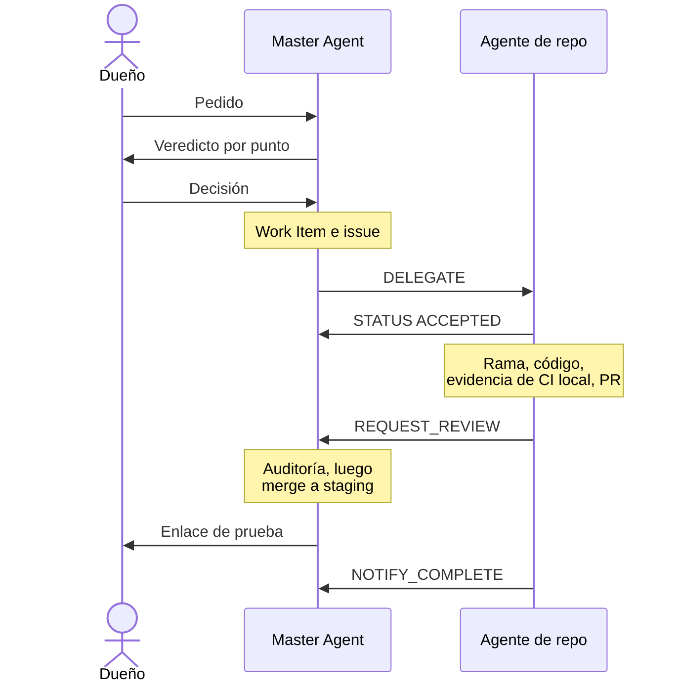

# El equipo de agentes

Cada agente tiene un área. Es dueño de esa área y nunca trabaja fuera de ella.

| Agente | Es dueño de | Nunca hace |
|--------|-------------|------------|
| Master Agent | Specs, Work Items, gobierno, el plan entre repos, delegación, estado, auditorías y merges de PRs | Escribir código de producto |
| Agent Infra | Plataforma Cloudflare, DNS, entornos, el inventario de secretos (solo nombres), observabilidad, herramientas de calidad (`infrastructure/`) | Editar repos de producto |
| Agent API | `gelpy-api`: Express, TypeScript, Prisma, Clean Architecture, Cloudflare Containers | Cambiar el esquema (eso es trabajo de Agent DB) |
| Agent DB | `gelpy-db`: migraciones SQL, la única fuente del esquema (ADR-0009) | Tocar producción fuera de un release aprobado |
| Agent App | `gelpy-app`: app Expo para Android, iOS y web | Programar una pantalla sin un diseño aprobado |
| Agent Web | `gelpy-web`: sitio web comercial en Nuxt, motion web, videos HyperFrames | Publicar textos que no cumplen las reglas de afirmaciones públicas |
| Agent Console | `gelpy-console`: consola de admins en Next.js | Entregar una pantalla sin un diseño aprobado |
| Agent Design | `gelpy-design-system`: tokens, assets, `BRAND.md`; el único agente que cambia los assets de marca | Dejar que otros repos escriban valores de marca a mano |
| Agent Docs | `Gelpy/gelpy`: este sitio público y su espejo en la wiki | Publicar secretos, hosts internos, datos personales o vulnerabilidades abiertas |
| Business Coach | Estrategia de negocio para Perú (validación, economía, crecimiento, financiamiento); la memoria `business/` | Autorizar implementación, gastos, publicación o producción |
| Legal Peru | Investigación legal peruana desde fuentes oficiales, y borradores legales | Actuar como abogado (los borradores necesitan la aprobación de un abogado) |
| Marketing | Posicionamiento y experimentos de crecimiento para ambos lados del marketplace en Perú | Lanzar campañas o gastar sin el dueño |
| Especialistas temporales | Una disciplina y una pregunta a la vez (por ejemplo, finanzas) | Delegar a otros |
| Codex | Segundo ejecutor en ramas `codex/`, y revisor de PRs de release | Aprobar por silencio: no responder no es aprobar |

## Cómo trabajan

- Cada agente de repo trabaja en su propia sesión en la nube, en paralelo. El Master los coordina.
- Un agente de repo nunca edita otro repo. Envía un `REQUEST_CHANGE` al agente dueño.
- **Transferencias entre sesiones.** Cuando un agente no puede hacer push, entrega sus commits como un patch con un manifiesto de checksums. Quien lo recibe verifica cada checksum y el árbol de git resultante antes de hacer push.
- El Master audita cada PR antes del merge: secretos, alcance, evidencia y coincidencia con el diseño.

## Protocolo de mensajes

La skill `gelpy-orchestrate-agents` define el protocolo.

| Pedido | Uso |
|--------|-----|
| `DELEGATE` | Asignar un Work Item a un agente |
| `REQUEST_CHANGE` | Pedir un cambio al dueño de otro repo |
| `REQUEST_REVIEW` | Pedir la revisión de un trabajo terminado |
| `REQUEST_INFO` | Pedir un dato que falta |
| `NOTIFY_COMPLETE` | Avisar que el trabajo está completo |
| `NOTIFY_BLOCKED` | Avisar que el trabajo está bloqueado |

- Cada pedido lleva From, To, Work Item, Priority, Context, Dependencies y Artifacts.
- Las respuestas son mensajes `STATUS`: `ACCEPTED`, `COMPLETED`, `BLOCKED` o `NEEDS_INFO`.
- **Desacuerdo.** Un agente de repo que no está de acuerdo con un `DELEGATE` responde `STATUS: NEEDS_INFO` con su veredicto. El Master lo lleva al dueño, que decide.

## Un Work Item, de principio a fin

## Páginas relacionadas

- [Framework agéntico de Gelpy](./overview.md)
- [Skills](./skills.md)
- [Work Items y sprints](./work-items.md)
- [Reglas del dueño y seguridad](./rules.md)
