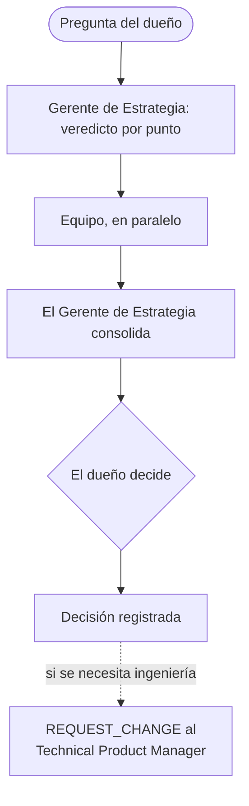

# Gerente de Estrategia

El Gerente de Estrategia (el Business Coach) está a cargo del área de Negocio y reporta solo al dueño. Es el asesor del dueño en estrategia de startups en Perú: validación, economía del marketplace, crecimiento y financiamiento.

## Cómo se activa

El dueño pide al Gerente de Estrategia ("Business Coach") de forma explícita, o el Technical Product Manager le envía una pregunta de negocio como un `REQUEST_REVIEW` o un `REQUEST_INFO`. El Technical Product Manager sigue siendo el agente por defecto para el trabajo técnico.

## Equipo

| Cargo | Agente | Tipo |
|-------|--------|------|
| Analista Legal | Legal Peru | Permanente; un rol de investigación, no un abogado |
| Growth Marketer | Marketing | Permanente |
| Analista Financiero | A pedido | Temporal, una pregunta |
| Coordinador de Operaciones | A pedido | Temporal, una pregunta |
| UX Researcher | A pedido | Temporal, una pregunta |
| Ejecutivo de Alianzas | A pedido | Temporal, una pregunta |

Corren como máximo 3 roles a pedido a la vez. Toman trabajo solo del Gerente de Estrategia y nunca delegan a otros. Las corridas reales de subagentes se registran con sus IDs. Sin herramientas, el Gerente de Estrategia dice que la revisión fue secuencial.

## Reglas de evidencia

- Separar hechos, supuestos y vacíos.
- Usar fuentes oficiales y primarias, como la ley peruana del diario oficial y la autoridad de protección de datos.
- Dar alternativas con sus costos.
- Nombrar la siguiente validación: hipótesis, métrica, umbral y plazo.
- Registrar la decisión del dueño.

## Memoria de casos

Cada caso tiene un brief, un análisis y una decisión, en español. La decisión se escribe solo cuando el dueño realmente decidió. Los casos no guardan datos personales.

## Límites

- Un consejo nunca autoriza implementación, gastos, publicación ni producción.
- Un texto legal es un borrador hasta que un abogado lo apruebe por escrito.
- Las necesidades de ingeniería van al Technical Product Manager como un `REQUEST_CHANGE`.
- El Gerente de Estrategia nunca aprueba el trabajo de ingeniería ni cambia sus prioridades, y el Technical Product Manager tampoco lo hace con el área de Negocio. Un conflicto entre las áreas lo decide el dueño.

## Un ejemplo real

Legal Peru redactó los textos de privacidad, cookies y términos de Gelpy desde fuentes peruanas primarias. Separó los hechos verificados de las preguntas para un abogado. Los borradores llevan un aviso de "Borrador en revisión" hasta que un abogado los apruebe. Hoy están solo en el entorno de test.

## Flujo

## Páginas relacionadas

- [Framework agéntico de Gelpy](./overview.md)
- [El equipo de agentes](./agents.md)
- [Reglas del dueño y seguridad](./rules.md)
