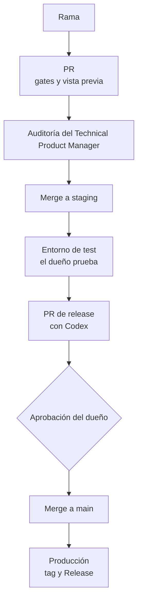

# Entrega: gates, entornos y releases

## Ramas

Estas reglas vienen del ADR-0005 y del ADR-0008.

- `claude/NNN-MMM-slug` para los agentes de Claude Code, y `codex/NNN-MMM-slug` para Codex.
- Los repos desplegables crean sus ramas desde `staging`. Los repos de arquitectura, docs y design system las crean desde `main`.
- `release/vX.Y.Z` y `hotfix/*`.
- Un Work Item por PR, un PR en curso por repo y squash merge.

## Gates de pull request

Estas reglas vienen de los ADR-0011, ADR-0015, ADR-0017 y ADR-0018.

- El CI local corre cada paso: auditoría, tests, lint, build y un deploy de prueba. Su evidencia se publica como comentario en el PR para el commit de cabeza.
- El quality gate de SonarCloud.
- El escaneo de secretos con gitleaks.
- Cobertura mínima de 90%, con meta de 95%.
- Una vista previa de Cloudflare Workers Builds con `noindex`.
- Ningún secreto de deploy en ningún build de PR (ADR-0018, punto 4).

**Modo MVP.** Hasta el 2026-11-30, los builds corren en Cloudflare Workers Builds. Los workflows de GitHub Actions quedan como respaldo manual.

## Entornos

| Entorno | Rama de origen |
|---------|----------------|
| Test | `staging` |
| Producción | `main` |

Cada entorno tiene su propia base de datos y sus propios secretos.

## Trenes de release

- El orden sigue las dependencias: db → api → console → app.
- Cada repo abre un PR de release de `staging` → `main`.
- Codex lo revisa. Los hallazgos P0, P1 y de seguridad bloquean; los P2 y P3 pasan a issues de seguimiento.
- El dueño aprueba de forma explícita.
- Las versiones siguen SemVer, con una sección de Keep a Changelog.
- El build crea el tag y el GitHub Release. El manifiesto de versiones registra la versión del sistema.
- Los repos de un mismo tren comparten MAJOR.MINOR.

## Móvil

| Canal de EAS | Rama | Uso |
|--------------|------|-----|
| `production` | `main` | Lo desplegado en `main` (api.gelpy.app) |
| `preview` | `staging` | Lo desplegado en `staging` (entorno de test): la app interna de prueba, que recibe sola cada actualización de staging |
| `development` | PR | Cliente de desarrollo: abre el código de un PR antes del merge, a pedido |

En Expo, un build preview es la app de QA interno y un build development es el cliente de desarrollo; los nombres son de Expo, no nuestros.

- Las actualizaciones por aire usan EAS Update con un runtime de tipo fingerprint, así un cambio solo de JS llega a los teléfonos sin un build nuevo.
- Un build nativo necesita la aprobación de su costo por parte del dueño.
- **Los builds de desarrollo de un PR** se publican solo a pedido del Technical Product Manager. Un token de Expo nunca entra en un build de PR.

## De la rama a producción

## Páginas relacionadas

- [Work Items y sprints](./work-items.md)
- [Reglas del dueño y seguridad](./rules.md)
- [Visión general de la arquitectura](../architecture/overview.md)
