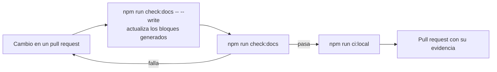

# Estándar de documentación

Cada repo de Gelpy se documenta de la misma forma (ADR-0021). Un ingeniero nuevo, un auditor o un inversionista abre cualquier repo y entiende en 15 minutos qué es, cómo se inicia, cómo se valida y cómo se protege.

:::note Estado

Aceptado el 2026-11-14. Los repos lo adoptan en tres olas:

1. Los documentos que todos leen y el gate `check:docs`.
2. Las referencias generadas, los runbooks y las correcciones que aparecen al documentar.
3. La guía funcional y su versión pública.

:::

## El conjunto de archivos

Cada repo tiene estos archivos, con las mismas secciones de nivel 2 en el mismo orden. Las plantillas viven en el repo privado de arquitectura.

| Archivo | Idioma | Qué responde |
|---------|--------|--------------|
| `README.md` | Inglés y español | Qué es el repo, cómo se inicia y cómo se configura, valida, despliega y protege, y dónde está cada documento |
| `docs/architecture.md` | Inglés y español | Cómo está construido y por qué: sus componentes, flujos clave, datos, dependencias externas y ADRs |
| `docs/quality.md` | Inglés | Cada paso del gate local, las pruebas por tipo, la cobertura y los pipelines |
| `SECURITY.md` | Inglés | Cómo reportar un problema, los controles, los escáneres, el inventario de secretos por nombre y las reglas de datos personales |
| `docs/runbook.md` | Inglés | Cómo desplegar, revertir, pasar al respaldo, responder a un incidente y resolver los problemas frecuentes |
| `CONTRIBUTING.md` | Inglés | Cómo entra un cambio: el Work Item y el pull request |

## El README es la puerta de entrada

El README tiene estas secciones, en este orden: Status, Architecture, Quick start, Configuration, Scripts, Quality gates, Deploy, Security, Documentation map y Related repos. Un registro de funciones no va ahí: se mueve a `docs/features/` o se queda en `CHANGELOG.md`.

## Reglas para todo documento

- **Los diagramas son bloques Mermaid dentro del Markdown.** GitHub los dibuja y quien revisa los lee en el pull request. El README tiene al menos un diagrama. El documento de arquitectura tiene al menos una vista de componentes y un diagrama de secuencia. Ningún archivo de imagen reemplaza un diagrama que Mermaid puede dibujar.
- **Las referencias se generan desde el código cuando se puede:**
  - la referencia de la API, desde sus esquemas de entrada;
  - el diagrama de tablas y el diccionario de datos, desde las migraciones de la base de datos;
  - la matriz de roles y permisos de la consola;
  - la referencia de tokens del design system;
  - el mapa de navegación de la app;
  - el modelo de contenido, el consentimiento y la política de seguridad de contenido del sitio web.
- **Nombres, nunca valores.** Un documento lista el nombre de una variable o de un secreto, para qué sirve y dónde vive. Nunca tiene un valor, datos personales ni una vulnerabilidad abierta. Las vulnerabilidades van a un aviso de seguridad privado.
- **Bilingüe solo en los documentos principales.** El README, el documento de arquitectura y la guía funcional tienen acompañante en español. Las referencias técnicas quedan solo en inglés. Menos acompañantes significa menos que se desfasan (ADR-0007, enmendado el 2026-11-14).

## El gate `check:docs`

Cada repo corre `npm run check:docs` en su gate local cuando adopta el estándar. Un solo verificador de referencia se copia a cada repo.

`check:docs` falla cuando:

- falta un archivo o una sección del estándar;
- falta un acompañante en español, o tiene otro número de secciones o de diagramas;
- un bloque Mermaid no nombra un tipo de diagrama conocido;
- un documento tiene un valor que parece un secreto, o una ruta de una sola máquina;
- un bloque generado difiere del código.

Un repo puede postergar un archivo solo en su manifiesto del estándar, `docs/standard.json`, y solo con el Work Item que lo va a agregar.

## Cómo se mantienen al día

- **El mismo pull request.** Un pull request que cambia un script, una variable, un paso del gate local, una ruta, un permiso o una tabla también actualiza el documento que lo describe. Es un paso de `gelpy-update-docs`.
- **Documentar y corregir.** Una brecha que aparece en una validación al documentarla tiene su propio Work Item pequeño. Así un documento describe una validación completa, no una excepción.
- **Terminado significa usable.** El estándar está terminado en un repo cuando un agente nuevo, leyendo solo el README, deja su gate local en verde.

## Dos lectores

El repo privado de arquitectura tiene la vista del sistema. Cubre el contexto, los contenedores, los entornos, el flujo de CI/CD, la estrategia de pruebas, la visión general de seguridad, la guía del primer día, el glosario, los runbooks y la guía funcional.

La documentación funcional tiene dos versiones:

- **La guía interna**, completa y organizada por flujo, con las reglas de negocio, los estados y quién puede hacer qué.
- **La versión pública en este sitio**, más corta. Solo Agent Docs la edita. Sigue la regla "previsto hasta producción" y pasa `check:public`.

Los repos guardan lo interno; este sitio guarda lo que se puede publicar. Este sitio no enlaza nada interno. Ningún documento de un repo copia lo que dice este sitio: lo enlaza.

## Páginas relacionadas

- [Skills](./skills.md)
- [Entrega: gates, entornos y releases](./delivery.md)
- [Reglas del dueño y seguridad](./rules.md)
- [Reglas de documentación](../contributing/documentation-rules.md)
