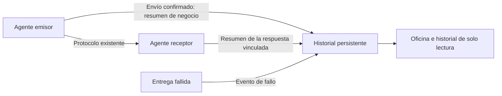

# Trazabilidad de Headquarters

Headquarters es la vista interna de oficina prevista para los dueños del negocio. Seguirá las sesiones reales y su trabajo mediante el [protocolo de mensajes](./agents.md#protocolo-de-mensajes). Es una vista de seguimiento: las instrucciones, aprobaciones y decisiones se mantienen en sus chats de origen.

:::note Estado

Implementación prevista en el Sprint 3. Esta página define el contrato de registro; no afirma que la oficina o sus integraciones estén disponibles en producción.

:::

## Los mismos mensajes, con un registro

Los agentes siguen usando `DELEGATE`, `REQUEST_CHANGE`, `REQUEST_REVIEW`, `REQUEST_INFO`, `NOTIFY_COMPLETE`, `NOTIFY_BLOCKED` y las respuestas `STATUS`: `ACCEPTED`, `COMPLETED`, `BLOCKED` o `NEEDS_INFO`. El registro guarda un resumen de negocio de cada mensaje; no envía una segunda instrucción ni reemplaza el medio de comunicación.

| Mensaje del protocolo | Qué deben entender los dueños |
|---|---|
| `DELEGATE` | Quién encargó el trabajo, a quién y con qué objetivo |
| `REQUEST_CHANGE` | Qué equipo necesita un ajuste de otro equipo |
| `REQUEST_REVIEW` | Qué entrega está lista para revisión |
| `REQUEST_INFO` | Qué información falta para continuar |
| `NOTIFY_COMPLETE` | Qué informa el agente que entregó |
| `NOTIFY_BLOCKED` | Qué impide continuar el trabajo |
| `STATUS` | Si el destinatario aceptó, respondió, terminó su parte o necesita ayuda |

El emisor registra el mensaje después de que el medio confirme el envío. Un envío fallido queda como fallo de entrega, nunca como conversación realizada. Cada respuesta tiene su propio evento, vinculado al mensaje original y a la tarea. Los reintentos conservan el identificador del evento para que un mensaje tenga una sola entrada en el historial. Una caída del registro no debe detener la comunicación original; el emisor reintenta después.

## Registrar avances de negocio

La oficina prevista tendrá un robot por sesión, con la apariencia de su oficio. El Technical Product Manager y el Gerente de Estrategia compartirán oficina. Un mensaje confirmado representará una visita al destinatario; su respuesta, la conversación de vuelta. El panel del robot reunirá el objetivo, la actividad actual, el último resultado, el siguiente paso y el historial. Las sesiones de una misma tarea se mantienen separadas y se pueden consultar juntas.

Un resumen útil dice, por ejemplo, «Preparando los avisos de las reservas; espera el texto aprobado». Explica el resultado o la decisión que falta en lenguaje de negocio. No copia completos los campos `Context`, `Dependencies` o `Artifacts`. Los eventos de presencia, pausa, reanudación y cierre complementan el protocolo; una señal de presencia no prueba por sí sola un avance.

El servicio previsto tendrá una sola oficina en producción. Los eventos pueden describir trabajo en `staging`: la rama donde se trabaja y el lugar donde los dueños consultan sus eventos son conceptos diferentes. El contrato cubre sesiones de Claude y Codex, pero cada integración necesita una comprobación con un mensaje y una respuesta reales antes de declararse operativa.

## Los tiempos y el cierre significan cosas distintas

| Dato mostrado | Significado |
|---|---|
| Tiempo transcurrido | Tiempo desde el encargo, incluidas las esperas |
| Actividad observada | Actividad respaldada por señales de la sesión, sin pausas ni intervalos sin señales recientes |
| Tiempo de espera | Tiempo declarado a la espera de información, revisión o decisión |
| Sin actualización | La última señal es demasiado antigua para afirmar que sigue trabajando |

Un `NOTIFY_COMPLETE` o `STATUS: COMPLETED` es lo que informa el agente. No marca un Work Item como `Done`. Los criterios de aceptación, la evidencia y las aprobaciones humanas que correspondan se siguen comprobando mediante [Work Items y sprints](./work-items.md).

## Limitar lo que se guarda

El contrato admite identificadores de tareas y sesiones, cargos, fechas, relaciones entre mensajes y resúmenes breves de negocio. Excluye conversaciones completas, archivos, código, salidas de comandos, credenciales y datos de clientes. El acceso se limita a los dueños autorizados; la vista no concede permiso para dirigir a un agente ni aprobar un pase a producción.

Está previsto eliminar los eventos detallados después de 90 días y los resúmenes diarios de resultados y tiempos después de un año. Estos registros sirven para el seguimiento interno de las operaciones; la función no añade publicidad, analítica de terceros ni grabación de sesiones.
