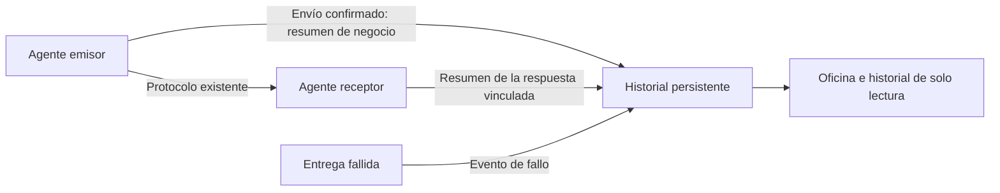

# Trazabilidad de Headquarters

Headquarters es la vista interna de oficina prevista para los dueños del negocio. Seguirá las sesiones reales y su trabajo mediante el [protocolo de mensajes](./agents.md#protocolo-de-mensajes). Es una vista de seguimiento: las instrucciones, aprobaciones y decisiones se mantienen en sus chats de origen.

:::note Estado

Al 2026-11-27, la vista de oficina está entregada en la consola de pruebas desde `staging`, y el propietario confirmó la primera versión en una demostración en vivo el 2026-11-18. El servicio confirma con HTTP 202 la recepción de mensajes reales del protocolo desde Codex y Claude; la recepción por sí sola no prueba la recuperación del historial tras un reinicio. La consola de producción no lee Headquarters: no tiene vista de oficina, y abrir ese lector es una decisión posterior, aprobada por separado. La comprobación completa de los reportes de Claude sigue en curso; los ajustes guardados o las pruebas locales no acreditan su aceptación.

:::

## Los mismos mensajes, con un registro

Los agentes siguen usando `DELEGATE`, `REQUEST_CHANGE`, `REQUEST_REVIEW`, `REQUEST_INFO`, `NOTIFY_COMPLETE`, `NOTIFY_BLOCKED` y las respuestas `STATUS`: `ACCEPTED`, `COMPLETED`, `BLOCKED` o `NEEDS_INFO`. El registro guarda un resumen de negocio de cada mensaje; no envía una segunda instrucción ni reemplaza el medio de comunicación.

| Mensaje del protocolo | Qué deben entender los dueños |
|---|---|
| `DELEGATE` | Quién encargó el trabajo, a quién y con qué objetivo |
| `REQUEST_CHANGE` | Qué equipo necesita un ajuste de otro equipo |
| `REQUEST_REVIEW` | Qué entrega está lista para revisión |
| `REQUEST_INFO` | Qué información falta para continuar |
| `NOTIFY_COMPLETE` | Qué informa el agente que entregó |
| `NOTIFY_BLOCKED` | Qué impide continuar el trabajo |
| `STATUS` | Si el destinatario aceptó, respondió, terminó su parte o necesita ayuda |

El emisor registra el mensaje después de que el medio confirme el envío. Un envío fallido queda como fallo de entrega, nunca como conversación realizada. Cada respuesta tiene su propio evento, vinculado al mensaje original y a la tarea. Los reintentos conservan el identificador del evento para que un mensaje tenga una sola entrada en el historial. Una caída del registro no debe detener la comunicación original; el emisor reintenta después.

## Registrar avances de negocio

Headquarters tendrá una oficina por área: Producto e Ingeniería y Negocio; cuando se defina un área nueva, se añadirá su oficina. El Technical Product Manager y el Gerente de Estrategia compartirán un espacio central. Cada sesión de un subagente tendrá su propio robot, con la apariencia de su oficio; varias sesiones de un mismo oficio seguirán siendo robots separados. Un mensaje confirmado representará una visita al destinatario; su respuesta, la conversación de vuelta. El panel del robot reunirá el objetivo, la actividad actual, el último resultado, el siguiente paso y el historial. Las sesiones de una misma tarea se mantienen separadas y se pueden consultar juntas.

Un resumen útil dice, por ejemplo, «Preparando los avisos de las reservas; espera el texto aprobado». Explica el resultado o la decisión que falta en lenguaje de negocio. No copia completos los campos `Context`, `Dependencies` o `Artifacts`. Los eventos de presencia, pausa, reanudación y cierre complementan el protocolo; una señal de presencia no prueba por sí sola un avance.

El backend sigue siendo un único servicio de producción, compartido por las consolas de pruebas y de producción; no se crea otro entorno de Headquarters. Los eventos pueden describir trabajo en `staging`; esa rama no selecciona otro historial. La recepción desde Codex está comprobada y la vista de la consola de pruebas está entregada. Abrir la consola de producción y completar la comprobación de Claude se siguen por separado, sin deducirlas de esa recepción.

## Acceso desde las consolas

El contrato de lectura admite los orígenes exactos de las consolas de pruebas y de producción. Cada consola conserva su propia autenticación: el servicio comprueba la sesión de la consola de pruebas con la API de pruebas, y la de producción con la API de producción. Los permisos temporales de lectura quedan ligados al origen que los solicitó y no se pueden reutilizar desde la otra consola. Compartir el historial de eventos no convierte una sesión de pruebas en una cuenta de producción. El servicio conserva ambas comprobaciones, pero hoy solo la consola de pruebas usa su acceso; la consola de producción no tiene vista de oficina.

## Autenticación del emisor

El emisor usa la configuración segura de su entorno; las credenciales nunca van en el comando, el archivo del mensaje ni el resumen de negocio. El modo de autenticación es explícito:

- **Modo directo**, el predeterminado, usa `HQ_PUBLISH_KEY` configurada. Si la clave falta o no es válida, falla; el emisor no cambia de modo automáticamente.
- **Modo proxy** usa `HQ_AUTH_MODE=proxy` y `HQ_PRODUCER_ID`. El proxy HTTP configurado del entorno añade la credencial Bearer. Claude Cloud no necesita una variable de entorno `HQ_PUBLISH_KEY` en este modo, y el emisor omite deliberadamente su propia cabecera Authorization.

Ambos modos envían al destino de producción aprobado. La configuración del proxy debe limitarse a ese destino y a la operación de registro. Si la credencial no se añade o no es válida, el servicio la rechaza; el evento sin datos sensibles queda en cola. La configuración y las pruebas locales de cabeceras no prueban una entrega desde la nube: cada origen necesita su propia comprobación real de recepción e historial.

## Los tiempos y el cierre significan cosas distintas

| Dato mostrado | Significado |
|---|---|
| Tiempo transcurrido | Tiempo desde el encargo, incluidas las esperas |
| Actividad observada | Actividad respaldada por señales de la sesión, sin pausas ni intervalos sin señales recientes |
| Tiempo de espera | Tiempo declarado a la espera de información, revisión o decisión |
| Sin actualización | La última señal es demasiado antigua para afirmar que sigue trabajando |

Un `NOTIFY_COMPLETE` o `STATUS: COMPLETED` es lo que informa el agente. No marca un Work Item como `Done`. Los criterios de aceptación, la evidencia y las aprobaciones humanas que correspondan se siguen comprobando mediante [Work Items y sprints](./work-items.md).

## Limitar lo que se guarda

El contrato admite identificadores de tareas y sesiones, cargos, fechas, relaciones entre mensajes y resúmenes breves de negocio. Excluye conversaciones completas, archivos, código, salidas de comandos, credenciales y datos de clientes. El acceso se limita a los dueños autorizados; la vista no concede permiso para dirigir a un agente ni aprobar un pase a producción.

Está previsto eliminar los eventos detallados después de 90 días y los resúmenes diarios de resultados y tiempos después de un año. Estos registros sirven para el seguimiento interno de las operaciones; la función no añade publicidad, analítica de terceros ni grabación de sesiones.
