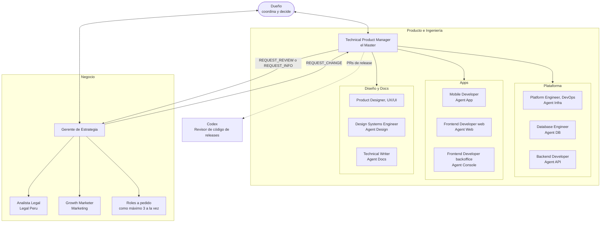

# Framework agéntico de Gelpy

El Framework agéntico de Gelpy es el método de trabajo que construye Gelpy. Un dueño humano dirige un equipo de agentes de IA especializados, organizado como una oficina de startup con dos áreas, cada una a cargo de un jefe. Los agentes planifican, diseñan, construyen, revisan, publican y documentan el producto, y asesoran sobre el negocio. El dueño coordina y decide; los agentes recomiendan, ejecutan y demuestran.

:::note Estado

En uso desde 2026-10-31. Versión 1.0 documentada el 2026-11-08. Organizado como oficina de startup el 2026-11-09.

:::

## Principios

Cada principio viene de una regla que siguen los agentes.

1. **El dueño decide.** Los agentes dan un veredicto por punto en cada pedido, y el dueño elige (`gelpy-challenge-request`).
2. **Primero la spec.** Ningún cambio importante empieza sin un Work Item con criterios de aceptación SMART y un issue de GitHub (ADR-0003).
3. **Primero el diseño.** Ninguna pantalla, flujo ni página nueva se programa antes de que el Product Designer la diseñe y el dueño apruebe el diseño por escrito.
4. **Evidencia antes de Done.** Cada criterio se verifica y se registra como PASS, FAIL o HUMAN PENDING antes de que un Work Item pase a Done (`gelpy-verify-work-item`).
5. **Test antes de producción.** El trabajo llega primero a `staging` y al entorno de test. Los releases a producción necesitan la aprobación explícita del dueño (ADR-0005).
6. **Secretos nunca en el código ni en el chat.** Los inventarios guardan solo nombres, y los agentes nunca ven los valores.
7. **Un dueño por repo.** Cada repo tiene un agente especializado. Los agentes nunca editan otro repo; lo piden mediante el protocolo.
8. **Memoria bilingüe.** El inglés es el canónico y el español es el acompañante. El dueño trabaja en español (ADR-0007).

## Organización

El dueño coordina a los dos jefes y es el único que decide. Cada jefe reporta solo al dueño.

- **Producto e Ingeniería** está a cargo del **Technical Product Manager** (el Master). Es dueño del backlog, las specs, las prioridades propuestas y la coordinación de la entrega. El dueño fija la dirección del producto y aprueba la arquitectura.
- **Negocio** está a cargo del **Gerente de Estrategia** (el Business Coach), con el Analista Legal y el Growth Marketer, más roles a pedido.
- Los equipos no tienen jefe y no agregan una capa. El Technical Product Manager delega directamente en cada agente de repo.
- El trabajo entre las áreas va de jefe a jefe. Ver [El equipo de agentes](./agents.md) para cada rol.

## Dónde vive

La fuente de verdad es el repo privado `gelpy-architecture`. Contiene:

- el gate `AGENTS.md`;
- los perfiles de los agentes en `.claude/agents/`;
- las skills en `codex/skills/`;
- las specs y los Work Items en `specs/`;
- los ADRs en `adr/`;
- los scripts de gobierno y `PROJECT_STATE.md`.

Cada repo de producto tiene su propio gate `AGENTS.md`, un perfil de agente y un router `codex/` hacia las skills centrales. Este sitio explica el método; no reemplaza esos archivos.

## En números

| Elemento | Cantidad |
|----------|----------|
| Agentes | 13, más Codex, más roles a pedido |
| Skills | 23 |
| ADRs | 19 |
| Specs | 11 |
| Work Items en la Fase 1 | Unos 170 |
| Repos | 8 |

## Glosario

| Término | Significado |
|---------|-------------|
| Jefe | Quien está a cargo de un área: el Technical Product Manager o el Gerente de Estrategia |
| Work Item | La unidad de trabajo más pequeña que se sigue: un PR en un repo |
| AC | Un criterio de aceptación |
| Gate | Un control que debe pasar antes del siguiente paso |
| Tren de release | Releases coordinados de `staging` → `main` en varios repos |
| Actualización OTA | Una actualización de JavaScript que llega a las apps instaladas sin un build de tienda |
| Handoff | El documento que inicia y registra una corrida larga de trabajo |
| Veredicto | La revisión ✅/⚠️/❌ de un pedido |

## Páginas relacionadas

- [El equipo de agentes](./agents.md)
- [Skills](./skills.md)
- [Work Items y sprints](./work-items.md)
- [Entrega: gates, entornos y releases](./delivery.md)
- [Reglas del dueño y seguridad](./rules.md)
- [Gerente de Estrategia](./business-coach.md)
- [Origen y evolución](./evolution.md)
