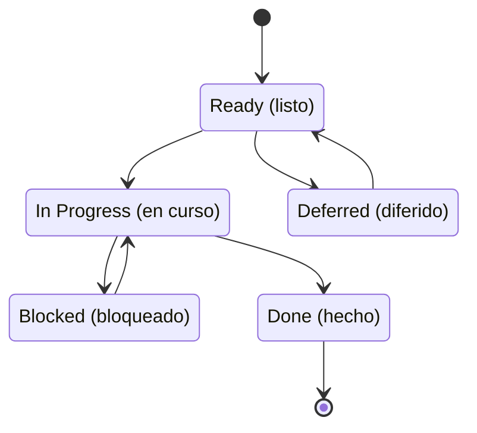

# Work Items y sprints

## De la spec a las tareas

Cada carpeta de spec tiene seis archivos: `spec.md`, `plan.md` y `tasks.md`, cada uno con un acompañante `.es.md`.

| Archivo | Contiene |
|---------|----------|
| `spec.md` | El resumen, los escenarios de usuario, los límites del alcance y una evaluación de cumplimiento (clasificación de datos, OWASP, la Ley 29733 de Perú, GDPR, logging) |
| `plan.md` | El enfoque, el repo dueño, la validación, la decisión de release y los riesgos |
| `tasks.md` | Los Work Items |

## Anatomía de un Work Item

Un Work Item tiene estos campos:

| Campo | Contenido |
|-------|-----------|
| Status | Ready, In Progress, Blocked, Deferred o Done |
| GitHub Issue | La URL del issue |
| Type | `user-story` o `task` |
| Target Repo | El único repo donde cae el trabajo |
| Sprint | El sprint al que pertenece |
| Estimate | Puntos |
| Dependencies | Los Work Items que deben terminar antes |
| Source | De dónde vino el pedido |
| Progress | Notas sobre el avance |
| User Story | "Como …, quiero …, para …" |
| SMART | Alcanzable, Relevante, con plazo |
| Criterios de aceptación | `AC-N`, cada uno con Given/When/Then, un Measure, un Check y Verified by |
| Compliance Assessment | Notas de datos y seguridad |
| Release Decision | La decisión de versión |

Cada criterio de aceptación tiene:

- **Given/When/Then**: el escenario;
- **Measure**: un número;
- **Check**: un comando exacto, o una verificación humana;
- **Verified by**: Agent o Human.

Este es un criterio completo de un Work Item ficticio, "Mostrar la versión de la app en la pantalla de Perfil":

```text
AC-1
Given una persona con sesión iniciada en la pantalla de Perfil,
When se abre la pantalla,
Then muestra la versión instalada de la app.
Measure: 1 texto de versión, igual a la versión de package.json.
Check: npm test -- profile-version.test.tsx
Verified by: Agent
```

## El lint

El script `check-work-items` revisa cada `tasks.md`. El script:

- rechaza palabras vagas, como "works well" o "funciona bien";
- exige un comando exacto en cada verificación de tipo Agent;
- exige los mismos IDs, estado, sprint, issue y cantidad de criterios en inglés y en español;
- exige la URL de cada issue cuando corre con `--require-issues`.

## Estados y sincronización de issues



| Estado | Issue de GitHub |
|--------|-----------------|
| Ready | Abierto, sin etiqueta de estado |
| In Progress | Abierto, `status:in-progress` |
| Blocked | Abierto, `status:blocked` |
| Deferred | Abierto, `status:deferred` (sprint: Backlog) |
| Done | Cerrado con un comentario de evidencia |

El `tasks.md` local es la fuente de verdad. El issue lo refleja.

## Jerarquía

Epic → un Feature por spec → Work Items, enlazados como sub-issues nativos de GitHub. El cuerpo de los issues se genera en español desde `tasks.es.md`.

## Sprints

- Un sprint dura 1 semana, de lunes a domingo (ADR-0003, enmendado el 2026-11-07).
- Cada sprint es un milestone de GitHub con fecha límite, que `sync-sprints` configura en los 8 repos.
- **Regla de cierre.** Al final de un sprint, un Work Item que sigue en curso pasa al siguiente sprint cuando solo le falta su verificación en producción. Si no, se queda hasta que cierre.

## Progreso

- El progreso se pondera por puntos.
- Solo cuenta Done; Deferred queda fuera.
- `progress-report` imprime una tabla por repo más un total.

## Scripts de gobierno

| Script | Propósito |
|--------|-----------|
| `check-work-items` | El lint de arriba |
| `publish-issues` | Crear los issues del Epic, de los Features y de los Work Items, y escribir las URLs de vuelta |
| `link-sub-issues` | Enlazar la jerarquía de sub-issues |
| `sync-sprints` | Milestones, el sprint de cada issue, etiquetas de estado; por defecto es una prueba sin cambios |
| `progress-report` | La tabla de porcentajes |
| `check-infrastructure` | Verificar que los inventarios de la plataforma guarden solo nombres |

Todos tienen tests con un gate de cobertura de 90% (ADR-0015).

## Páginas relacionadas

- [Framework agéntico de Gelpy](./overview.md)
- [El equipo de agentes](./agents.md)
- [Entrega: gates, entornos y releases](./delivery.md)
