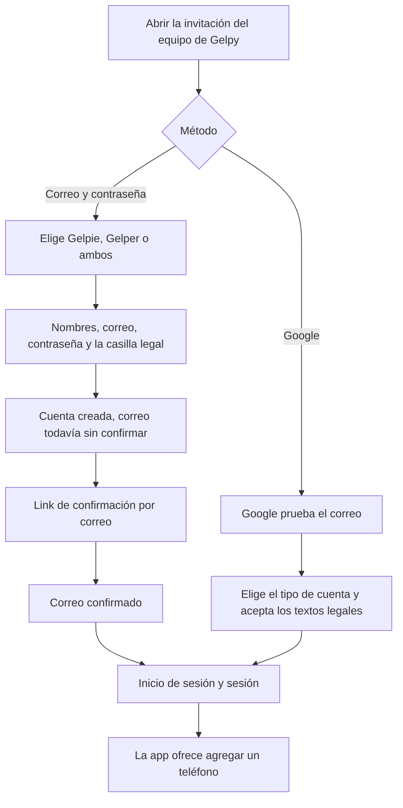

# Cuentas y perfil

Una persona crea una cuenta de Gelpy e inicia sesión en la app, en Android y en la web. Esta página describe lo que hace la persona. El lado de seguridad está en [Identidad e inicio de sesión](../security/identity.md).

:::note Estado

En producción en la web desde el 2026-11-07, y en el build de producción de Android desde el 2026-11-08. Desde el 2026-11-15, el registro es solo por invitación, y el equipo puede pausar el inicio de sesión de la app y desactivar cuentas. Las pantallas nuevas de la app de ese día están en la web, y llegan a Android con su próximo build. Los cambios previstos están al final de esta página.

:::

## Quién puede hacer qué

| Acción | Gelpie o Gelper |
|--------|-----------------|
| Crear una cuenta | Con una invitación del equipo de Gelpy, en la web |
| Iniciar sesión con correo y contraseña, o con Google | Sí |
| Iniciar sesión con una passkey | Sí, en la web |
| Crear, ver y revocar passkeys | Sí, en la web |
| Agregar y verificar un teléfono | Sí |
| Vincular Google a la cuenta | Sí, en la web |
| Encender el desbloqueo con la huella o el rostro | Sí, en Android |
| Cerrar sesión | Sí |

## Crear una cuenta

- **Por invitación.** El registro está cerrado: la app ofrece solo iniciar sesión, y un correo nuevo recibe la misma respuesta de registro cerrado. El equipo de Gelpy invita a una persona desde la consola de administración. El link de la invitación sirve una sola vez, solo para el correo invitado, y la pantalla muestra el día en que vence.
- **Tipo de cuenta.** Cada cuenta dice cómo usa Gelpy la persona: Gelpie, Gelper o ambos. La cuenta no existe sin un tipo. La app todavía no puede agregar el otro tipo después.
- **Contraseña.** Tiene de 8 a 64 caracteres, sin reglas de composición.
- **Link de confirmación.** Una cuenta con correo y contraseña empieza sin confirmar. El link del correo sirve una sola vez y dura 24 horas, y ninguna sesión empieza antes de usarlo. La pantalla que pide revisar el correo puede enviar el link otra vez tras una breve espera.
- **Google.** Google prueba el correo, así que una cuenta de Google empieza confirmada.
- **Textos legales.** El registro necesita la casilla "Acepto los Términos y condiciones y leí la Política de privacidad de Gelpy.", sin marcar por defecto. Sin ella no se crea nada. Cada aceptación se registra con la versión de cada texto. Cuando un texto legal tiene una nueva versión mayor, la app en la web pide a cada cuenta aceptarlo otra vez, y muestra solo esa pantalla y "Cerrar sesión" hasta que la persona acepta.
- **La app no revela si un correo tiene cuenta.** Registrarse con un correo que ya tiene cuenta recibe la misma respuesta que uno nuevo, y solo el dueño de ese correo recibe un aviso.

## Iniciar sesión

- Con correo y contraseña, o con Google, en la web y en Android.
- Con una passkey en la web: "Usar una passkey" en la pantalla de inicio de sesión.
- Una contraseña incorrecta y un correo desconocido reciben la misma respuesta. Tras varios intentos fallidos, la app pide esperar antes de volver a intentar.
- En Android, la sesión sobrevive al cerrar la app. En la web vive solo en la página abierta, así que al recargar se pide iniciar sesión otra vez.
- "Cerrar sesión" en Perfil termina la sesión en el dispositivo y en el servidor.
- **Pausa de mantenimiento.** El equipo puede pausar el inicio de sesión de la app por mantenimiento. La app en la web muestra entonces "Estamos haciendo mantenimiento" con "Reintentar". Una persona que ya inició sesión la conserva, y la app vuelve a donde estaba cuando termina la pausa.
- **Desactivación.** El equipo puede desactivar una cuenta con un motivo. Se cierran todas las sesiones de la cuenta, los datos se conservan y la persona no puede iniciar sesión. La app en la web dice "Tu cuenta está desactivada", con la dirección de soporte. La desactivación no es una eliminación.

## Teléfono

- Después de un inicio de sesión sin teléfono verificado, la app ofrece agregar uno. La persona puede omitirlo.
- El teléfono se agrega desde Perfil. Debe ser un celular peruano, y se verifica con un código enviado por SMS.
- La app muestra el número enmascarado.

## Perfil

Perfil muestra la cuenta: la foto de Google cuando la hay, el nombre, el correo y los tipos de cuenta. Su tarjeta "Seguridad y acceso" tiene:

- **Teléfono:** agregar o verificar el teléfono.
- **Passkeys:** donde el navegador las admite, crear una passkey, ver cada una con su fecha y revocarla tras una confirmación.
- **Google**, en la web: vincular Google a la cuenta, para iniciar sesión también con él.
- **Desbloqueo con la huella o el rostro**, en Android: apagado por defecto. Cuando está encendido, abrir la app pide la huella o el rostro. Android lo revisa en el teléfono, y Gelpy nunca lo recibe.

## Lo que ve la persona cuando algo falla

| Situación | Lo que ve la persona | Qué hacer |
|-----------|----------------------|-----------|
| Correo sin confirmar | Un pedido de confirmar el correo, con un botón para reenviar el link | Abrir el link del correo |
| Link usado o vencido | El link se rechaza | Pedir un link nuevo |
| Contraseña incorrecta o correo desconocido | Un mensaje de que el correo o la contraseña no son correctos | Intentar otra vez |
| Demasiados intentos | Un mensaje de que hubo demasiados intentos, con el tiempo que hay que esperar | Esperar la cuenta regresiva |
| Falla una passkey | Un mensaje de que no se pudo usar la passkey | Intentar otra vez, o usar otro método |
| Registro cerrado | Solo se ofrece iniciar sesión. Un formulario enviado igual dice "El registro está cerrado por ahora" | Pedir una invitación al equipo de Gelpy |
| Invitación usada, revocada o vencida | La invitación se rechaza | Pedir una invitación nueva |
| Inicio de sesión en pausa | "Estamos haciendo mantenimiento" con "Reintentar" | Intentar otra vez en unos minutos |
| Cuenta desactivada | "Tu cuenta está desactivada", con la dirección de soporte | Escribir a la dirección de soporte |

## Previsto

- En Android, las pantallas del 2026-11-15: la pantalla de mantenimiento, la cuenta desactivada, aceptar una nueva versión de los textos legales y vincular Google, con el próximo build de Android.
- Agregar el otro tipo de cuenta desde Perfil.
- Recuperar la contraseña, passkeys en Android y la eliminación de la cuenta.

## Páginas relacionadas

- [Qué hace Gelpy hoy](./overview.md)
- [Identidad e inicio de sesión](../security/identity.md)
- [Desbloqueo con huella y passkeys](../security/biometrics-passkeys.md)
- [Base de la app](../architecture/app-shell.md)
