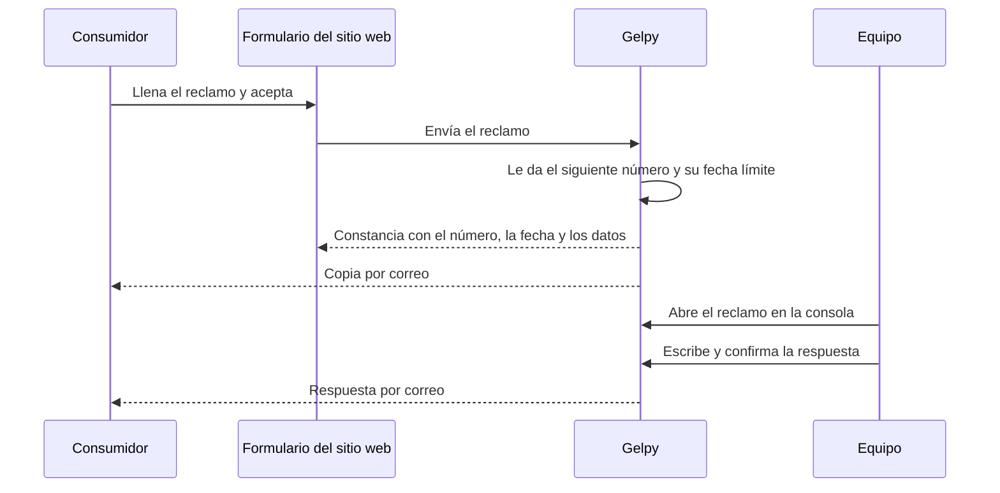

# Libro de Reclamaciones (previsto)

Como atiende a consumidores también por internet, Gelpy tiene un Libro de Reclamaciones virtual, como pide la ley peruana. Es un formulario en el sitio web que cualquier persona puede usar, y un módulo en la consola de administración donde el equipo responde.

:::note Estado

Previsto. El Libro de Reclamaciones funciona en el entorno de test y todavía no está en producción. Esta página describe cómo funcionará cuando llegue a producción.

:::

## Quién podrá hacer qué

| Acción | Cualquier persona | Equipo |
|--------|-------------------|--------|
| Presentar un reclamo o una queja, sin cuenta | Sí | — |
| Recibir una constancia con un número y una copia por correo. Si la copia no se puede enviar, la constancia en pantalla lo dice y pide imprimirla o guardarla | Sí | — |
| Leer, responder, exportar e imprimir los reclamos | — | Sí, con el permiso |

## El flujo

## Cómo funcionará

- El formulario estará en el sitio web, en español e inglés, y no necesita cuenta. La página define qué es un reclamo y qué es una queja.
- El formulario pide los datos que lista la norma: la identidad y los datos de contacto de quien reclama, lo que se contrató, el detalle del reclamo y el pedido. Para un menor de edad también se piden los datos de su padre, madre o tutor.
- Cada reclamo recibe un número correlativo de su año. La constancia muestra el número, la fecha, la fecha límite de la respuesta y los datos enviados. Se puede imprimir o guardar como PDF.
- Gelpy responde en un plazo de 15 días hábiles, por correo. Presentar un reclamo no impide que el consumidor acuda a Indecopi, la autoridad de protección al consumidor.
- Un reclamo presentado no se puede borrar ni cambiar: solo cambian su estado y su respuesta. Los reclamos se guardan al menos 2 años, como pide la norma.
- En la consola, la lista muestra el número, la fecha, el tipo, el estado y los días hábiles que quedan de cada reclamo, y marca los que vencen pronto o ya vencieron. Una respuesta necesita una confirmación y, una vez enviada, no se puede editar.
- La app enlazará el Libro de Reclamaciones desde pantallas que no necesitan sesión, como la bienvenida y el inicio de sesión, y desde Perfil.
- El Libro de Reclamaciones no depende del marketplace: funcionará con el marketplace encendido o apagado.

## Datos personales

- Solo los miembros del equipo con el permiso ven los datos personales de un reclamo, en la consola.
- Los datos de un reclamo nunca van a la barra de direcciones del navegador, a su almacenamiento ni a los logs.

## Páginas relacionadas

- [Qué hace Gelpy hoy](./overview.md)
- [Consola de administración](./console.md)
- [Sitio web comercial](../architecture/website.md)
