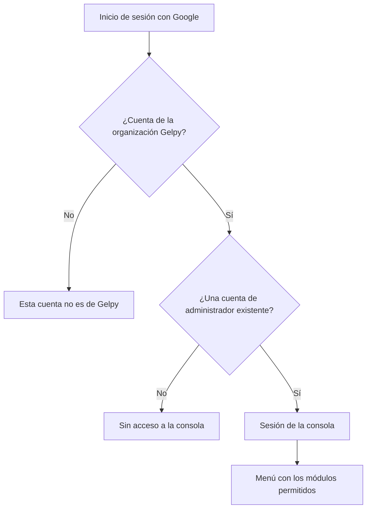

# Consola de administración

La consola de administración es donde el equipo de Gelpy opera la plataforma. Es una app web solo para el equipo, no para Gelpies ni Gelpers.

:::note Estado

En producción desde el 2026-11-07, con el módulo de Push desde el 2026-11-08. Los módulos previstos están al final de esta página.

:::

## Quién entra

- Solo cuentas de Google de la organización de la empresa Gelpy. La consola no tiene inicio de sesión con correo y contraseña.
- Una cuenta de la app no puede usar la consola.
- Se rechaza una cuenta fuera de la organización, y también una cuenta de la organización que no es administradora. El inicio de sesión de la consola nunca crea cuentas.
- La consola guarda su sesión solo en la página abierta, así que al recargar se pide iniciar sesión otra vez.

## Qué hace hoy

| Módulo | Qué hace |
|--------|----------|
| Push: Enviar | Redacta una push, muestra a cuántas personas y dispositivos llega y la envía tras una confirmación. Ver [Notificaciones](./notifications.md) |
| Push: Historial | Lista cada envío con su remitente, su audiencia y sus conteos de entrega, y actualiza los estados cuando se pide |

Cada envío registra quién lo hizo, y ningún log ni registro de auditoría guarda un correo.

## Previsto

- **Roles y permisos:** el Super admin arma roles a partir de permisos y los asigna a los miembros del equipo. Cada persona ve solo los módulos de sus roles.
- **Cuentas de la app:** encontrar una cuenta por su correo exacto, y desactivarla o activarla con un motivo.
- **Invitaciones de registro:** invitar a una persona a registrarse mientras el registro está cerrado.
- **Configuración de la plataforma:** abrir o cerrar el registro, pausar el inicio de sesión de la app por mantenimiento y encender o apagar la búsqueda asistida.
- **El Libro de Reclamaciones:** leer, responder, exportar e imprimir cada reclamo. Ver [Libro de Reclamaciones](./complaints-book.md).
- **Categorías:** los oficios y servicios del marketplace.

## Páginas relacionadas

- [Qué hace Gelpy hoy](./overview.md)
- [Identidad e inicio de sesión](../security/identity.md)
- [Notificaciones push](../architecture/push.md)
