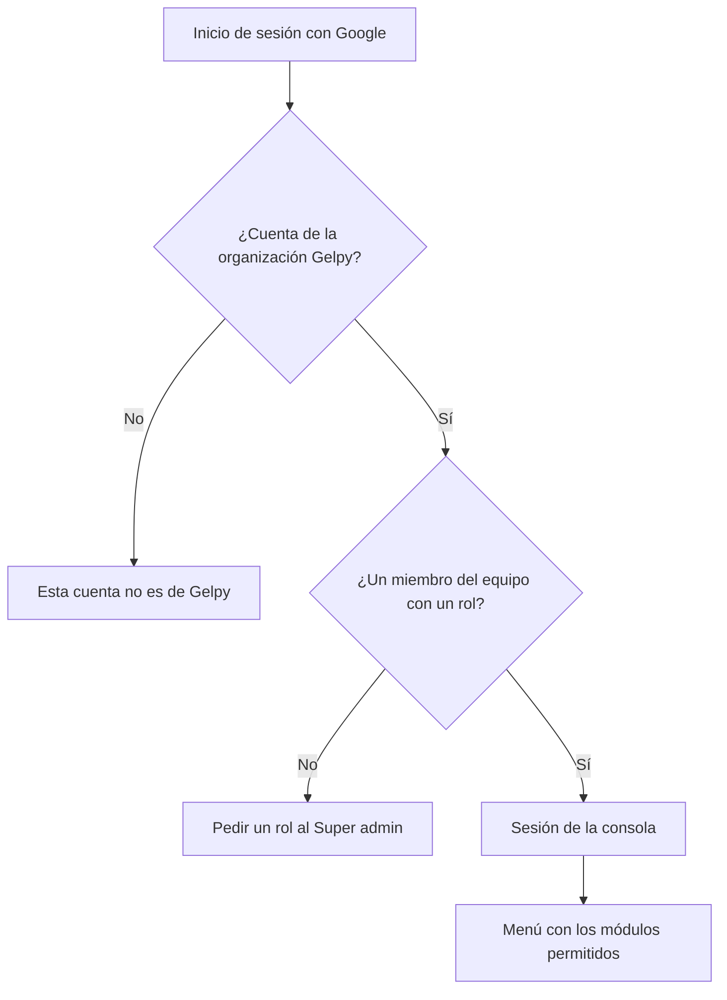

# Consola de administración

La consola de administración es donde el equipo de Gelpy opera la plataforma. Es una app web solo para el equipo, no para Gelpies ni Gelpers.

:::note Estado

En producción desde el 2026-11-07, con el módulo de Push desde el 2026-11-08 y los demás módulos desde el 2026-11-15. Los módulos previstos están al final de esta página.

:::

## Quién entra

- Solo cuentas de Google de la organización de la empresa Gelpy. La consola no tiene inicio de sesión con correo y contraseña.
- Una cuenta de la app no puede usar la consola.
- Se rechaza una cuenta fuera de la organización. Una cuenta de la organización sin un rol ve un pedido de solicitarle uno al Super admin. El inicio de sesión de la consola nunca crea cuentas.
- La consola guarda su sesión solo en la página abierta, así que al recargar se pide iniciar sesión otra vez.

## Qué hace hoy

| Módulo | Qué hace |
|--------|----------|
| Push: Enviar | Redacta una push, muestra a cuántas personas y dispositivos llega y la envía tras una confirmación. Ver [Notificaciones](./notifications.md) |
| Push: Historial | Lista cada envío con su remitente, su audiencia y sus conteos de entrega, y actualiza los estados cuando se pide |
| Acceso | El Super admin decide quién del equipo entra a la consola, arma roles a partir de permisos y los asigna a los miembros del equipo. Solo el Super admin ve este módulo |
| Usuarios del app | Encuentra una cuenta de la app por su correo exacto, y la desactiva o la activa con un motivo tras una confirmación. Ver [Cuentas y perfil](./accounts.md) |
| Invitaciones de registro | Invita a una persona a crear una cuenta de la app mientras el registro está cerrado, y reenvía o revoca una invitación |
| Configuración de la plataforma | Abre o cierra el registro, pausa el inicio de sesión de la app por mantenimiento y enciende o apaga la búsqueda asistida. Solo el Super admin cambia esta configuración |
| Libro de Reclamaciones | Lee, responde, exporta e imprime cada reclamo, y reenvía un correo de respuesta que no se pudo enviar. Ver [Libro de Reclamaciones](./complaints-book.md) |
| Categorías, Funciones, Idiomas de la app | El catálogo que usará el piloto del marketplace: los oficios y servicios, los detalles del trabajo y los idiomas |
| Proveedores | El registro de los servicios externos que Gelpy paga o usa |

Cada persona ve solo los módulos y las acciones que sus roles permiten; un módulo sin el permiso lo dice. Cada envío y cada cambio registra quién lo hizo, y ningún log ni registro de auditoría guarda un correo.

## Previsto

- **Invitaciones al piloto**, para las personas invitadas al piloto del marketplace. Ver [Piloto del marketplace](./marketplace-pilot.md).
- **Registrar un reclamo que llega por correo** en el Libro de Reclamaciones.

## Páginas relacionadas

- [Qué hace Gelpy hoy](./overview.md)
- [Identidad e inicio de sesión](../security/identity.md)
- [Notificaciones push](../architecture/push.md)
