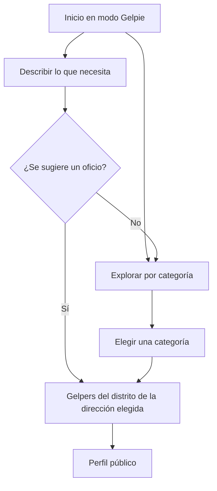

# Piloto del marketplace (previsto)

El marketplace es donde un Gelpie encuentra al Gelper adecuado cerca de casa. Gelpy lo abre primero como un piloto controlado, solo con personas invitadas (ADR-0019).

:::note Estado

Previsto. El marketplace funciona en el entorno de test y está apagado en producción. Abre solo después de las aprobaciones legales del piloto, y entonces solo para personas invitadas. Hasta entonces, la app muestra en su lugar una pantalla de "muy pronto".

:::

## Qué hará

| Para | Qué |
|------|-----|
| Gelpers | Armar un perfil en tres pasos (sus oficios y servicios, una descripción y los distritos donde trabajan), y luego agregar detalles opcionales como una tarifa referencial |
| Gelpers | Ver cómo los encuentran los clientes: cuántas veces apareció y se abrió el perfil, solo como conteos |
| Gelpies | Recorrer las categorías abiertas, ver los Gelpers del distrito de una dirección guardada y abrir el perfil público de un Gelper |
| Gelpies | Guardar los lugares donde necesitan ayuda, como la casa o la oficina |
| Gelpies | Describir lo que necesitan en pocas palabras y recibir un oficio sugerido |
| El equipo | Abrir oficios y categorías, y encender o apagar la búsqueda asistida, desde la consola |

Reservar a un Gelper llega después: en el perfil, "Solicitar Gelp" muestra "Próximamente".

## Encontrar a un Gelper

## Reglas que protegen a las personas

- **Un perfil completo.** Un Gelper aparece en la lista solo con un nombre visible, al menos un oficio y un servicio, una descripción, un distrito activo y un teléfono verificado. Un perfil completo no significa una persona verificada, y el perfil nunca afirma una revisión de antecedentes.
- **Lo que ven los clientes.** El nombre visible es el primer nombre y la inicial del apellido. El perfil público muestra los oficios, los servicios, la descripción, los distritos y, solo si están puestos, los detalles opcionales. Nunca muestra un teléfono, un correo, una dirección ni el nombre completo.
- **La foto.** Un Gelper puede mostrar la foto de Google de su cuenta solo si marca una casilla, y puede desmarcarla en cualquier momento. Gelpy no guarda una copia.
- **Todavía sin opiniones.** Los perfiles dicen "Nuevo" hasta que existan opiniones. No se inventan estrellas, promedios ni conteos de trabajos.
- **Direcciones.** Las direcciones de un Gelpie nunca son públicas. En Android, el Gelpie puede confirmar una dirección con la ubicación del teléfono: el teléfono la compara con la dirección, y Gelpy solo recibe que coinciden y la fecha, nunca la ubicación.
- **Búsqueda asistida.** La app envía solo el texto de la búsqueda. Gelpy le quita correos y números largos, y un servicio de inteligencia artificial sugiere un oficio del catálogo activo, sin datos que identifiquen a la persona. El texto nunca se guarda. Un aviso debajo de la caja lo dice antes de enviar nada.
- **Estadísticas.** Un Gelper ve solo conteos, nunca quién vio su perfil.

## Páginas relacionadas

- [Qué hace Gelpy hoy](./overview.md)
- [Cuentas y perfil](./accounts.md)
- [Visión general de la arquitectura](../architecture/overview.md)
