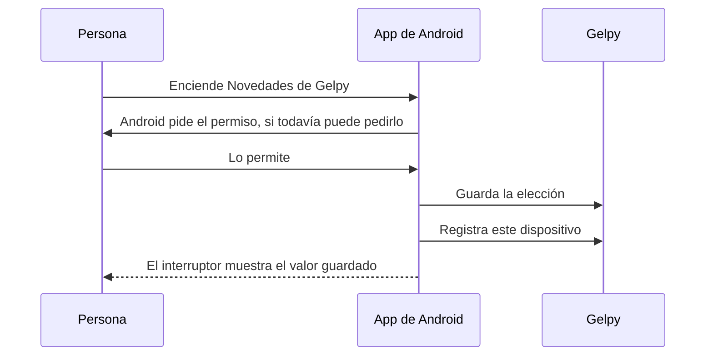

# Notificaciones

Gelpy avisa a las personas de tres formas: una notificación push en la app de Android, un correo y un código por SMS. El lado técnico de las push está en [Notificaciones push](../architecture/push.md).

:::note Estado

Las push están en producción desde el 2026-11-08: en el build de producción de Android y en la consola de administración. El correo de invitación de registro y los correos del Libro de Reclamaciones están en producción desde el 2026-11-15. Los cambios previstos están al final de esta página.

:::

## Quién puede hacer qué

| Acción | Gelpie o Gelper | Equipo |
|--------|-----------------|--------|
| Encender o apagar "Novedades de Gelpy" | Sí, en Android | — |
| Recibir una push | Con el tipo encendido, en un dispositivo Android con sesión en Gelpy | — |
| Recibir correos de cuenta | Sí | — |
| Ver el alcance y enviar una push desde la consola | — | Sí |
| Leer el historial y actualizar los estados de entrega | — | Sí |

## Push en la app

- Hoy hay un solo tipo de push: "Novedades de Gelpy", noticias sobre Gelpy. Es publicitaria, así que se activa por elección y empieza apagada.
- Su interruptor está en Perfil, en Notificaciones.
- Android pide el permiso de notificaciones cuando hace falta: en el paso de la bienvenida en Android 13 o más nuevo, y cuando la persona enciende el interruptor.
- Las push funcionan solo en la app de Android. La versión web de la app no tiene la fila de notificaciones. Las push en el navegador y en iOS están fuera del alcance.
- "Cerrar sesión" también detiene las push a ese dispositivo.

## Enviar desde la consola

- El equipo envía una push a una persona, encontrada por el correo exacto de la cuenta, o a todos los Gelpies, todos los Gelpers o ambos.
- Solo la reciben las personas con el tipo encendido y un dispositivo activo. Una persona con dos teléfonos la recibe en ambos.
- Un envío tiene un título, un texto corto y la pantalla de la app que se abre al tocarla.
- Antes de enviar, la consola muestra a cuántas personas y dispositivos llega. La push sale solo después de que el miembro del equipo confirma.
- Un envío de la consola siempre es una push, nunca un correo.
- El historial muestra cada envío. Los estados de entrega pasan de enviado a entregado o fallido cuando se lee el historial o cuando el equipo presiona "Actualizar estados".

## Correos y SMS

- **Correos de cuenta**, nunca de marketing: el link de confirmación, el aviso al dueño de un correo que ya tiene cuenta y la invitación de registro. Siguen la marca Gelpy, y un token de un link nunca llega a un log del servidor.
- **Correos del Libro de Reclamaciones:** la copia de un reclamo y la respuesta del equipo. Ver [Libro de Reclamaciones](./complaints-book.md).
- **SMS:** solo el código que verifica un teléfono.

## Lo que ve la persona cuando algo falla

| Situación | Lo que ve la persona | Qué hacer |
|-----------|----------------------|-----------|
| El permiso de Android está bloqueado | El interruptor bloqueado, con un botón para abrir los ajustes del teléfono | Permitir las notificaciones en los ajustes del teléfono |
| El interruptor no puede guardar | El interruptor vuelve atrás, con un mensaje para revisar la conexión | Intentar otra vez con conexión |
| Se usa la app web | No hay fila de notificaciones | Usar la app de Android |

## Previsto

- Un envío repetido por error sale una sola vez.
- Avisos sobre las reservas, un segundo tipo de push encendido por defecto que se puede apagar, para el piloto del marketplace.

## Páginas relacionadas

- [Qué hace Gelpy hoy](./overview.md)
- [Notificaciones push](../architecture/push.md)
- [Consola de administración](./console.md)
