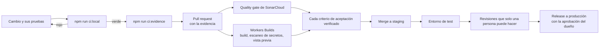

# Visión general de la calidad

Cada cambio de Gelpy se prueba y se revisa antes de llegar a las personas. Esta página muestra las reglas, el camino que sigue un cambio y las pruebas que lo respaldan.

:::note Estado

Estas reglas ya se aplican en cada repositorio de Gelpy. Hasta el 2026-11-30, las pruebas corren en el gate local de cada repositorio, y el resultado se publica en el pull request (modo MVP, ADR-0018).

:::

## Las reglas

| Regla | Decisión |
|-------|----------|
| Cada pull request con código trae sus pruebas y su reporte de cobertura | ADR-0015 |
| La cobertura es de al menos 90% en líneas, ramas, funciones y sentencias, con 95% como meta. Una brecha se cierra con pruebas, nunca con una exclusión ni bajando el umbral | ADR-0015 |
| Los gates de un pull request son lint, tipos, pruebas con cobertura, el build y la auditoría de dependencias. Las superficies visuales tienen además revisiones de accesibilidad y de marca | ADR-0011 |
| El quality gate de SonarCloud es obligatorio en cada pull request | ADR-0011 |
| Un cambio se valida una vez y se despliega al fusionarse. Ningún pull request puede leer un secreto de deploy | ADR-0017 |
| La lógica de deploy vive en scripts probados, no en archivos de workflow | ADR-0015 |
| Hasta el 2026-11-30, las pruebas corren en `npm run ci:local`, y `npm run ci:evidence` publica el resultado en el pull request | ADR-0018 |

## Cómo se valida un cambio

- El gate local corre cada paso de las revisiones del pull request en la máquina del agente. Un paso en rojo devuelve el cambio.
- Cada criterio de aceptación del Work Item se revisa y se registra como aprobado, fallido o pendiente de una persona, antes de que el Work Item esté terminado.
- El release a producción necesita la aprobación escrita del dueño. Ver [Entrega](../framework/delivery.md).

## La pirámide de pruebas

| Nivel | Qué prueba | Herramientas | Dónde |
|-------|------------|--------------|-------|
| Unitaria | La lógica aislada | Vitest, `node --test` | Cada componente |
| De componente y HTTP | Una pantalla o una ruta con sus colaboradores reales, sin la red | Vitest con jsdom o happy-dom, supertest | App, sitio web, consola, API |
| De base de datos | Migraciones, permisos y consultas contra un PostgreSQL real | `node:test`, Vitest | Base de datos, API |
| De navegador | Líneas base visuales, accesibilidad con axe, tamaños de pantalla y flujos completos | Playwright | App, sitio web, consola |
| De rendimiento | Un puntaje de rendimiento de al menos 0,9 y un puntaje de accesibilidad de 1 | Lighthouse | Sitio web |
| Reglas como pruebas | La política de los workflows, los encabezados de seguridad, ningún rastreador sin consentimiento y ningún secreto en los logs | Las herramientas de arriba | Cada componente |

Cada componente se prueba por separado, contra los contratos de los demás.

## El gate local de cada componente

| Componente | Lint y revisiones | Pruebas y cobertura | Build y ensayo |
|------------|-------------------|---------------------|----------------|
| API | ESLint, estricto, con 0 advertencias; tipos de la app y del Worker | Vitest, 90% | Build |
| Base de datos | Lint de SQL | `node:test` contra un PostgreSQL real, 90% | Las migraciones se revisan antes de llegar a producción |
| App | ESLint, tipos, lint de marca | Vitest, 90% | Exportaciones web y Android, revisiones de Expo y un deploy de prueba para test y producción |
| Sitio web | ESLint, tipos, lint de marca, revisiones de medios y de movimiento | Vitest, 90% | Builds para test y producción, verificación del sitio, tamaño del bundle y un deploy de prueba |
| Consola | ESLint, tipos, lint de marca | Vitest, 90% | Build, encabezados de seguridad y un deploy de prueba para test y producción |
| Design system | Validación de tokens | `node --test`, 90% | Build, salida sin cambios y una prueba del paquete |
| Este sitio | Revisiones de seguridad pública y de marca | `node --test`, 90% | Build en inglés y español, build de la wiki y un deploy de prueba |

Los gates de la API, la base de datos, la app, el sitio web, la consola y este sitio también corren la auditoría de dependencias.

## Dónde corre cada escáner

| Escáner | Qué encuentra | Dónde |
|---------|---------------|-------|
| gitleaks | Secretos en el código | Cada build de pull request en Workers Builds |
| `npm audit` | Vulnerabilidades conocidas en las dependencias | El gate local |
| actionlint y zizmor | Errores y patrones inseguros en los workflows de GitHub | El gate local, cuando cambia un workflow |
| SonarCloud | Bugs, code smells y security hotspots | Cada pull request |

Las versiones de los escáneres están fijadas por checksum.

## Cobertura y evidencia

- La cobertura se reporta en la evidencia de cada pull request: el commit de cabeza, el resultado de cada paso, el número de pruebas y la cobertura de líneas, ramas y funciones.
- SonarCloud juzga el código nuevo de cada pull request. No guarda la cobertura.

## Lo que verifica una persona

Algunos criterios de aceptación solo los puede revisar una persona: un diseño que aprueba el dueño, un flujo que el dueño prueba en un celular o un texto que el dueño lee. Un agente nunca los marca como aprobados. Quedan pendientes hasta que la persona confirma por escrito, y el Work Item registra la fecha y las palabras.

## Páginas relacionadas

- [Entrega: gates, entornos y releases](../framework/delivery.md)
- [Visión general de la arquitectura](../architecture/overview.md)
- [Visión general de seguridad](../security/overview.md)
